# 犀牛派 X1 板卡与手柄使用教程

## 目录

- [犀牛派 X1 板卡与手柄使用教程](#犀牛派-x1-板卡与手柄使用教程)
  - [目录](#目录)
  - [系统使用](#系统使用)
    - [ADB 基本使用](#adb-基本使用)
      - [ADB 基本命令](#adb-基本命令)
    - [IP 地址确认](#ip-地址确认)
      - [通过 ADB 获取 IP 地址](#通过-adb-获取-ip-地址)
      - [通过 Ubuntu 界面获取 IP 地址](#通过-ubuntu-界面获取-ip-地址)
      - [WiFi 连接（可选）](#wifi-连接可选)
    - [Web 登录](#web-登录)
      - [通过浏览器登录](#通过浏览器登录)
    - [SSH 登录](#ssh-登录)
      - [通过 SSH 登录](#通过-ssh-登录)
    - [文件传输](#文件传输)
      - [使用 SCP 文件传输](#使用-scp-文件传输)
      - [使用 AidLux 文件浏览器传输文件](#使用-aidlux-文件浏览器传输文件)
  - [连接蓝牙手柄](#连接蓝牙手柄)
    - [配置蓝牙手柄驱动](#配置蓝牙手柄驱动)
    - [命令行连接蓝牙](#命令行连接蓝牙)
    - [显示器连接蓝牙](#显示器连接蓝牙)
    - [正确连接状态](#正确连接状态)
    - [重新连接](#重新连接)
  - [手柄测试](#手柄测试)
    - [测试步骤](#测试步骤)
    - [常见报错解决方法](#常见报错解决方法)
  - [结语](#结语)

## 系统使用

犀牛派 X1 默认预装 Ubuntu 22.04 系统。本章节介绍常用的系统使用功能：ADB 调试、IP 地址确认、Web / SSH 登录与文件传输。

> 官方参考文档：[系统使用 | APLUX Doc Center](https://rhinopi.docs.aidlux.com/rhino-x1-ubuntu/getting-started/system-use/)

### ADB 基本使用

ADB（Android Debug Bridge）是一个命令行工具，用于在计算机与设备之间进行通信。它支持应用安装、调试、文件传输、日志查看以及通过 USB 或网络进行设备控制。

> 官方参考：[ADB 基本使用 | APLUX Doc Center](https://rhinopi.docs.aidlux.com/rhino-x1-ubuntu/getting-started/system-use/adb_use)

#### ADB 基本命令

```bash
# 查看当前连接设备
adb devices

# 如果发现多个设备
adb -s 设备号 其他指令

# 安装 apk 文件
adb install xxx.apk

# 传递文件：
# 往设备 SDCard 传递文件
adb push PC端文件路径 /sdcard

# 从设备下载文件到 PC
adb pull 设备上文件路径 本地保存路径

# 进入 shell 环境
adb shell

# 重启设备
adb reboot
```

### IP 地址确认

#### 通过 ADB 获取 IP 地址

ADB 的安装及使用请参考上文「[ADB 基本使用](#adb-基本使用)」。

若已插入网线，执行以下命令获取 IP 地址：

```bash
# 进入设备
adb shell

# 获取 IP 地址
ifconfig eth0
```

可以看到如下输出：

<p align="center">
  
</p>

`inet addr` 参数表示了该设备的 IP 地址。

> 官方参考：[IP 地址获取 | APLUX Doc Center](https://rhinopi.docs.aidlux.com/rhino-x1-ubuntu/getting-started/system-use/ip_get)

#### 通过 Ubuntu 界面获取 IP 地址

当开发者可以访问 Ubuntu 系统界面后，在 Terminal 中输入以下命令即可查询 IP 地址：

```bash
# 获取 IP 地址
ifconfig eth0
```

#### WiFi 连接（可选）

如需通过 WiFi 联网，使用以下命令连接：

```bash
nmcli dev wifi connect "APLUX" password "iro2021420"
```

<p align="center">
  
</p>

连接成功后，再次获取 IP 地址：

```bash
# 获取 IP 地址
ifconfig
```

<p align="center">
  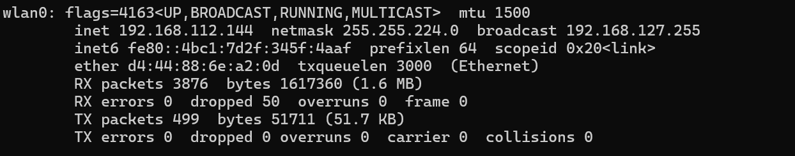
</p>

### Web 登录

当设备接入网络后，开发者可以通过局域网 Web 界面登录到系统，具体操作如下。

#### 通过浏览器登录

确保电脑与设备处于同一局域网下，在浏览器中输入 `http://<设备IP>:8000/login`（将 `ip` 替换为设备的实际 IP 地址）：

- **用户名 / 密码**：`aidlux` / `aidlux`

<p align="center">
  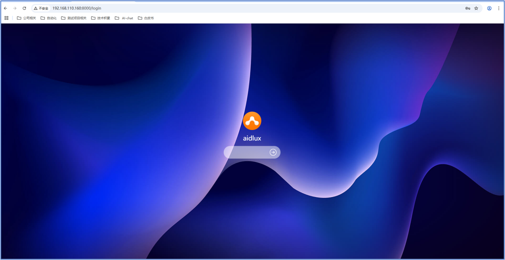
</p>

> 官方参考：[Web 登录 | APLUX Doc Center](https://rhinopi.docs.aidlux.com/rhino-x1-ubuntu/getting-started/system-use/web_login)

### SSH 登录

#### 通过 SSH 登录

确保电脑与设备处于同一局域网下，在 Terminal 中输入命令 `ssh aidlux@ip`（将 `ip` 替换为设备的实际 IP 地址）即可访问系统。

- **访问密码**：`aidlux`

<p align="center">
  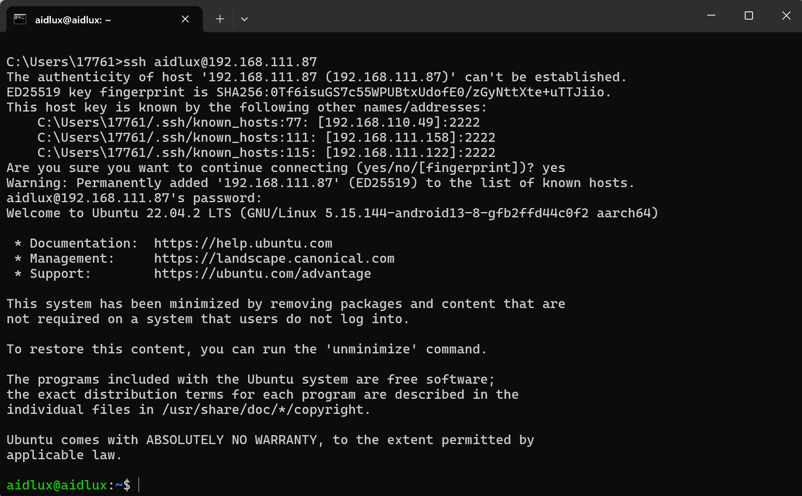
</p>

> 官方参考：[SSH 登录 | APLUX Doc Center](https://rhinopi.docs.aidlux.com/rhino-x1-ubuntu/getting-started/system-use/ssh)

### 文件传输

#### 使用 SCP 文件传输

确认设备 IP 地址后，可以通过 SCP 命令传输文件：

```bash
scp -r -P2222 .\test.txt aidlux@192.168.110.194:/home/aidlux/
```

也可以使用 WinSCP 进行图形化文件传输。下载并安装 WinSCP：

<p align="center">
  
</p>

打开 WinSCP，使用以下信息登录设备：

- **用户名**：`aidlux`
- **密码**：`aidlux`

<p align="center">
  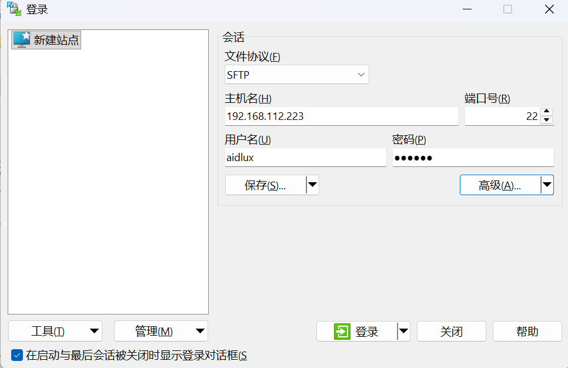
</p>

<p align="center">
  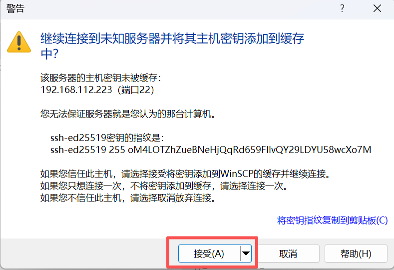
</p>

<p align="center">
  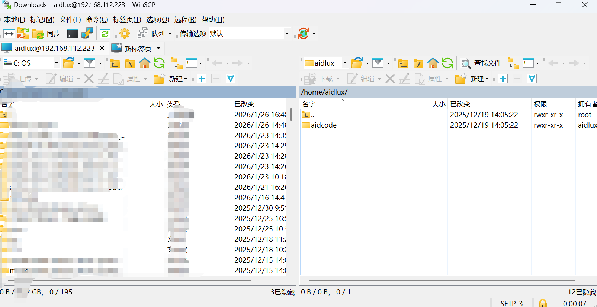
</p>

#### 使用 AidLux 文件浏览器传输文件

通过浏览器访问 AidLux 界面，点击文件浏览器图标：

<p align="center">
  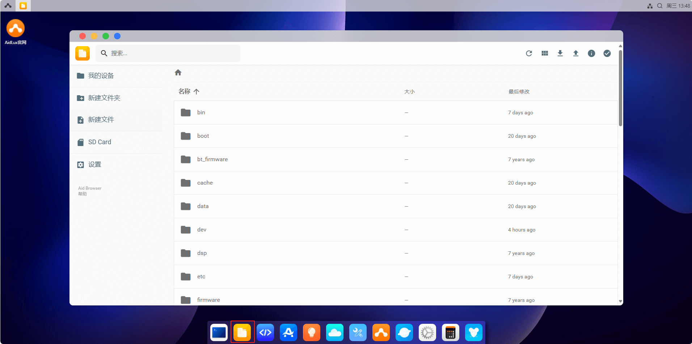
</p>

点击右上角上传按钮，传入文件或目录到 `/home/aidlux` 目录下：

<p align="center">
  
</p>

点击右上角下载按钮，将 `/home/aidlux` 目录下的文件或目录下载到本地：

<p align="center">
  
</p>

> 官方参考：[文件传输 | APLUX Doc Center](https://rhinopi.docs.aidlux.com/rhino-x1-ubuntu/getting-started/system-use/file_upload)

## 连接蓝牙手柄

本章节以 Joy-Con 手柄为例，介绍蓝牙手柄的驱动配置与连接方法。
> 官方参考：[LeRobot-JoyCon](https://rhinopi.docs.aidlux.com/rhino-x1-ubuntu/getting-started/system-use/file_upload](https://github.com/box2ai-robotics/lerobot-joycon))

### 配置蓝牙手柄驱动

在设备终端中（可通过 [SSH 登录](#ssh-登录) 或外接显示器进入），克隆并安装驱动库：

```bash
git clone https://github.com/box2ai-robotics/joycon-robotics.git
```

<p align="center">
  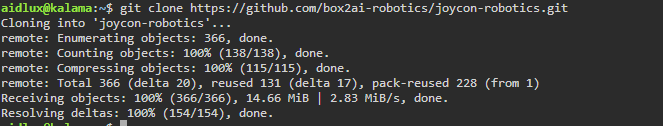
</p>

```bash
cd joycon-robotics
pip install -e .
```

<p align="center">
  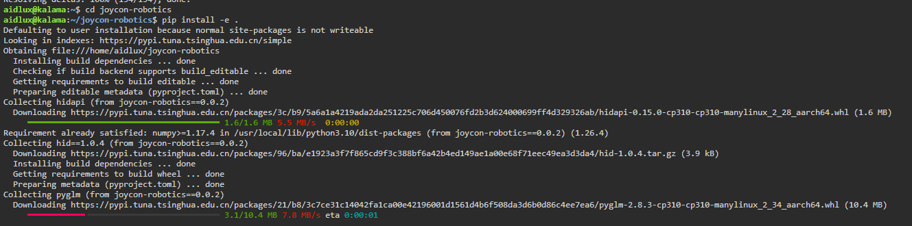
</p>

安装编译依赖（sudo 密码：`aidlux`）：

```bash
sudo apt-get update
sudo apt-get install -y libevdev-dev libudev-dev cmake
```

<p align="center">
  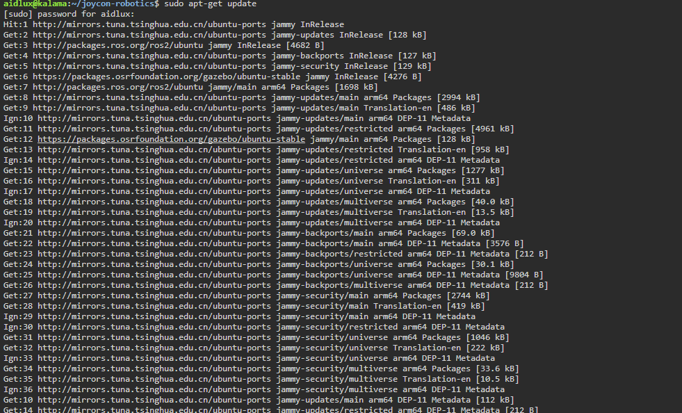
</p>

> [!IMPORTANT]
> 在执行 `make install` 之前，需要先完成以下两个步骤。

1. 打开 `Makefile`，将倒数第二行中的 `install_nintendo` 删除后保存修改。

<p align="center">
  
</p>

2. 创建临时安装目录：

```bash
mkdir /tmp/joycon-install-temp
```

<p align="center">
  
</p>

完成以上步骤后执行安装：

```bash
make install
```

<p align="center">
  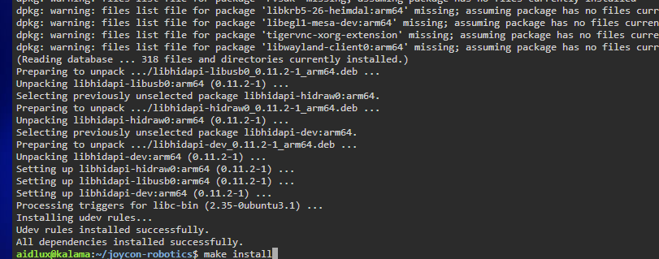
</p>

### 命令行连接蓝牙

查看是否有蓝牙模块：

```bash
hciconfig
```

<p align="center">
  
</p>

进入蓝牙控制台：

```bash
bluetoothctl
```

<p align="center">
  
</p>

打开蓝牙：

```bash
power on
```

<p align="center">
  
</p>

依次注册代理并开始扫描：

```bash
agent on
default-agent
scan on
```

然后：

1. 进入配对模式：长按 Joy-Con 侧边圆形按钮 3 秒。
2. 在系统蓝牙设置中连接 Joycon (L) 或 Joycon (R)。

<p align="center">
  
</p>

<p align="center">
  
</p>

配对并连接：

```bash
pair 12:34:56:78:9A:BC
connect 12:34:56:78:9A:BC
```

```bash
pair 9C:54:00:E0:6C:B2
connect 9C:54:00:E0:6C:B2
```

停止扫描：

```bash
scan off
```

### 显示器连接蓝牙

如果设备已连接显示器，也可以在桌面环境中连接蓝牙手柄：

1. 将 HDMI 接口插入板卡的 HDMI-OUT 口。

<p align="center">
  
</p>

2. 插入 USB 鼠标和键盘。

<p align="center">
  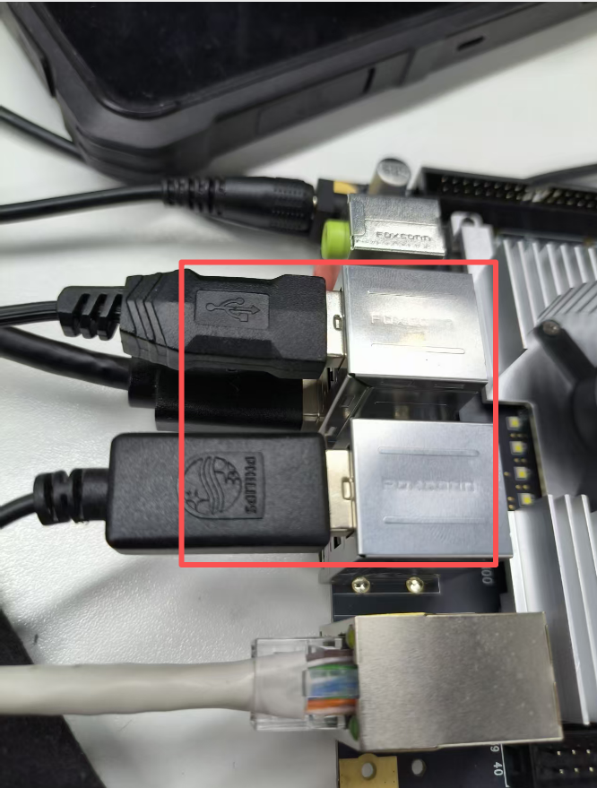
</p>

3. 输入密码 `aidlux` 进入系统。

4. 点击右上角选择蓝牙 Bluetooth。

<p align="center">
  
</p>

5. 进入配对模式：长按 Joy-Con 侧边圆形按钮 3 秒。

6. 在系统蓝牙设置中连接 Joycon (L) 或 Joycon (R)。

<p align="center">
  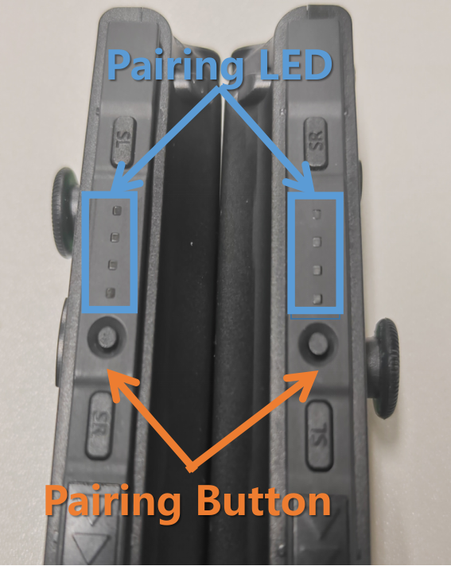
</p>

### 正确连接状态

1. 绑定连接成功时 Joy-Con 会震动。
2. 单控制器模式：同时长按 R + ZR（上下两个肩键）3 秒。
3. 双控制器模式：双 Joy-Con 震动后，同时按下：左控制器的 L（顶部肩键）+ 右控制器的 R（顶部肩键）。

### 重新连接

<p align="center">
  
</p>

- 已配对设备按 L 或 R 键自动重连。
- 等待震动提示后重复上述步骤 2。

## 手柄测试

### 测试步骤

1. 在应用中心下载并安装 VS Code。

<p align="center">
  
</p>

<p align="center">
  
</p>

2. 使用 VS Code 打开 `/home/aidlux/joycon-robotics/` 文件夹。

<p align="center">
  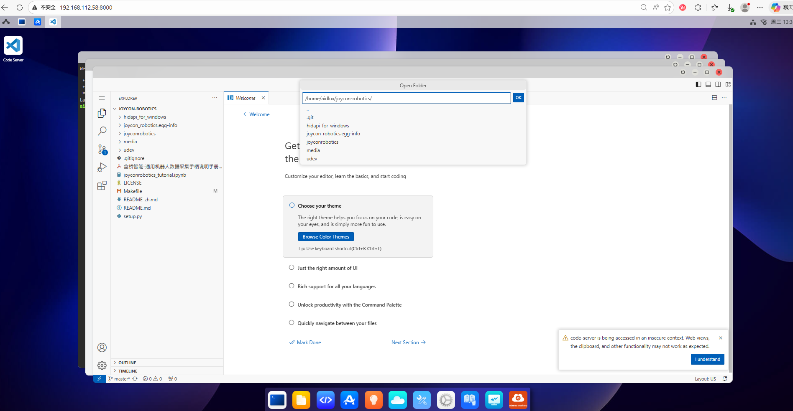
</p>

3. 新建一个 Python 文件，输入以下测试代码：

```python
from joyconrobotics import JoyconRobotics
import time

joyconrobotics_right = JoyconRobotics("right")

for i in range(1000):
    pose, gripper, control_button = joyconrobotics_right.get_control()
    print(f'{pose=}, {gripper=}, {control_button=}')
    time.sleep(0.01)

joyconrobotics_right.disconnnect()
```

<p align="center">
  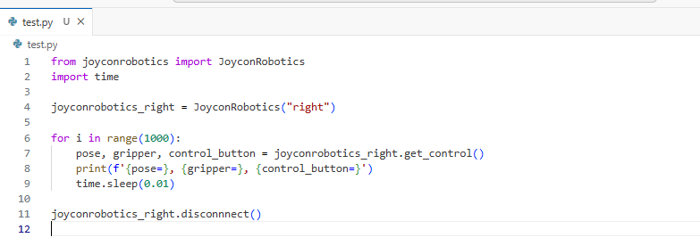
</p>

4. 打开命令行，在 `/home/aidlux/joycon-robotics/` 目录下执行：

```bash
python3 test.py
```

<p align="center">
  
</p>

### 常见报错解决方法

**报错 1：缺少 `glm` 模块**

```text
Traceback (most recent call last):
  File "/home/aidlux/Xlebot/lerobot/examples/1.py", line 1, in <module>
    from joyconrobotics import JoyconRobotics
  File "/home/aidlux/Xlebot/lerobot/examples/joyconrobotics/__init__.py", line 1, in <module>
    from .joyconrobotics import JoyconRobotics
  File "/home/aidlux/Xlebot/lerobot/examples/joyconrobotics/joyconrobotics.py", line 5, in <module>
    from glm import vec3, quat, angleAxis
ModuleNotFoundError: No module named 'glm'
```

执行以下命令安装 PyGLM 即可：

```bash
python -m pip install PyGLM
```

<p align="center">
  
</p>

**报错 2：缺少 `hid` 模块**

```text
Traceback (most recent call last):
  File "/home/aidlux/Xlebot/lerobot/examples/1.py", line 1, in <module>
    from joyconrobotics import JoyconRobotics
  File "/home/aidlux/Xlebot/lerobot/examples/joyconrobotics/__init__.py", line 1, in <module>
    from .joyconrobotics import JoyconRobotics
  File "/home/aidlux/Xlebot/lerobot/examples/joyconrobotics/joyconrobotics.py", line 7, in <module>
    from .joycon import JoyCon
  File "/home/aidlux/Xlebot/lerobot/examples/joyconrobotics/joycon.py", line 3, in <module>
    import hid
ModuleNotFoundError: No module named 'hid'
```

执行以下命令安装 hidapi 即可：

```bash
python -m pip install hidapi
```

## 结语

以上就是板卡与手柄使用教程的全部内容。更多系统使用说明（显示器使用、CPU 性能设置等）请参考官方文档中心：

- [系统使用 | APLUX Doc Center](https://rhinopi.docs.aidlux.com/rhino-x1-ubuntu/getting-started/system-use/)
- [APLUX Doc Center（官方文档中心）](https://rhinopi.docs.aidlux.com/)
