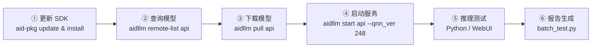

# 在 Rhino Pi-X1 上部署 Qwen3-VL-8B：从 SDK 更新到实测效果

> 本文完整记录在 APLUX Rhino Pi-X1 边缘计算板卡上，基于 AidGenSE 推理引擎部署 **Qwen3-VL-8B** 视觉语言模型（VLM）的全过程：更新 SDK → 查询并下载模型 → 启动 OpenAI 兼容推理服务 → 图片推理实测。文末附实测效果与踩坑总结，供同样在做端侧多模态部署的开发者参考。

**TL;DR：**

- 板卡：Rhino Pi-X1（高通 QCS8550），系统 Ubuntu 22.04（AidLux）
- 模型：`qwen3-vl-8b-instruct-qnn2.48-w4a16-qcs8550`（QNN 2.48 / W4A16 量化，约 5.2 GB）
- **最大的坑**：启动服务时 QNN 版本必须与模型匹配（`--qnn_ver 248`），否则服务会一直卡在 `Api server starting...`
- **实测效果**：5 张不同场景的图片均能被准确识别与流利描述（详见文末「实测效果」）

## 一、背景

端侧部署视觉语言模型（VLM），可以在完全离线的条件下完成图片理解、图文问答等任务——数据不出设备、没有网络往返延迟，非常适合工业质检、智能相机、离线助手等场景。AidGenSE 是 APLUX 提供的生成式 AI 推理引擎，支持将量化后的多模态大模型以 **OpenAI 兼容 HTTP 服务**的形式部署到边缘板卡上。

本文以官方教程《使用 AidGen 部署 VLM》为参考，在 Rhino Pi-X1 上部署 8B 级别的 Qwen3-VL-8B，并实测其图片理解效果。

## 二、环境信息

| 项目 | 说明 |
| --- | --- |
| 设备 | Rhino Pi-X1 |
| 芯片平台 | 高通 QCS8550（`qc8550 enterprise`） |
| 系统 | Ubuntu 22.04.2 LTS（AidLux / linux edition，ROOTFS 50） |
| CPU 架构 | aarch64（kernel 5.15.148） |
| 推理引擎 | AidGenSE 3.3.1 |
| SDK 版本 | aidgen-sdk 2.4.3.166 / aidgen-qnn248 2.4.3.166 |
| 模型 | qwen3-vl-8b-instruct-qnn2.48-w4a16-qcs8550 |
| 服务端口 | 8888（OpenAI 兼容 API） |

## 三、部署流程总览



## 四、步骤一：更新并安装 SDK

> **为什么必须先更新 SDK？** AidGen 的模型与 SDK / QNN 版本强绑定。板卡预装的 SDK 较旧时，`aidllm` 可能查询不到或无法运行新模型，因此第一步就是更新软件包索引并安装最新组件。

```bash
# 1. 更新软件包索引
sudo aid-pkg update

# 2. 安装 AidGenSE（生成式 AI 推理引擎服务）
sudo aid-pkg -i aidgense

# 3. 安装 AidGen SDK 与各版本 QNN 运行时
sudo aid-pkg -i aidgen-sdk
sudo aid-pkg -i aidgen-qnn236
sudo aid-pkg -i aidgen-qnn240
sudo aid-pkg -i aidgen-qnn248
```

两个容易踩的细节：

1. `aid-pkg -i` **一次只能安装一个包**，写成 `sudo aid-pkg -i a b c` 会报 `Please enter the correct parameter`；
2. 安装过程会检查依赖包（如 `aidgen-sdk`、`aidlms-sdk`、`aidlux-aistack-base`），并交互式询问 `[y/n]`，按提示确认即可。

本次安装后的关键版本：

| 包 | 版本 |
| --- | --- |
| aidgense | 3.3.1 |
| aidgen-sdk | 2.4.3.166 |
| aidgen-qnn240 | 2.4.3.166 |
| aidgen-qnn248 | 2.4.3.166 |
| aidgen-qnn236 | 2.4.0.139 |

## 五、步骤二：查询与下载模型

```bash
# 查看当前支持的全部模型（自动按板卡 SoC 过滤）
aidllm remote-list api
```

输出示例（已按 QCS8550 过滤）：

```text
socfg:  { qc8550 enterprise}
Current Soc :  8550

qwen3-vl-8b-instruct-qnn2.48-w4a16-qcs8550            VLM     2026-08-13 17:55:43
qwen3-vl-4b-instruct-448x448-qnn2.40-w4a16-qcs8550    VLM     2026-08-13 17:55:59
qwen2.5-vl-3b-instruct-392x392-qnn2.36-w4a16-qcs8550  VLM     2026-08-13 17:55:59
...
```

模型命名规则可以拆解为四段（下载和启动时都别手拼错）：

| 片段 | 含义 |
| --- | --- |
| `qwen3-vl-8b-instruct` | 模型名称与规格 |
| `qnn2.48` | 依赖的 QNN 运行时版本（**决定启动时的 `--qnn_ver`**） |
| `w4a16` | 量化方式（权重 4 bit / 激活 16 bit） |
| `qcs8550` | 目标芯片平台 |

然后下载并确认：

```bash
# 下载模型（约 5.2 GB）
aidllm pull api qwen3-vl-8b-instruct-qnn2.48-w4a16-qcs8550

# 查看本地已下载模型
aidllm list api
```

## 六、步骤三：启动推理服务（关键：QNN 版本必须匹配）

先看**踩坑现场**——按直觉直接启动：

```bash
aidllm start api -m qwen3-vl-8b-instruct-qnn2.48-w4a16-qcs8550
```

日志会反复循环，服务始终起不来：

```text
Use model:  qwen3-vl-8b-instruct-qnn2.48-w4a16-qcs8550
Processor:  dsp
args : [--device dsp --qnn_ver 240]        # ← 注意这里
Api server starting...
Api server starting...
Api server starting...
...
```

原因就出在 `--qnn_ver 240`：`aidllm start api` 的 `--qnn_ver` **默认值是 240**，而这个模型是按 **QNN 2.48** 编译的。显式指定版本后，服务一次启动成功：

```bash
aidllm start api \
  -m qwen3-vl-8b-instruct-qnn2.48-w4a16-qcs8550 \
  -d dsp \
  --qnn_ver 248
```

```text
Use model:  qwen3-vl-8b-instruct-qnn2.48-w4a16-qcs8550
Processor:  dsp
args : [--device dsp --qnn_ver 248]
Api server start successfully.
```

> 经验口诀：**模型名里的 `qnn2.xx`，就是 `--qnn_ver` 该填的值**（236 / 240 / 248）。

验证服务状态：

```bash
curl -s http://127.0.0.1:8888/v1/models
```

```json
{
    "object": "list",
    "loaded_id": "qwen3-vl-8b-instruct-qnn2.48-w4a16-qcs8550",
    "model_type": "vlm",
    "data": [
        { "id": "qwen3-vl-8b-instruct-qnn2.48-w4a16-qcs8550", "object": "model", "owned_by": "aplux" }
    ]
}
```

服务端口默认 **8888**。常用管理命令：

```bash
aidllm status api     # 查看状态
aidllm restart api    # 重启
aidllm stop api       # 停止
```

（可选）如果想用 Web 界面快速体验对话：

```bash
sudo aidllm install ui
aidllm start ui       # 浏览器访问 http://<板卡IP>:51104
```

## 七、步骤四：图片推理测试

### 7.1 单张图片对话（Python）

核心要点：图片转 base64 的 `data URL`，按 OpenAI 多模态消息格式（`image_url`）发送，并解析 SSE 流式响应：

```python
import base64, json, requests

def run(image_path: str, prompt: str = "描述这张图片的内容。"):
    with open(image_path, "rb") as f:
        b64 = base64.b64encode(f.read()).decode()
    messages = [
        {"role": "system", "content": "You are a helpful assistant."},
        {"role": "user", "content": [
            {"type": "text", "text": prompt},
            {"type": "image_url", "image_url": {"url": f"data:image/png;base64,{b64}"}},
        ]},
    ]
    r = requests.post(
        "http://127.0.0.1:8888/v1/chat/completions",
        json={"model": "qwen3-vl-8b-instruct-qnn2.48-w4a16-qcs8550",
              "messages": messages, "stream": True},
        stream=True,
    )
    for line in r.iter_lines():
        if line and line.startswith(b"data: "):
            data = line[6:].decode()
            if data.strip() == "[DONE]":
                break
            content = json.loads(data)["choices"][0]["delta"].get("content")
            if content:
                print(content, end="", flush=True)
```

### 7.2 批量测试脚本（batch_test.py）

为方便批量验证，编写 `batch_test.py`：自动遍历图片目录、逐张调用模型，并将每张图片的模型回答汇总为 Markdown 报告：

```bash
python3 assets/rhino_x1/scripts/batch_test.py \
  --images-dir assets/rhino_x1 \
  --model qwen3-vl-8b-instruct-qnn2.48-w4a16-qcs8550 \
  --url http://127.0.0.1:8888/v1/chat/completions \
  --output README_timing.md
```

运行产物：

- `README_timing.md`：汇总报告（含逐图模型回答全文）
- `assets/rhino_x1/scripts/batch_timing.json`：测试原始数据

## 八、实测效果

部署完成后，用 5 张不同场景的图片检验模型的视觉理解能力，统一提示词为「描述这张图片的内容。」。以下是模型的实际回答。

### 1. 冲浪

<p align="center">
  
</p>

> 这张图片展示了一位冲浪者在壮观的巨浪前冲浪的场景。画面中，冲浪者穿着深色的冲浪服，站在浪尖上，双腿微屈，身体前倾，左手自然下垂，右手抬起，保持平衡。他正面对着前方，脚下的冲浪板在波浪中稳定地滑行，姿态轻松自信。  背景是开阔的蓝色海洋，远处是淡蓝色的天空，点缀着几朵白云。海浪汹涌澎湃，巨大的浪头在阳光下泛着白色的泡沫，显得非常壮观。画面右侧上方可以看到一个小小的云朵，为整个画面增添了层次感。  整个画面充满了动感和力量，展示了冲浪运动的魅力和刺激。冲浪者在巨浪中从容应对，展现出极高的技巧和勇气。画面中没有其他人物或物体，只有冲浪者和汹涌的海浪。  这个场景显然是在海上拍摄的，可能是冲浪者在享受冲浪的乐趣，或者是在进行一项冲浪活动。整个画面给人一种自由、激情和冒险的感觉。  整体而言，这是一张充满活力和动感的冲浪照片，展示了冲浪者在巨浪前的英勇姿态。……

### 2. 复古自行车

<p align="center">
  
</p>

> 这张图片展示了一辆淡绿色的复古自行车，停靠在一面红砖墙前。自行车前部有一个藤编篮子，车座是棕色皮革材质，车架纤细优雅，整体给人一种宁静、怀旧的感觉。  画面构图简洁，自行车位于画面中央偏右，背景是红砖墙，砖块排列整齐，颜色为经典红褐色，墙角处略显斑驳，带有岁月痕迹。地面是灰色石板路，石板边缘清晰，质感突出，为画面增添了一丝复古气息。  整个画面色调柔和，带有淡淡的复古滤镜效果，营造出一种静谧、温馨的氛围，仿佛是在一个安静的午后，一个人独享宁静时光的场景。  这是一幅充满诗意的街头静物摄影，通过自行车与砖墙的组合，传递出一种悠闲、怀旧的情绪。

### 3. 雨后苹果

<p align="center">
  
</p>

> 这张图片展示了一个红苹果挂在树枝上的特写镜头，背景是模糊的秋季树林景象。  - **主体**：一个饱满的红色苹果，表面布满了晶莹剔透的水珠，仿佛刚刚经历了一场雨。苹果的光泽和质感清晰可见，呈现出新鲜、饱满的状态。  - **背景**：背景被虚化，呈现出模糊的树木与黄褐色的落叶，营造出秋日氛围。从颜色和形状判断，这可能是苹果树的一部分，或是一个秋日果园的局部。  - **构图**：苹果位于画面右下角，占据视觉中心，树枝从左上方斜向延伸，将画面分割为两部分，使苹果成为视觉焦点。  - **风格**：照片色调柔和，略带暖黄色调，整体氛围宁静、自然，带有淡淡的秋意。  - **细节**：苹果上的水滴清晰可见，有的顺着表面滑落，有的聚在凹陷处，展现出湿润质感。树叶部分呈黄绿色，边缘略带枯黄，进一步强化了秋天的感觉。……

### 4. 斜拉桥

<p align="center">
  
</p>

> 这张图片展示了一座现代化的斜拉桥，从高空俯瞰视角拍摄。桥身结构清晰，由多根斜拉索连接桥塔与桥面，桥塔高耸，线条笔直且对称，展现出强烈的现代工程美学。桥面宽阔，车辆稀疏，表明交通流畅。  桥下是广阔的水域，水面平静，呈现出深蓝色调，与桥体形成鲜明对比。整个画面没有其他干扰元素，仅聚焦于这座宏伟的桥梁及其与水的互动，构图简洁，视觉中心突出。  整体画面色调统一，以蓝调为主，强调了桥梁的结构美感和水面的宁静氛围。该图像很可能用于展示工程成就或作为风景摄影素材，突出桥梁作为现代交通与建筑艺术结合的象征。  **总结：**   这是一张从高空俯拍的斜拉桥照片，画面简洁清晰，以蓝天、水面和桥梁为主体，展现了现代桥梁工程的壮丽景象。   —— **场景描述完毕。**

### 5. 春日樱花

<p align="center">
  
</p>

> 这张图片展示了一枝盛开的樱花树枝，背景是清澈的蓝天。树枝从画面右下角斜向延伸至左上角，花朵密集地分布在枝头，花瓣呈现淡粉色或白色，部分花蕾仍含苞待放。花朵与蓝天形成鲜明对比，营造出清新、宁静的春日氛围。  图片整体色调柔和，光线明亮，传达出温暖、柔和的感觉。背景中的天空部分被轻微虚化处理，使前景的樱花更加突出。整体构图简洁，以自然元素为主，聚焦于樱花的细腻与春日的生机。  这张图片展现了春天的美好，是一幅充满诗意的自然景象。

> 注：测试时单张回答上限为 256 token，长回答在文末以「……」表示截断；实际部署时可调大 `max_tokens` 获得完整回答。

## 九、踩坑与经验总结

1. **QNN 版本必须与模型匹配**（本文最大的坑）：`aidllm start api` 的 `--qnn_ver` 默认 240，跑 `qnn2.48` 的模型会一直卡在 `Api server starting...`；显式加 `--qnn_ver 248` 后一次成功。
2. **先 `aid-pkg update` 再安装**：SDK 与模型版本强绑定，不更新可能查询不到新模型。
3. **`aid-pkg -i` 一次只装一个包**，多包连写会直接报参数错误。
4. **安装过程有交互确认**：依赖包会逐个询问 `[y/n]`，写自动化脚本时要注意处理交互。
5. **模型名别手拼**：用 `aidllm remote-list api` 查询后原样复制，命名本身携带了 QNN 版本、量化方式、目标平台等关键信息。
6. **服务启动后先验证再使用**：`curl http://127.0.0.1:8888/v1/models` 确认 `loaded_id` 与预期一致，再发业务请求。

## 十、小结与展望

本次在 Rhino Pi-X1 上完整跑通了 Qwen3-VL-8B 的端侧部署链路：**更新 SDK → 下载模型 → 按 QNN 2.48 启动服务 → OpenAI 兼容接口推理**。从实测效果看，模型能够准确识别并流利描述不同场景的图片，端侧离线的图片问答、视觉描述类应用完全可行。

后续可以继续探索：

- 多图 / 多帧序列输入（OpenAI 兼容接口的 `content` 数组天然支持扩展）
- Web UI 演示与服务常驻化（systemd / 开机自启）
- 结合业务场景（如摄像头 + VLM 的实时画面理解）做端到端方案验证

## 附录 A：本文相关文件位置

| 文件 | 说明 |
| --- | --- |
| `11犀牛派X1部署VLM方法.md` | 本文（部署全过程与实测记录） |
| `assets/rhino_x1/scripts/batch_test.py` | 批量测试脚本（运行后生成测试报告） |
| `assets/rhino_x1/scripts/batch_timing.json` | 测试原始数据 |
| `assets/rhino_x1/` | 本文实测使用的 5 张测试图片 |

## 附录 B：参考资料

- 使用 AidGen 部署 VLM（官方教程）：<https://rhinopi.docs.aidlux.com/software/tutorial/genai-dev/vlm_chat_aidgen>
