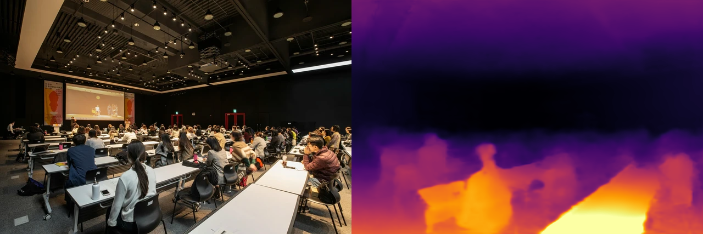
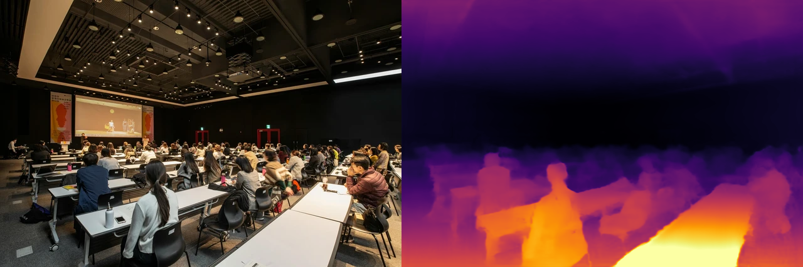

# DepthART：约 6M 参数的单目深度估计，从 CPU 复现到端侧部署

用一张 RGB 图片预测场景的相对远近，并测出它在自己电脑上的真实耗时。本章复现 **DepthART MobileNetV4-M-slim-SPF 的公开预训练模型推理**，附带 224、448 两种输入的本地结果、完整测速记录和可独立运行的 ONNX 脚本。

阅读前提：了解 Python 环境和图片数组即可。CPU 路线无需 PyTorch、CUDA、TensorRT 或相机，不需要下载训练集。

> 来源线索是机器之心的[这篇报道](https://mp.weixin.qq.com/s/pnSoNdPKvZxbOKBomE8QNQ)。**6M 是约 600 万个参数，不是 6MB 文件。** 本章实际下载的单个 FP32 ONNX 文件为 24,155,097 字节，约 24.16MB / 23.04MiB。参数少能降低部署成本，但实时性还要看算子、输入尺寸、硬件和完整处理链路。

## 1. 它在具身系统中做什么

DepthART 属于视觉感知前端。它把单目 RGB 转成稠密的相对几何表示，可以用于研究场景结构、物体边界及策略的视觉输入。它不直接输出机械臂动作。

```text
RGB 相机 → 图像预处理 → DepthART → 相对深度表示
                                     ↓
                           感知融合 / 规划 / 策略
                                     ↓
                              机器人控制器
```

本章的相对模型没有米制尺度。伪彩色图中的明暗表示本图内部的相对预测值；可视化按每张图的 2%～98% 分位数拉伸，因此不能拿两张图的同一种颜色直接比较距离。要获得米制输出，应使用官方单独发布的 metric 模型和真实相机内参，并在目标场景验证误差。

## 2. 为什么小模型还能保留泛化能力

根据[论文](https://arxiv.org/abs/2607.17099)及作者说明，DepthART 主要研究训练数据分布、蒸馏和相机适配，而不是直接把一个大模型的权重文件压缩到几兆。

- **BRDS：抗偏置数据采样。** 在多源候选图像中降低重复、密集区域的采样倾向，让有限容量的小模型接触更均衡的视觉分布。报道中的候选池约 4400 万张，筛选后约 170 万张。
- **相对几何蒸馏。** 使用 Depth Anything V2-L 生成的伪标签监督小模型，使其学习可迁移的场景几何。
- **CamFT：相机条件化微调。** 在度量深度阶段保护已学到的编码器表示，通过相机适配和尺度估计恢复绝对尺度。
- **SPF：单路径金字塔融合。** 后续 MobileNetV4 路线以裁剪后的编码器和更轻的解码器降低计算量，并使用标准 ONNX 算子。

本章只复现公开权重的推理与测速。截至 2026-10-18，官方仓库仍将完整训练代码和可复现训练配置列为待发布内容，因此这里没有重做 BRDS 蒸馏或 CamFT 训练。

## 3. 选择哪一条路线

| 路线 | 规模与定位 | 部署要求 | 本章覆盖 |
| --- | --- | --- | --- |
| TinyViM-S + DPT | 约 6.0M 参数，原始论文的 S 模型 | 高效 CUDA 推理和 TensorRT 部署涉及 Selective Scan 扩展/插件 | 提供官方入口，未在本机运行 |
| MobileNetV4-M-slim-SPF | 6.054609M 参数，448² 下约 3.780059 GMAC | 标准 ONNX 算子，便于先在 CPU 上运行 | **224 和 448 都已实际运行** |
| TinyViM metric indoor/outdoor | 相机感知的米制深度 | 对应领域权重、真实内参及适配后的预处理 | 解释接口，未做米制评估 |

参数量与 GMAC 来自作者随源码发布的 [MobileNetV4 测速表](https://github.com/xuefeng-cvr/DepthART/blob/b307c123f19051e2d969960bba93ee3684874b90/deploy/pc/results/a6000/mobilenetv4_relative_speed.csv)。标准 ONNX 降低了移植门槛；具体 NPU/BPU 的算子覆盖、精度和速度仍需在对应工具链验证。本章没有验证 ROCm GPU 后端。

对 6.054609M 参数，仅计算参数存储，FP32 约 24.22MB，FP16 约 12.11MB，INT8 约 6.05MB。这是理想估算；计算图优化、缓存和元数据会改变实际文件大小，运行时还要容纳中间激活与工作区。本章使用的是官方 FP32 ONNX，没有执行 INT8 量化。

## 4. 在自己电脑上运行

配套文件：[运行脚本](./code/depthart_onnx.py)、[依赖清单](./code/requirements.txt)、[示例图片](./assets/scene_640.webp)。

以下操作先进入本章目录。脚本只请求两个明确的官方模型文件之一，首次运行下载约 24MB，并按作者 `CHECKSUMS.sha256` 校验；第二次运行复用缓存。

### Windows / PowerShell

在教程仓库根目录执行：

```powershell
cd '06-策略抓取或抓取VLA/大模型控制、VLA、VLM/10DepthART轻量单目深度估计'
python -m venv .venv
.\.venv\Scripts\python.exe -m pip install -r code/requirements.txt

.\.venv\Scripts\python.exe code/depthart_onnx.py --image assets/scene_640.webp --resolution 224 --output-dir outputs/cpu_224
.\.venv\Scripts\python.exe code/depthart_onnx.py --image assets/scene_640.webp --resolution 448 --output-dir outputs/cpu_448
```

### Linux / macOS

在教程仓库根目录执行：

```bash
cd '06-策略抓取或抓取VLA/大模型控制、VLA、VLM/10DepthART轻量单目深度估计'
python3 -m venv .venv
source .venv/bin/activate
python -m pip install -r code/requirements.txt

python code/depthart_onnx.py --image assets/scene_640.webp --resolution 224 --output-dir outputs/cpu_224
python code/depthart_onnx.py --image assets/scene_640.webp --resolution 448 --output-dir outputs/cpu_448
```

本章实际验证环境是 Windows、Python 3.12.3、ONNX Runtime 1.29.0、NumPy 2.2.6、OpenCV 4.12.0。另建了不继承系统包的环境，按 `requirements.txt` 安装后完成 224 离线推理，输出与原环境通过数值一致性检查。Linux/macOS 命令沿用同一 CPU API，未在这些系统上实际运行；安装时需要与操作系统和 Python 版本匹配的 wheel。

每次运行保存四个文件：

| 文件 | 用途 |
| --- | --- |
| `relative_prediction.npy` | 原图尺寸的 float32 相对预测，适合后续计算 |
| `relative_prediction.png` | 便于观察的伪彩色预测图 |
| `comparison.png` | 左侧输入 RGB、右侧本次推理输出 |
| `benchmark.json` | 模型版本、哈希、环境、输入输出形状和逐次耗时 |

替换 `--image` 即可处理自己的图片。中文路径通过文件字节解码和编码保存；输入统一转 RGB，缩放为正方形，再按官方均值和标准差归一化。输出用与 `align_corners=True` 对应的双线性坐标恢复到原图尺寸。正方形缩放会改变宽高比，这里遵循官方单图 demo；它与保留宽高比的完整数据集评估协议并不相同。

模型默认位于用户目录的 `.cache/every-embodied/depthart/`，不写入教程仓库。可以用 `--model-dir /your/model/cache` 指定已有缓存，再加 `--offline` 验证离线运行。缓存缺失或哈希不匹配时会明确报错，不会继续使用损坏文件。

正式测量可提高预热和采样次数：

```bash
python code/depthart_onnx.py --image assets/scene_640.webp --resolution 224 --output-dir outputs/cpu_224_long --warmup 200 --samples 1000 --threads 4
```

Windows 使用上文的 `.\.venv\Scripts\python.exe` 替换 `python`。CPU 线程数会影响延迟和资源占用；比较不同分辨率时，应使用相同线程数并避免其他计算任务干扰。

## 5. 本机实际结果

测试日期为 **2026-10-18（北京时间）**。设备是 AMD Ryzen 7 5800H，使用 `CPUExecutionProvider`，ONNX Runtime 内部计算线程数为 4，OpenCV 线程数为 1。笔记本虽然有 NVIDIA GPU，本次没有使用 GPU。输入为项目页的真实室内场景样例，缩至 640×427；batch=1，预热 10 次，分别采样 100 次。

| 输入张量 | 模型均值 / P95 | 含前后处理均值 / P95 | 含前后处理平均吞吐估算 |
| --- | ---: | ---: | ---: |
| 1×3×224×224 | 9.92 / 12.54 ms | 30.02 / 36.75 ms | 33.31 FPS |
| 1×3×448×448 | 55.30 / 82.61 ms | 81.59 / 113.92 ms | 12.26 FPS |

原始记录：[224](./evidence/benchmark_cpu_224.json)、[448](./evidence/benchmark_cpu_448.json)。每份记录包含 100 个模型耗时和 100 个处理链路耗时，可以重新计算统计量；这属于单图重复推理验证，没有深度真值，不能由此报告 δ1、AbsRel 或跨场景精度。

**计时范围：**“模型”是输入张量已就绪后的同步 `session.run`；“含前后处理”从内存里的 BGR 图像开始，包含 RGB 转换、缩放、归一化、推理、原图尺寸恢复和分位数着色。两种计时均不含模型下载、会话初始化、图片读盘解码、结果写盘、相机采集和通信。表中 FPS 为 `1000 / 平均毫秒数`，不是实测相机帧率。

224 的处理链路均值接近 30Hz，但 P95 已超过 33.3ms，不能据此承诺每一帧都满足 30Hz 的截止时间。448 的结果展示了分辨率、边界细节和延迟之间的取舍；整机实时部署还需要测相机到消费者的延迟、抖动、功耗及持续运行表现。



图 1：224 输入的本地推理。近处桌椅与远处墙面的相对结构可用于观察模型是否跑通，不能当作真实距离标注。



图 2：448 输入的本地推理。两张图分别着色；应观察物体轮廓与结构，不能直接用颜色差比较数值误差。

## 6. 再迁移到 Jetson，如何验收

文章中的低延迟数字涉及 NVIDIA GPU、指定输入分辨率及不同推理精度。TinyViM-S 的桌面结果、MobileNetV4 的标准 ONNX 结果与本章 CPU 数据应分别记录。它们不能互相替代，也不能把 model-only FPS 当作机器人闭环控制频率。

如果具备 Jetson Orin NX，沿用[官方 Orin NX 部署指南](https://github.com/xuefeng-cvr/DepthART/blob/b307c123f19051e2d969960bba93ee3684874b90/deploy/orin_nx/README.md)。作者给出的环境是 JetPack 6.2 和 NVIDIA PyTorch 25.06 容器；TinyViM 路线需在设备上构建 Selective Scan 扩展和 TensorRT 插件，TensorRT engine 也应在目标设备构建。

建议按以下顺序完成设备验收：

1. 在同一张 RGB 上运行相对深度，确认形状、有限数值和视觉结构；再用官方 PyTorch 输出核对数值。
2. 固定 batch、分辨率、精度、功耗模式和线程配置，记录软件版本、模型哈希、均值及 P95。
3. 使用设备上真实相机测量采集、预处理、推理、后处理和通信，记录丢帧及持续运行情况。
4. 如要报告精度，按官方数据集协议评估；相对模型需要规定的尺度/偏移对齐，不能把对齐后的分数当作米制误差。MobileNetV4 的 KITTI 评估还使用滑窗，不能以正方形单图 demo 直接替代。

需要米制结果时，官方接口另有 `metric/infer_image.py`，内参顺序为 `fx fy cx cy`，对应原始输入图像，并使用匹配领域的 indoor/outdoor checkpoint。切勿把示例相机参数照搬到自己的相机。

**本章已验证的范围：** 两个标准 ONNX 模型的下载校验、CPU 单图推理、深度图保存及明确范围的延迟统计。Jetson、TensorRT、NPU/BPU、米制度量、训练和机器人闭环仍是后续独立实验。

## 7. 版本、素材和参考资料

本章固定以下版本，避免上游更新后命令与模型对应不上：

| 项目 | 固定值 |
| --- | --- |
| DepthART 源码提交 | `b307c123f19051e2d969960bba93ee3684874b90` |
| Hugging Face 模型提交 | `9e154201cd8fb3453c9def581997aaf1b4da3c22` |
| 224 ONNX SHA256 | `7b38623362745ef9d60405f68c679fcf05a5cfbec160c9b031fbf6983507aef2` |
| 448 ONNX SHA256 | `825114de5341612386de409f82f5dfb0496bb9afa559565ac633466bf172fb71` |

本章脚本是教程新增的 CPU 运行器，复用官方公开的模型输入约定，没有修改网络或重新训练。模型哈希来自固定源码提交的 [CHECKSUMS.sha256](https://github.com/xuefeng-cvr/DepthART/blob/b307c123f19051e2d969960bba93ee3684874b90/CHECKSUMS.sha256)。后处理坐标与 PyTorch 双线性插值的核对、离线缓存缺失和损坏模型拒绝检查见[验证记录](./evidence/validation.json)。

`assets/scene_640.webp` 源自[官方项目页发布的场景样例](https://xuefeng-cvr.github.io/DepthART/images/self_collection/rgb/1.webp)，本章按宽高比缩至 640×427 并重新编码；两张对照图是本章运行结果。上游的[许可说明](https://github.com/xuefeng-cvr/DepthART/blob/b307c123f19051e2d969960bba93ee3684874b90/LICENSE)将项目自有素材列为 CC BY 4.0，并保留第三方材料的原许可。上游还特别说明教师 Depth Anything V2-L 权重涉及 CC BY-NC 4.0；不能据此把所有权重视为无条件商用。本章不附带模型权重或转载公众号全文。

- [DepthART 官方仓库](https://github.com/xuefeng-cvr/DepthART)
- [论文：DepthART: Scaling Foundation Monocular Depth to Tiny Models](https://arxiv.org/abs/2607.17099)
- [项目主页](https://xuefeng-cvr.github.io/DepthART/)
- [官方预训练模型](https://huggingface.co/Fengxue93/DepthART/tree/9e154201cd8fb3453c9def581997aaf1b4da3c22)
- [官方单图预处理与推理代码](https://github.com/xuefeng-cvr/DepthART/blob/b307c123f19051e2d969960bba93ee3684874b90/relative/infer_image.py)
- [上一章：具身智能推理与部署框架](../09具身智能推理与部署框架/README.md)
