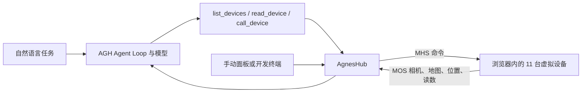

# Agnes Harness：从插件到火星基地多设备协作

本章把 [Agnes Harness（AGH）](https://github.com/AgnesAI-Labs/agnes-harness) 已公开源码的 demo 接入 Every Embodied，提供固定版本、统一启动脚本和中文任务。先手动操作虚拟设备，再接入模型完成自然语言任务。无需购买机器人，也无需训练策略或下载大模型权重。


图 1：Ubuntu 上运行的火星基地。所有运行截图直接来自独立测试浏览器的网页视口，不包含桌面、其他应用或个人账号。

## 1. 可以玩什么

| Demo | 公开实现 | 本章入口 | 需要模型 API 吗 |
| --- | --- | --- | --- |
| MHS 办公室四设备 | `packages/mhs` 的开发 Hub：移动机器人、灯、环境传感器、机械臂 | `mhs-build` → `devices` | 不需要，直接操作面板和终端 |
| 火星基地手动交互 | `examples/mars-world`：11 台虚拟设备、3D 场景、状态和相机 | `mars-manual` | 不需要，通过开发 Hub 发命令 |
| 火星救援、采样回传、沙尘暴准备 | 同一火星场景中的三条协作任务 | `build` → `mhs-install` → `web` + `mars-world` | 需要支持图片与工具调用的模型 |
| 后端工具插件 | `examples/packages/hot-tool-plugin` | `plugins-test`，或安装后在 AGH 调用 `demo_text_stats` | 组件测试不需要；自由对话需要 |
| 前端面板插件 | `examples/packages/client-panel` | `plugins-test`，或按上游教程加载面板 | 面板本身不需要 |
| 前后端联动插件 | `examples/packages/client-service-panel` | `plugins-test`，或按上游教程连接服务 | 服务查询本身不需要 |

新闻里的办公室小车找书并朗读没有被本章当作单独可复现工程收录：这里接入的是上述能定位到公开源码的例子。火星三条任务共用一个世界，并不是三个独立模拟器。

## 2. 它如何运行



这套 demo 的关键是**设备声明驱动的调用和反馈**。设备主动向 Hub 登记工具、状态和数据源；模型用固定的设备工具入口，把设备 id、动作和参数交给 Hub。Hub 再转发调用，设备更新场景并返回进度与结果。例如火星车的 `drive_to` 会改变位置，`collect_sample` 改变载荷；飞行器消耗推进剂，气闸有压力和门状态，对地通信受时间窗口限制。

MHS（Model Hardware Standard）处理设备交互，MOS（Model Observation Standard）传送观测。这里有可交互的状态与动作逻辑，不是播放预录动画；它适合学习设备编排，不把浏览器场景当作机器人动力学评测。对应实现见上游 `examples/mars-world/src/live/`。上游此版本的 Jev 仍在集成，任务运行用内置 Core loop。

## 3. 固定版本与准备

核对日期：2026-10-23。基线记录在 [upstream.json](./upstream.json)，固定上游提交 `98bc11572ba162bcdf6ce2b29612a44508faf951`。本章只维护自己的脚本与任务说明，完整上游源码放在项目已忽略的 `third_party/agnes-harness`，避免把上游依赖、贴图和构建产物塞进教程仓库。

要求 Python 3.10+（启动器仅用标准库）、Git、Node.js **24.10+**、pnpm **10.34.5**。完整 AGH 还需要平台原生构建工具，见[上游安装说明](https://github.com/AgnesAI-Labs/agnes-harness/blob/98bc11572ba162bcdf6ce2b29612a44508faf951/docs/guide/install.zh-CN.md)。版本不满足时启动器会直接提示，不修改全局 Node、pnpm 或 PATH。

本次实际环境为 **Ubuntu x86_64、Node 24.19.0、pnpm 10.34.5、Google Chrome**。Node 与 pnpm 放在独立实验目录；系统自带的 Node 18 保持原样。`bwrap`、C 编译器与 Node API headers 使用工作站既有安装，原生 helper 与完整 AGH 均成功构建。无需占用训练 GPU，浏览器截图使用软件渲染。

下面从**本章目录**运行。`--source` 可指定其他专用上游目录；同一实验的所有命令使用相同路径。

```bash
python demo.py list
python demo.py prepare
python demo.py check
```

`prepare` 获取固定提交；已有目录只检查，不重置或覆盖。`check` 检查提交、已跟踪源码是否改动和运行时版本。查看启动计划而不执行：

```bash
python demo.py mars-manual --dry-run
```

### 下载依赖与资源

安装和资源预取单独执行，传入所在机器的下载入口。实验室机器按约定使用良心云专线；先确认专线状态就绪。以下 Windows 命令可完成准备步骤：

```powershell
$lane = 'C:\Users\kewei\Documents\2026\07重要学术项目\15wifi扩展\LabDownload.cmd'
python demo.py install --download-wrapper $lane
python demo.py assets --download-wrapper $lane
```

Ubuntu 使用已配置的入口：

```bash
python demo.py install --download-wrapper "$HOME/.local/bin/lab-download"
python demo.py assets --download-wrapper "$HOME/.local/bin/lab-download"
```

其他机器可提供自己的命令包装器：需支持 `--download-exec pnpm install --frozen-lockfile` 和 `curl ...`，并自行配置合适的下载线路。包装器只用于依赖安装和资产预取，不包住模型调用或仿真运行。

资产约 26.5 MB，按上游 `assets/manifest.json` 逐项下载并核对大小、MD5，写入原生缓存位置；已有正确文件直接复用。上游 Node `fetch()` 脚本未显式配置代理，所以本章预取用包装器内的 curl。启动世界前再次校验，缺失时停止，避免运行时隐式下载。

**平台选择：**固定版本的 Mars `dev.mjs` 与 `start.mjs` 用 URL pathname 拼文件路径，包含 Windows 盘符或经 URL 编码的空格、中文目录时会有路径问题。本章对 Windows 原生火星启动给出明确提示，火星路线请在 Linux、macOS 或已配置的 WSL 环境运行，源码使用无空格的 ASCII 路径。例如在 POSIX 终端先设 `export AGNES_DEMO_SOURCE=/tmp/agnes-source`，再执行 `prepare` 和后续命令；每个终端都设置同一变量。WSL 需有自己的 Node/pnpm、源码目录和下载入口，不能直接套用 Windows 的 127.0.0.1 专线地址。本次补充验证了 Linux 上的 `plugins-smoke`；Windows 原生仍不运行该 Unix socket 流程。

## 4. 第一站：四台设备，无需 API

```bash
python demo.py mhs-build
python demo.py devices
```

打开 [四设备面板](http://127.0.0.1:4191/?lang=zh-CN)。应看到 `robot-01`、`lamp-01`、`env-01`、`arm-01`。在设备、数据流、地图三个页面查看设备状态；在运行 Hub 的终端输入 `help`，还可以输入 `health robot-01 hot` 和 `pose robot-01 lost`，观察健康与定位的变化。此站验证设备协议与界面，无需 AGH 模型配置。


实际验证通过了台灯写状态、机器人移动和相机读取。台灯设为开启、亮度 30%、冷色；机器人从初始位置移动到 `(5, 4)`，Hub 返回到达结果，页面同步显示新位置。办公室相机使用上游生成的测试图案。

| 台灯状态写入后的面板 | 机器人移动后的坐标与相机 |
| --- | --- |
|  |  |

## 5. 第二站：手动玩火星基地，无需 API

先完成资源预取。在支持的平台运行：

```bash
python demo.py mars-manual
```

打开 [火星基地](http://127.0.0.1:4200/?hub=ws://127.0.0.1:4180)，开发 Hub 在 4180，世界在 4200。在终端输入 `help`，按它显示的格式列出设备、读取状态和调用工具。设备参数定义见[上游设备参考](https://github.com/AgnesAI-Labs/agnes-harness/blob/98bc11572ba162bcdf6ce2b29612a44508faf951/examples/mars-world/README.md)。

建议先找 `rover-01` 的 `drive_to {x,y}`，再看 `hopper-01` 的 `take_off {alt}` 和 `land {pad}`。每次调用后，比较场景位置、设备状态和返回结果。页面按 `1`–`9` 切视角，`0` 跟随 Monolith，`M` 开关小地图，`R` 重置。卡顿时在网址后加 `&quality=low`。

## 6. 第三站：模型指挥三条火星任务

先关闭上一站由自己启动的手动火星进程，释放 4180/4200。手动 Hub 与 AGH 插件 Hub 二选一，不能同时占用 4180。

```bash
python demo.py build
python demo.py mhs-install
python demo.py web
```

安装时按上游预览完成确认。在打印的 Web 地址里配置模型，进入设置 → 插件管理，启用 `@agnes/mhs` 并确认。在第二个终端、同一本章目录运行：

```bash
python demo.py mars-world
```

再次打开火星基地网址。启动器为 `mhs-install`、`web` 等命令统一设置 `AGH_HOME=上游目录的父目录/agnes-demo-home`、`AGNES_PROFILE=local-dev` 和 Hub origin，保持会话与插件配置一致。运行记录和模型配置留在该专用目录，API Key 不写进本教程。手动执行上游插件教程中的命令时，也须先在该终端设置这两个相同的环境变量；全栈示例的能力配置写入该专用 home 的 `profiles/local-dev/profile.yaml`。

**不强制 GPT API。**可选择 AGH 支持的 provider，模型须同时支持图片输入与工具调用。手动玩法不调用模型；这一站的自由规划会调用所配置的模型服务，是否付费取决于该服务。仅支持文本的模型无法完成相机观察链路。

每轮任务前按 `R` 重置世界，并新建 AGH 对话：

| 任务 | 可复制到对话的指令 | 看哪些反馈 |
| --- | --- | --- |
| 基础巡检 | 查看基地空气、电力和天气，再读取基地相机，总结当前情况。 | 设备状态和相机内容是否进入工具结果 |
| 宇航员救援 | 请先派飞行器去西边野外寻找失联宇航员，再让 Monolith 接人，通过气闸送回栖息舱。 | 侦察、移动、携带、气闸占用与加压进度 |
| 采样回传 | 侦察西边野外的岩石，为火星车安排路线，采样后回坞，交给实验室分析，在通信窗口打开时发送报告。 | 绕障路线、样本载荷、实验室结果、发送反馈 |
| 沙尘暴准备 | 检查天气与电力，让基地做好沙尘暴准备，并说明每台设备采取了什么行动。 | 天气读数、太阳能板、飞行器、火星车和舱门状态；允许多种合理方案 |

采样任务的对地通信在世界打开后前两分钟关闭，之后每四分钟开放三分钟；等待窗口是场景机制。用 Trace 和设备面板的动态记录查看实际调用顺序，每轮保存提示词、模型名称、结果摘要和关键截图，便于比较不同模型。

### 不接模型，也能验证这三条任务

本章的 `verify-mars` 通过真实 Hub WebSocket 接口依次调用设备工具，并按返回结果和设备状态检查任务。路线来自飞行器的实时勘察返回，动作在场景中实际执行；脚本不直接改写模拟器内部状态。该路线不调用语言模型，适合先确认设备与场景链路。

救援的气闸顺序是：`cycle_out` → `open_outer` → Monolith 把人放入气闸 → `close_outer` → `cycle_in`。仅减压不会自动开外门；遗漏时设备会返回 `x_door_closed`。最后检查宇航员确实进入栖息舱，而不是只看机器人走到了门口。

三条脚本任务均已在 Ubuntu 运行通过。采样中，飞行器返回了四段绕障路线；火星车到达 `(-45.75, -46.21)`，采集 `rock-1` 并回坞。实验室返回场景预置的矿物组成和分析结论，通信设备确认发送了 186 个字符。沙尘暴准备检查了太阳能板 `stowed`、栖息舱 `storm_shelter`、飞行器 `landed`。

| Monolith 抱起宇航员 | 将宇航员放入打开的气闸 |
| --- | --- |
|  |  |

| 样本回坞，实验室完成卸载与分析 | 沙尘暴准备：太阳能板已收起 |
| --- | --- |
|  |  |

## 7. 第四站：三个插件 demo

安装依赖后，先运行上游真实示例模块的组件检查：

```bash
python demo.py plugins-test
```

然后按以下固定版本教程，在上游专用试用配置内安装并查看交互：

| 示例 | 教程 | 观察目标 |
| --- | --- | --- |
| 后端工具 | [backend.zh-CN.md](https://github.com/AgnesAI-Labs/agnes-harness/blob/98bc11572ba162bcdf6ce2b29612a44508faf951/docs/develop/backend.zh-CN.md) | `demo_text_stats` 对 `hello world` 返回 11 字符、2 词 |
| 前端面板 | [frontend.zh-CN.md](https://github.com/AgnesAI-Labs/agnes-harness/blob/98bc11572ba162bcdf6ce2b29612a44508faf951/docs/develop/frontend.zh-CN.md) | 面板 v1/v2 的加载、更新与卸载 |
| 全栈联动 | [fullstack.zh-CN.md](https://github.com/AgnesAI-Labs/agnes-harness/blob/98bc11572ba162bcdf6ce2b29612a44508faf951/docs/develop/fullstack.zh-CN.md) | 选中会话后显示后端版本，更新与回滚改变查询行为 |

Linux/macOS 的完整构建还可以运行 `python demo.py plugins-smoke`：上游脚本用模拟模型驱动真实插件安装、执行、更新、回滚和删除，输出 `result.json`，无需真实 API。本次 Ubuntu 上的原版流程已完整通过。

下面是浏览器实际加载的三个界面。截图中的模型名称来自上游目录，回答由本机 loopback 模拟服务提供，没有调用 DeepSeek 或其他外部模型服务。


| 全栈插件连接 backend 1.0.0 | 更新后连接 backend 2.0.0 |
| --- | --- |
|  |  |

注意：上游回滚针对 profile 快照。在“更新 v2”和“回滚 v1”的检查之间插入其他插件的启停，会改变快照顺序。本章截图验证先完成原始更新与回滚检查，再切换面板拍照，保留原版流程的断言。

## 8. 一键复核与截图

完成安装、资源预取与构建后，在本章目录运行。源码目录可沿用 `AGNES_DEMO_SOURCE` 或每条命令指定 `--source`：

```bash
python demo.py plugins-test
python demo.py verify-office --output ./runs/office
python demo.py verify-mars --output ./runs/mars
python demo.py verify-plugins --output ./runs/plugins
```

三项验证会各自启动所需服务，在完成或失败后关闭自己启动的进程。输出包含网页截图、状态断言报告和设备调用记录；默认不覆盖已有日常 AGH 配置。运行前关闭前面自己启动、占用 4180/4191/4200 的手动演示。浏览器默认使用 `google-chrome`，可通过 `CHROME=/path/to/chrome` 指定可执行文件。

`capture.mjs` 为测试创建独立浏览器配置，仅捕获网页内容。无头 Chrome 需要 `Emulation.setFocusEmulationEnabled`，让页面处于可见状态，MHS 才会订阅观测，火星场景才会持续渲染；脚本同时等待场景完成加载和足够帧数，避免把空场景或“等数据”当成运行结果。

## 9. 本次接入的验证状态

| 检查 | 本次结果 | 记录 |
| --- | --- | --- |
| 固定提交、版本与完整构建 | 通过，Ubuntu / Node 24.19.0 / pnpm 10.34.5 | [总记录](./verification.json) |
| 插件与火星场景组件测试 | 6 个文件、23 项测试全部通过 | 总记录中的命令 |
| 办公室四设备 | 状态写入、移动与相机读取通过 | [office.json](./evidence/office.json) |
| 火星三条任务 | 救援、采样分析回传、沙尘暴准备全部通过 | [mars.json](./evidence/mars.json)、[逐次设备调用](./evidence/mars-calls.json) |
| 原版模拟模型流程 | 全部通过，含更新、回滚和删除 | 总记录 |
| 加入浏览器检查的插件流程 | 20 个检查点通过，前端及后端 v1/v2 实际显示 | [plugins.json](./evidence/plugins.json) |
| 页面截图 | 11 张，逐张检查了内容与取景 | 本章各图 |

39 个资源文件（26,504,508 字节）全部通过上游 manifest 的大小与 MD5 检查。验证脚本结束后关闭了自己启动的服务，4180/4191/4200 已释放。真实模型 API 的自主规划按本轮选择留待后续配置，本次没有发生模型服务调用。

上游代码遵循 Apache-2.0，第三方代码和资产保留各自许可，具体以固定版本 [LICENSE](https://github.com/AgnesAI-Labs/agnes-harness/blob/98bc11572ba162bcdf6ce2b29612a44508faf951/LICENSE)、[NOTICE](https://github.com/AgnesAI-Labs/agnes-harness/blob/98bc11572ba162bcdf6ce2b29612a44508faf951/NOTICE) 和资源 manifest 为准。本章发布自己的启动与验证脚本、运行记录及场景截图，完整上游源码和资产留在外部目录。

继续阅读：[具身智能推理与部署框架](../09具身智能推理与部署框架/README.md) · [Every Embodied 首页](../../../README.md)。
