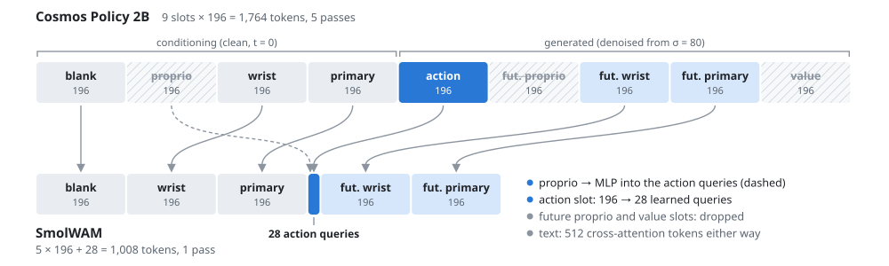
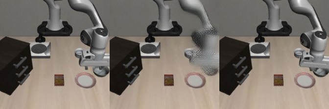

# SmolWAM：把视频世界动作模型改造成轻量控制接口

**SmolWAM（A Latent World-Action Model for Robotic Manipulation on Edge Devices）从 Cosmos Policy 2B 蒸馏得到约 0.88B 的模型，在一次前向中同时预测 16 步机器人动作和 16 步后的双相机视觉潜在表示。** 作者报告它在 LIBERO 的 400 回合中完成 382 回合（95.5%）；A100 上每个动作块耗时 57 ms，相比教师加速约 11 倍。[论文摘要与表 1](https://arxiv.org/html/2610.13740v1#S4)

本章关注一个具体问题：已经有视频预训练权重，怎样保留它的控制与未来预测能力，同时去掉视频生成接口带来的开销？阅读前提是了解 Transformer、VAE 和动作块。可先阅读[具身智能推理与部署框架](../09具身智能推理与部署框架/README.md)，理解模型推理和动作执行的分工。

本章按 2026-10-24 的公开论文和官方代码编写，是方法解读与实践入口；下面的性能数字来自作者实验，本仓库尚未运行 SmolWAM 推理或重新评测 LIBERO。


图 1：上半部分是教师的视频生成接口，下半部分是 SmolWAM 的轻量控制接口。可沿图对照视觉编码、文本、Transformer 深度和读出步数的变化。来源：[SmolWAM 官方架构图](https://github.com/iitimii/SmolWAM/blob/dde1e5bfe35c439499343c6d70e9cd32c96d0b36/assets/architecture.svg)，原图保留。图中教师算力沿用官方仓库的 31.0 TFLOP；本章结果表采用论文 v1 的 42.6 TFLOP，口径差异见第 4 节。

## 1. 从视频生成布局理解成本来源

Cosmos Policy 的 LIBERO 接口把不同类型的数据放入同一条潜在帧序列。每帧先表示为 `16 × 28 × 28` 的潜在张量，再切成 `14 × 14 = 196` 个令牌；动作、状态和价值向量也通过重复填充占满一帧。

```text
教师：9 帧 × 196 = 1764 个令牌
条件：空白帧 | 当前状态 | 当前腕部图像 | 当前外部图像
生成：动作块 | 未来状态 | 未来腕部图像 | 未来外部图像 | 价值

学生：5 帧 × 196 + 28 = 1008 个令牌
条件：空白帧 | 当前腕部图像 | 当前外部图像
生成：28 个状态条件动作查询 | 未来腕部图像 | 未来外部图像
```

图中列出保留的槽位；实际实现继续使用教师的原始令牌位置。当前状态被注入动作查询，未来状态帧和价值帧被移除。两个未来相机帧仍参与同一次预测，它们构成 world head（世界头）。[论文 §3.1–3.2](https://arxiv.org/html/2610.13740v1#S3)、[官方布局实现](https://github.com/iitimii/SmolWAM/blob/dde1e5bfe35c439499343c6d70e9cd32c96d0b36/smolwam/layout.py)



图 2：学生保留空白帧、当前与未来的双相机帧，以 28 个状态条件查询替换动作帧；横向宽度对应令牌数量。来源：[SmolWAM 官方令牌布局图](https://github.com/iitimii/SmolWAM/blob/dde1e5bfe35c439499343c6d70e9cd32c96d0b36/assets/tokens.svg)，原图保留。

教师原本还要执行 33 帧片段 VAE 编码、使用 4.8B 参数的 T5-XXL 文本编码器，并对 1764 个令牌运行 28 层 Transformer、做 5 步去噪。SmolWAM 保留预训练主干权重、令牌位置和整流流读出，围绕视觉、文本、深度、动作布局与采样步数逐项重建接口。

## 2. 五项改动，以及它们为什么需要蒸馏

### 2.1 单帧编码：用适配器接回教师的潜在空间

每个相机图像只经约 54M 参数的 Wan2.1 编码器编码一次，再用约 0.5M 参数的适配器映射到教师期望的片段模式潜在空间。

单帧编码并不天然等价于片段编码。论文在教师上测量单步动作块相对示范的归一化 L1 误差：原接口为 **0.0089**，直接换单帧升至 **0.038**，加入适配器恢复到 **0.0092**。这里的适配器承担的是输入分布对齐，而不是重新学习整套视觉表示。[论文 §3.2](https://arxiv.org/html/2610.13740v1#S3.S2)

### 2.2 缓存 BERT：512 个位置包含有用的注意力汇

SmolWAM 用 BERT-base 指令特征替代 T5-XXL，投影到主干的上下文宽度，并补零至 **512 个位置**。官方发布包缓存 LIBERO 指令；新指令会按需调用 BERT 编码。另有六个零初始化的视觉到语言层，让指令特征关注图像。

补零长度为何影响动作？教师交叉注意力的键、值投影没有偏置，因此补零位置产生零 key、零 value。对一个查询，设有效词的注意力 logit 为 \(\ell_i\)，补零位置有 \(m\) 个，则注意力输出为：

$$
o=\frac{\sum_i \exp(\ell_i)v_i}{\sum_i\exp(\ell_i)+m}.
$$

补零位置的 value 虽然为零，每个位置的 `exp(0)=1` 仍进入 softmax 分母，吸收注意力质量。直接截断这些位置就改变了有效词的权重。**这些零位置须参与注意力归一化；把它们屏蔽掉也会改变原来的计算。**

作者把教师文本上下文截成 32 或 128 个位置时，每组闭环诊断都降到 **0/5** 成功；解析补回被移除的 softmax 质量后恢复为 **5/5**，与原补零注意力的数值差异约为 `6e-8`。这解释了为什么“删除无内容的位置”仍会破坏预训练接口。[论文 §3.2](https://arxiv.org/html/2610.13740v1#S3.S2)

### 2.3 保留边界层：近恒等层不能任意成组删除

作者使用块影响度 \(1-\cos(h_{in},h_{out})\) 衡量层对表示的改变。第 0、1、25–27 层影响最大，第 3–22 层单独看接近恒等映射。

但“单层变化小”不能直接推出“联合移除无影响”。每组 5 回合的零样本诊断显示：单独跳过第 1、26 或 27 层均为 0/5；单独跳过第 7、14 或 20 层均为 5/5；一起跳过第 12–15 层又变成 0/5。

最终学生保留 **0–2 和 19–27，共 12 层**，继承对应教师权重再蒸馏。论文 §3.2 将保留层的规模写为约 **0.85B**；表 1 与官方实验记录将学生网络计为约 **0.88B**（精确记录约 0.878B），参数统计不包含 VAE 和文本编码器。两种口径应分别理解。[论文 §3.2、表 1](https://arxiv.org/html/2610.13740v1#S3.S2)、[官方实验说明](https://github.com/iitimii/SmolWAM/blob/dde1e5bfe35c439499343c6d70e9cd32c96d0b36/experiments/README.md)

### 2.4 状态条件动作查询：把状态接入 28 个查询

零初始化 MLP 将机器人状态加入 28 个动作查询，以此替代原来占 196 个令牌的动作帧，查询沿用教师动作槽位的位置。

作者先在教师上诊断哪些布局可以直接改动：

| 零样本布局改动 | 相对示范的归一化动作 L1 |
| --- | ---: |
| 原布局 | 约 0.009 |
| 移除未来状态与价值帧 | 不超过 0.019 |
| 移除空白帧 | 0.30 |
| 移除当前状态帧 | 0.058 |
| 将向量帧压缩到 28 令牌 | 0.21 |

最终学生保留空白帧，通过状态条件查询重新接入当前状态，并训练紧凑布局。**直接删除状态帧的诊断结果，与学习了状态注入的最终学生，是两个不同实验。** 1008 个令牌的计算为：空白帧 196、当前双相机 392、未来双相机 392，再加动作查询 28。[论文 §3.2](https://arxiv.org/html/2610.13740v1#S3.S2)

### 2.5 单步整流流：从同一份干净估计读出动作与未来

整流流将干净数据与噪声插值，并预测速度：

$$
x_\tau=(1-\tau)x_0+\tau\epsilon,\qquad
v_\theta(x_\tau,\tau)\approx\epsilon-x_0.
$$

由此得到干净估计：

$$
\hat{x}_0=x_\tau-\tau v_\theta(x_\tau,\tau).
$$

SmolWAM 在最大噪声水平 \(\sigma=80\)、\(\tau=80/81\approx0.988\) 使用固定噪声，只运行一次主干，分别从 \(\hat{x}_0\) 读出动作块和未来潜在表示。动作与未来联合生成，动作没有等待一个已经去噪完成的未来再作为条件输入。

世界头在训练时受到监督；常规控制推理保留潜在预测，不进行 RGB 解码。官方 API 另提供 `return_future=True` 与 `decode_future(...)`，供可视化未来预测。[论文 §3.1–3.2](https://arxiv.org/html/2610.13740v1#S3)、[官方策略 API](https://github.com/iitimii/SmolWAM/blob/dde1e5bfe35c439499343c6d70e9cd32c96d0b36/smolwam/policy.py)

## 3. 布局课程：先恢复剪枝，再学习压缩

学生从保留的教师层初始化。训练前 **1000 步**仍使用教师的 1764 令牌布局，随后切换为 1008 令牌布局，总计 **5000 步**。这个顺序把深度剪枝和布局压缩的分布变化分阶段处理。

数据来自 Cosmos Policy 发布的 1700 条成功 LIBERO 示范，每四步抽样得到 68,830 个观测。教师在固定噪声下生成单步动作与未来潜在表示，预先缓存为蒸馏目标。

设示范动作和真实未来潜在表示为 \(a,z\)，教师预测为 \(a^{\mathcal T},z^{\mathcal T}\)，主要损失为：

$$
\mathcal L=\|\hat a-a\|_1+\|\hat a-a^{\mathcal T}\|_1
+\|\hat z-z\|_1+\|\hat z-z^{\mathcal T}\|_1.
$$

状态帧和价值帧还存在时，另加权重 0.1 的对应损失。训练采用 AdamW、batch 32、bf16；继承权重学习率为 `2e-5`，新权重为 `1e-4`。论文报告单张 A100 上训练约 **3.6 小时**；官方完整流水线含准备步骤约 **5 小时**，教师目标缓存约 **66 分钟**。[论文 §3.3](https://arxiv.org/html/2610.13740v1#S3.S3)、[官方训练入口](https://github.com/iitimii/SmolWAM/blob/dde1e5bfe35c439499343c6d70e9cd32c96d0b36/experiments/train_smolwam.sh)

## 4. 结果：效率提升在哪里，世界头学到了什么

下表统一采用论文 v1 表 1 的统计。耗时是 A100-SXM4-40GB、batch 1、bf16 下，从观测到一个 16 步动作块的时间，包含预处理与 VAE 编码；各模型的文本特征均缓存。TFLOP 包含网络和 VAE 编码器。

| 模型 | 网络参数 | TFLOP/块 | ms/块 | 峰值显存 GiB | 60 回合筛选成功率 | 400 回合成功率 |
| --- | ---: | ---: | ---: | ---: | ---: | ---: |
| Cosmos Policy，5 步 | 1.96B | 42.6 | 624 | 7.55 | 96.7% | 98.2% |
| 教师，单帧 + 适配器、1 步 | 1.96B | 7.52 | 126 | 4.39 | 100.0% | — |
| SmolWAM，1 步 | 0.88B | 2.30 | 57 | 2.36 | 93.3% | 95.5% |

教师的 400 回合结果来自作者较早的 L4 评测流水线，原 Cosmos Policy 论文报告 98.5%；此处按 SmolWAM 论文使用 98.2% 作对照。官方 README 部分结果表将教师算力写为 31.0 TFLOP，和论文表 1、摘要的 42.6 不一致，因此本章的 **18.5 倍算力下降**使用 `42.6 / 2.30`，不混用这两处数值。[论文表 1](https://arxiv.org/html/2610.13740v1#S4)、[官方仓库](https://github.com/iitimii/SmolWAM)

仅把教师改成单帧、单步，耗时就从 624 降至 126 ms；学生的层数和布局改造进一步降至 57 ms。这支持了论文的核心判断：视频接口本身占据了很大一部分控制推理成本。

四个完整评测套件分别是 Spatial **99%**、Object **100%**、Goal **94%**、Long **89%**。效率收益保留了教师约 97% 的成功率，差距主要集中在多步骤任务。57 ms 对应约 17.7 次动作块查询/秒；把每块 16 个动作相乘得到的约 282 动作/秒是生成吞吐量，反馈反应频率取决于动作块执行与查询调度。

世界头在 96 个留出上下文上，相比直接复制当前帧，将未来潜在 L1 从 **0.133 降至 0.101**，光流端点误差从 **1.63 降至 1.43 像素**；解码图像的 LPIPS 为 0.128，复制当前帧为 0.115。它保留了运动预测能力，图像纹理仍较模糊。控制证据目前来自 LIBERO；官方还给出 M2 Pro 上约 0.9 秒/块的运行记录。[论文 §4](https://arxiv.org/html/2610.13740v1#S4)



图 3：从左至右为**当前画面、预测未来、真实未来**。预测捕捉了机械臂未来位置，外观细节较模糊；此图为展示而解码，常规控制路径直接保留未来潜在表示。来源：[SmolWAM 论文图 2](https://arxiv.org/html/2610.13740v1#S4.F2)、[作者原图](https://github.com/iitimii/SmolWAM/blob/dde1e5bfe35c439499343c6d70e9cd32c96d0b36/paper/figs/world_head_forecast.png)。

## 5. 对照代码，理解输入输出

官方代码以纯 PyTorch 支持 CUDA、Apple MPS 和 CPU。建议先跑仓库自带观测的 quickstart，再做单回合 LIBERO，最后运行完整协议。以下是已核对官方接口的调用示意：

```python
from pathlib import Path
import json
import numpy as np
from PIL import Image
from smolwam import SmolWAM

# 从官方 SmolWAM 仓库根目录运行；使用已预取的发布目录。
sample = Path("examples/sample_obs")
meta = json.loads((sample / "obs.json").read_text(encoding="utf-8"))
obs = {
    "primary_image": np.asarray(Image.open(sample / "primary.png").convert("RGB")),
    "wrist_image": np.asarray(Image.open(sample / "wrist.png").convert("RGB")),
    "proprio": np.asarray(meta["proprio"], dtype=np.float32),
}
policy = SmolWAM.from_pretrained("/path/to/local/smolwam-release")
actions, future = policy.predict_action(obs, meta["instruction"], return_future=True)
print(actions.shape)       # (16, 7)：末端位姿增量 6 维 + 夹爪命令 1 维
print(tuple(future.shape)) # (2, 16, 28, 28)：双相机潜在表示
print(policy.last_timing)  # 首次查询含预热；测速应重复调用
frames = policy.decode_future(future)  # 仅在需要展示未来画面时调用
```

`future` 的第二个维度 16 是潜在通道数；时间目标是未来第 16 步的两张相机图像，不是输出 16 帧视频。`proprio` 为 9 维，依次包含两个夹爪关节位置、三维末端位置、四维四元数。图像应是正向 RGB；接 LIBERO 原始观测时使用官方 `policy_observation` 处理渲染翻转。[官方示例](https://github.com/iitimii/SmolWAM/blob/dde1e5bfe35c439499343c6d70e9cd32c96d0b36/examples/quickstart.py)、[策略实现](https://github.com/iitimii/SmolWAM/blob/dde1e5bfe35c439499343c6d70e9cd32c96d0b36/smolwam/policy.py)

发布权重在 [Hugging Face](https://huggingface.co/timiiowolabi/SmolWAM)，官方说明首次准备模型与 Wan2.1 VAE 约需 4 GB。**本机、moon 和 Ubuntu 的模型、依赖与数据预取须沿用项目的良心云下载专线**；本机入口是 `C:\Users\kewei\Documents\2026\07重要学术项目\15wifi扩展\LabDownload.cmd`。先通过入口完成依赖安装和资源预取，再复用缓存运行推理、训练或评测；仅传本地模型路径仍需准备配置引用的 VAE，缓存外指令还需 BERT 资源。不要把整个评测程序放进下载专线。

### 官方复现入口与阅读顺序

| 学习目标 | 官方入口 | 应观察的内容 |
| --- | --- | --- |
| 单次推理 | `examples/quickstart.py` | `(16, 7)` 动作块、预热后耗时 |
| 理解 1008 令牌 | `smolwam/layout.py`、`smolwam/model.py` | 槽位保留、状态注入、原始位置与单步读出 |
| 对接闭环环境 | `smolwam/envs/libero.py`、`smolwam/eval_libero.py` | 图像方向、9 维状态、动作块执行 |
| 复现成功率 | `experiments/eval_libero.sh full` | 40 任务 × 10 回合，seed 195，16 步整块执行 |
| 复现效率 | `experiments/bench.sh` | 参数、令牌、FLOP、无争用设备上的耗时与显存 |
| 检查未来预测 | `experiments/world_eval.sh` | 对照复制当前帧的潜在误差和运动指标 |
| 重做蒸馏 | `experiments/train_smolwam.sh` | 潜在库 → 适配器 → 文本缓存 → 教师目标 → 训练 → 导出 |

脚本的命令、预期输出与环境见[官方实验说明](https://github.com/iitimii/SmolWAM/blob/dde1e5bfe35c439499343c6d70e9cd32c96d0b36/experiments/README.md)。完整评测会并行跑四个套件；耗时对比应另用空闲设备测速。教师诊断发现，将原 16 步动作块只执行 8 步就重新查询会使筛选任务全部失败，因此复现时应保留整块执行协议。[论文 §4](https://arxiv.org/html/2610.13740v1#S4)

另一个实现细节是 RoPE 空间外推系数 **3.0**，并关闭 frame-rate modulation。官方指出，若重建主干时误用库默认值，权重能正常加载，但动作误差会从约 0.009 升至 0.40。阅读或移植 `smolwam/nn/dit.py` 时应一并核对这些配置。[官方方法说明](https://github.com/iitimii/SmolWAM#method)

## 6. 与部署框架章衔接

SmolWAM 的主要收益发生在模型结构与输入输出接口：单帧适配、保留注意力汇、边界层剪枝、状态条件查询，以及单步动作和未来联合读出。它为[推理与部署框架章](../09具身智能推理与部署框架/README.md)提供了一个轻量 WAM 案例；运行时优化和机器人执行调度可在这个模型接口之上继续开展。

阅读后可以沿三个具体问题继续分析：补零位置改变了哪一项归一化计算？为什么近恒等层的影响不能直接相加？为什么状态帧的删除必须和动作查询的学习一起理解？这三个问题分别对应本章的注意力、深度和布局诊断。

## 参考资料

- [论文：SmolWAM，arXiv:2610.13740v1](https://arxiv.org/abs/2610.13740v1)，Timi Owolabi、Hikmah Olawore、Frances Adelakun、Ayotomiwa Oyewumi，2026-10-09。
- [官方项目页与演示](https://smolwam.vercel.app/)。
- [官方代码仓库](https://github.com/iitimii/SmolWAM)；本章代码核对版本为 [`dde1e5b`](https://github.com/iitimii/SmolWAM/tree/dde1e5bfe35c439499343c6d70e9cd32c96d0b36)。
- [模型权重](https://huggingface.co/timiiowolabi/SmolWAM)。
- [教师：Cosmos Policy 论文](https://arxiv.org/abs/2601.16163)、[官方代码](https://github.com/NVlabs/cosmos-policy)。

配图文件、来源版本与许可说明见 [assets/SOURCES.md](./assets/SOURCES.md)。
