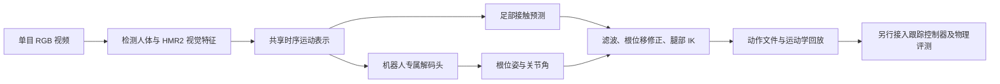

# BeyondRetarget：从单目视频生成八种人形机器人动作

> 核查日期：2026-10-18。对应[视频号演示](https://weixin.qq.com/sph/A9gBA1DBZ6)，南京大学等团队的 BeyondRetarget。本文提供官方在线推理、本地基础版推理与结果检查流程。具体实测状态见[验证记录](./results/validation.md)。

[](./results/eight_robots.mp4)

点击图片观看本次生成的六秒回放；[下载八份动作文件](./results/motions.zip)。这是本教程调用官方服务的新推理结果，输入取自所给视频号的单人画面裁剪；不是将原演示中的机器人画面直接用作结果。该输入分辨率较低，只用于流程验证，不能据此报告精度或执行成功率。

## 1. 先理解要复现什么

输入是一段人全身可见的 RGB 视频，输出是机器人根节点位置、根节点旋转及各关节随时间变化的角度。它适合生成动作参考轨迹，后续再交给动作跟踪控制器。

传统路线通常是“视频 → 人体运动重建 → 动作重定向”。BeyondRetarget 在推理阶段直接从视觉特征预测机器人运动；使用人体标注训练，并不等于推理时必须先输出 SMPL。其论文与当前公开基础版的范围应分别理解：[论文](https://arxiv.org/html/2609.29850v1)、[官方项目页](https://bear-ty.github.io/Beyondretarget_page/)、[官方代码](https://github.com/bear-ty/BeyondRetarget)。



核心区别在最后两步：修正脚底穿地、悬空和支撑脚滑动，可以改善轨迹；直接把关节角写入仿真模型进行回放，仍不能证明机器人在重力、接触及执行器约束下能跟踪这条轨迹。论文的执行成功率还使用了 SONIC 跟踪器。本文不把导出 NPZ 或渲染视频算作物理执行成功。

截至核查日，GitHub 已公开基础版推理代码、资源下载器和流式入口，原始代码及权重为 **CC BY-NC 4.0**；机器人和第三方组件保留各自许可。Hugging Face Space 的公开仓库仍只是调用私有运行包的外壳，两者不能混淆。教程链接到上游，不将上游代码、权重或原视频按本仓库 CC BY 4.0 重新发布。参见[上游许可](https://github.com/bear-ty/BeyondRetarget/blob/main/LICENSE)、[第三方声明](https://github.com/bear-ty/BeyondRetarget/blob/main/THIRD_PARTY_NOTICES.md)、[Space 说明](https://huggingface.co/spaces/bear-ty/BeyondRetarget/blob/main/README.md)。

## 2. 准备合适的视频

先拍一段 5–10 秒的固定机位视频：单人、全身和双脚始终可见，先做抬手、侧伸或浅蹲，避免遮挡和大范围走动。当前基础版不支持自由移动相机和大范围全局轨迹，不能用这些输入判断尚未发布的增强版效果。

视频号链接中的内容是讲解加多方法拼接画面，不能把整段 78.75 秒视频直接当作单人输入。自行录制视频更容易观察动作对应关系。在线演示会把上传视频发送给作者的 Hugging Face 服务，请使用可公开处理的素材。

安装 [FFmpeg](https://ffmpeg.org/download.html)，把自己的原视频转为六秒、30 FPS、无音轨输入。在 PowerShell 或 Linux 终端执行：

```bash
ffmpeg -i input.mp4 -t 6 -vf fps=30 -an -c:v libx264 -crf 18 person_6s.mp4
ffprobe -v error -show_entries stream=width,height,r_frame_rate,nb_frames -show_entries format=duration -of json person_6s.mp4
```

这是重新采样视频，后续 `--fps 30` 应与它一致。直接给任意帧率的视频修改 FPS 元数据，会改变动作时间尺度。

## 3. 无本地 GPU：官方在线推理

打开[官方 Space](https://huggingface.co/spaces/bear-ty/BeyondRetarget)，上传不超过 10 秒的视频，点击 **Generate Robot Motion**。完成后应同时出现八机器人视频与动作 ZIP。ZeroGPU 使用共享队列，限额或服务故障时请稍后手动重试，不要连续提交。

也可以使用本章的客户端脚本。从**本章目录**运行，Windows 激活环境用 `.venv-client\Scripts\Activate.ps1`，Linux 用 `source .venv-client/bin/activate`：

```bash
python -m venv .venv-client
# 激活环境后：
python -m pip install -r requirements-client.txt
python scripts/run_online.py /absolute/path/person_6s.mp4 --output /absolute/path/runs/beyondretarget-online-001
python scripts/inspect_motion.py /absolute/path/runs/beyondretarget-online-001/motions.zip --output /absolute/path/runs/beyondretarget-online-001/motion_report.json
```

输出目录必须不存在，避免覆盖已有结果。`run_online.py` 先检查时长，随后使用**同一个 Gradio 会话**依次调用 `/zero_gpu_inference` 与 `/finish_cpu_stage`。第一步只保存服务器状态；第二步才渲染并返回视频、ZIP。只调用第一步或重新创建客户端，会丢失后续步骤需要的状态。脚本保存输入哈希、运行时间、成败及输出哈希；失败时 `run.json` 仍保留失败类型。

接口名称可能随上游更新。出错时先在 Space 页面手工验证，再用 `Client("bear-ty/BeyondRetarget").view_api()` 检查接口。在线服务的运行包版本没有与 GitHub 提交建立公开对应关系，因此在线结果不能声称来自下面固定的本地源码版本。[Gradio 客户端文档](https://www.gradio.app/main/docs/python-client/introduction)说明了会话状态与接口调用方法。

## 4. Linux + NVIDIA：本地基础版推理

### 4.1 固定源码与独立环境

本章核对的上游提交为 `e0331d0faf9091095bae9100e03655c944e2b64a`。以下步骤依据该版本入口和安装脚本整理；是否已在本教程实跑，请以验证记录为准。

上游环境为 Linux x86_64、Python 3.10、PyTorch 2.3.0 / CUDA 12.1。不要把这些依赖装进已有训练环境；Windows 原生和 AMD ROCm 不在该安装流程的支持范围。Blackwell 显卡还需要另行核验旧版 PyTorch 的兼容性，不能只看 `nvidia-smi` 正常就判定环境可用。

```bash
mkdir -p "$HOME/src"
git clone https://github.com/bear-ty/BeyondRetarget.git "$HOME/src/BeyondRetarget"
cd "$HOME/src/BeyondRetarget"
git checkout e0331d0faf9091095bae9100e03655c944e2b64a
bash scripts/setup_rgb2robo.sh --env-name beyondretarget-tutorial
conda activate beyondretarget-tutorial
bash scripts/setup_rgb2robo.sh --env-name beyondretarget-tutorial --check-only
```

安装器会创建环境、下载资源并检查安装；不是训练命令。中断后重跑可恢复下载。`--check-only` 不应下载或修复环境；`--quick-check` 会跳过部分权重加载检查，不能代替完整检查。来源：[固定版本安装器](https://github.com/bear-ty/BeyondRetarget/blob/e0331d0faf9091095bae9100e03655c944e2b64a/scripts/setup_rgb2robo.sh)。

四项必需资源的压缩文件总量约 3.35 GB，解压后另占空间。大文件放到教程仓库外，保留资源目录和网格引用关系：

| 资源 | 上游要求的相对路径 | 下载文件大小 |
| --- | --- | ---: |
| 动作预测权重 | `assets/checkpoints/rgb2robo_multirobot_clean.pth` | 415,291,282 B |
| HMR2 权重 | `assets/hmr2/epoch=10-step=25000.ckpt` | 2,709,494,041 B |
| YOLOv8x 权重 | `assets/yolo/yolov8x.pt` | 136,890,692 B |
| 机器人资源包 | `assets/robot.zip`，解压为 `assets/robot/` | 92,183,004 B |

安装器记录了文件大小和 SHA256；不要把 Google Drive 返回的 HTML 页面当成权重。参见[资源说明](https://github.com/bear-ty/BeyondRetarget/blob/main/assets/README.md)及[固定版本下载器](https://github.com/bear-ty/BeyondRetarget/blob/e0331d0faf9091095bae9100e03655c944e2b64a/scripts/download_rgb2robo_assets.py)。

### 4.2 先跑 G1，再扩展机器人

在上游项目根目录执行：

```bash
python app/infer/infer_video.py \
  --video /absolute/path/person_6s.mp4 \
  --robots g1 \
  --fps 30 \
  --output_dir /absolute/path/runs/beyondretarget-g1-001
```

该入口依次生成框、HMR2 特征、原始动作、接触预测及后处理动作。正常结果结构为：

```text
beyondretarget-g1-001/
  inputs/person_6s/
    bbox.npy
    vit_features.pt
  predictions/
    raw/
    contact/
    postprocess/
```

实际文件位于机器人、序列子目录中。复用已经提取的视觉特征，避免重复执行 HMR2：

```bash
python scripts/validate_inputs.py /absolute/path/runs/beyondretarget-g1-001/inputs
python scripts/run_multirobot_pipeline.py \
  --input_root /absolute/path/runs/beyondretarget-g1-001/inputs \
  --checkpoint assets/checkpoints/rgb2robo_multirobot_clean.pth \
  --robots g1,r1,gr1t1,h1_with_hand,gr2v3_8_7_dummy_hand,t1_serial,atlas_v4,tienkung \
  --fps 30 --batch_windows 1 --phase all \
  --output_root /absolute/path/runs/beyondretarget-eight-001
```

这里把窗口批量设为 1，便于先检查流程；它不是显存需求保证，而且不控制 HMR2 提取阶段的批量。`--phase infer` 只生成原始动作与接触预测，`--phase postprocess` 用于已有预测的后处理。官方 CLI 与输出定义见[固定版本多机器人入口](https://github.com/bear-ty/BeyondRetarget/blob/e0331d0faf9091095bae9100e03655c944e2b64a/scripts/run_multirobot_pipeline.py)。

| 机器人 | CLI 名称 |
| --- | --- |
| Unitree G1 / R1 | `g1` / `r1` |
| Fourier GR1-T1 / GR2-V3 | `gr1t1` / `gr2v3_8_7_dummy_hand` |
| Unitree H1 | `h1_with_hand` |
| Booster T1 | `t1_serial` |
| Tienkung / Atlas | `tienkung` / `atlas_v4` |

### 4.3 检查数据与回放

回到本章目录，对 `raw` 或 `postprocess` 下的**动作目录**执行检查。不要把只有接触概率的 `contact` 目录交给动作检查器：

```bash
python scripts/inspect_motion.py /absolute/path/runs/beyondretarget-g1-001/predictions/postprocess --output /absolute/path/runs/beyondretarget-g1-001/motion_report.json
```

检查器支持单个 NPZ、目录或在线返回的 ZIP，不需要解压 ZIP。它拒绝空结果、未知结构、非法数值、帧数不一致、无效 FPS 与未归一化四元数。结构检查通过后，再目视检查抬手方向、身体朝向、脚底高度、滑步及动作切换。

无需 GPU，可先用随章结果验证检查器：`python scripts/inspect_motion.py results/motions.zip`。本次在线包内只有八个 `*_raw_pred.npz`，没有接触标签或独立后处理文件；不能从包内容断言官方服务执行了哪一种接触后处理。

上游原始动作结构中，`root_trans` 为 `[T,3]`，`root_rot_quat` 为 `[T,4]` 且顺序为 **wxyz**，`dof` 为 `[T,D]`，`fps` 含单个数值。另一种 body 导出使用 `joint_pos`、`body_pos_w` 和 `body_quat_w`。G1 的模型关节排列与 XML 排列有映射，不能把 `dof` 不经转换直接写进 XML 顺序的关节。来源：[导出实现](https://github.com/bear-ty/BeyondRetarget/blob/main/lib/util/robot_export_utils.py)、[G1 配置](https://github.com/bear-ty/BeyondRetarget/blob/main/config/robot/g1.yaml)。

对于上游流式入口生成的 `g1_action_stream.npz`，可在上游根目录回放：

```bash
python stream_infer/live_mujoco_viewer.py /absolute/path/g1_action_stream.npz
```

这是需要桌面显示的 G1 运动学查看器。它更新 `qpos` 并调用 `mj_forward`，没有完成控制器驱动的动力学跟踪。不同机器人应使用各自模型、关节顺序和对应的查看方式。[流式文档](https://github.com/bear-ty/BeyondRetarget/blob/main/stream_infer/README.md)还提供视频、相机、MuJoCo 查看和 GR00T ZMQ 发布入口；流式检测器需要另行准备，不包含在基础资源下载中。

## 5. 复现实验如何验收

建议分三层保存证据，每层独立报告：

| 层级 | 最低证据 | 能得出的结论 |
| --- | --- | --- |
| 视频到动作 | 输入哈希、源码/服务版本、有效 NPZ、输出哈希 | 对这段输入完成了动作生成 |
| 运动学可视化 | 同步回放、动作方向、脚底和关节检查 | 轨迹在模型上可回放 |
| 物理执行 | 控制器版本、初始状态、误差/终止判据、完整接触仿真回合 | 在给定协议下可以跟踪 |

训练复现还需要原始训练数据、训练配置和训练过程。公开基础版推理入口不等于已经公开完整论文训练复现流程，不能把 `setup` 或推理运行写成重新训练。论文用 MotionPRO 数据监督运动与接触，获取数据应遵循[官方数据入口](https://shenqiu.njucite.cn/motionpro/)的注册与使用条款；教程不打包数据。

## 6. 排障

- **安装时尝试编译 PyTorch3D**：先确认 Python 3.10 / PyTorch 2.3.0 / CUDA 12.1 与上游指定 Linux wheel 匹配，勿在不匹配环境盲目编译。
- **CUDA 不可用或显存不足**：先检查其他任务占用；缩短输入、单机器人起跑。`--batch_windows 1` 只影响多机器人预测阶段，HMR2 阶段仍可能需要更多显存。不要终止其他人的任务。
- **漏检、左右肢体或深度不稳定**：换为固定机位、清晰单人全身输入，保留脚部，避免多人拼接和遮挡；低分辨率裁剪只能用于流程测试。
- **脚底仍滑动或穿地**：确认查看的是 `postprocess` 结果，再核对 FPS、机器人模型和关节顺序。后处理不是完整动力学求解器。
- **在线生成失败**：检查共享队列/限额，先手工验证 Space。不要用更换客户端的方式接续前一会话的 CPU 阶段。

## 7. 继续阅读

- [论文与引用信息](https://arxiv.org/abs/2609.29850)
- [上游源码与安装说明](https://github.com/bear-ty/BeyondRetarget)
- [接触后处理说明](https://github.com/bear-ty/BeyondRetarget/blob/main/postprocess/README.md)
- [同章：春晚舞蹈机器人复刻](../01春晚舞蹈机器人复刻.md)
- [同章：Booster K1 网页 MuJoCo 与 AMP](../02-BoosterK1-mjlab-AMP/README.md)
