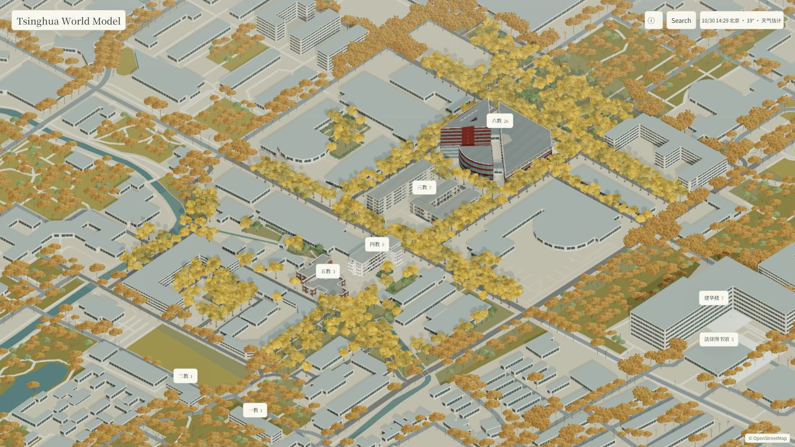
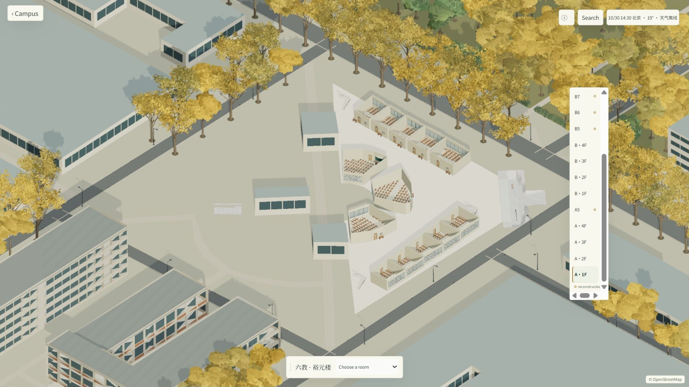
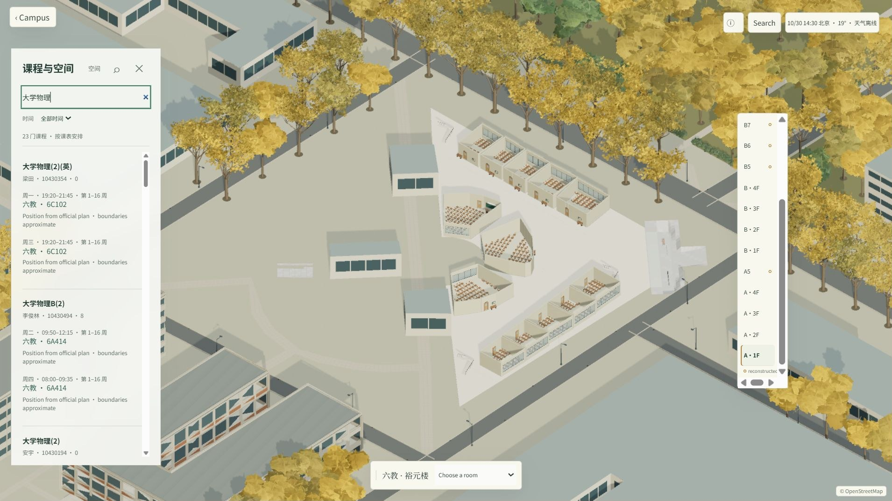
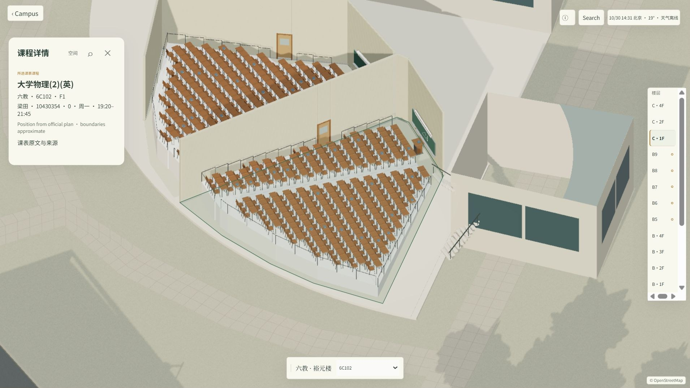

# 从校园地图到可探索的 3D 世界：清华校园案例分析与 Prompt 实践

本教程以 [Tsinghua World Model](https://tsinghua-world-model.pages.dev/) 为案例，分析浏览器里的校园建筑、教室和课程是如何组织的，再给出一套可交给 AI 编程助手执行的 Prompt，帮助你从一张校园地图逐步做出自己的可交互 3D 校园。

这个案例是非官方学生项目。本文对实现的判断来自 2026 年 10 月 30 日检查的公开网页、前端代码与资源清单，并非作者的开发访谈或原始工程源码。教程中的实施步骤是根据这些证据设计的复现方案，不代表作者一定按相同流程制作。

## 1. 我们要做出什么

最终目标是一个浏览器应用：用户能在校园总览中旋转、缩放和点击建筑；选择楼层后查看教室；搜索课程后定位到对应地点；天气与时间驱动场景变化。建议先做一栋建筑、一层楼和两间教室，跑通之后再扩展全校。

~~~mermaid
flowchart LR
 A[地图轮廓与建筑资料] --> B[坐标转换与建筑数据]
 B --> C[校园地面和背景建筑]
 D[照片 平面图 人工整理] --> E[重点建筑和楼层模型]
 E --> F[GLB 模型及房间索引]
 G[课程和地点数据] --> H[课程搜索与位置关联]
 C --> I[Three.js 浏览器场景]
 F --> I
 H --> I
 I --> J[校园总览 建筑 楼层 教室]
 K[天气接口] --> I
~~~

## 2. 先看实际效果

以下截图来自本地运行的案例网站，拍摄于 2026 年 10 月 30 日；画面展示的是原项目效果，而不是下文 Prompt 已生成的成果。地图数据署名见画面右下角。原网站：[Tsinghua World Model](https://tsinghua-world-model.pages.dev/)。

图 1：校园总览。地图轮廓、背景建筑、树木和带标签的重点建筑共同组成场景；中间偏上是六教。

图 2：点击六教后显示建筑及楼层视图，右侧提供楼层导航。各楼层内容的精度应以项目标注为准。

图 3：搜索“大学物理”，课程结果列出上课时间和地点。

图 4：点击课程后定位到六教 6C102，显示教室视图和课程信息。房间边界、桌椅等具体细节包含重建内容。

## 3. 案例网站的建筑和教室怎么做的

### 3.1 校园底图：地图轮廓 + 本地坐标

公开资源中的 `data/spatial.json` 包含校园原点、经纬度投影参数，以及建筑的名称、中心点、多边形轮廓、洞、来源和精度字段。文件的来源记录提到 OpenStreetMap（OSM）数据和 Overpass 查询快照；网页也显示 OpenStreetMap 署名。

可行做法是：获取建筑平面轮廓，把经纬度换算成相对于校园原点的局部坐标，再将轮廓拉伸成立体外形。轮廓缺高度时需要补充资料，或明确标为估计。地图本身不能告诉我们每间教室的布局。

项目的 `data/foundation-facades.json` 把背景立面描述为重建的立面节奏，并注明窗户和房间位置未经核实。这说明至少一部分背景视觉细节是按规则重建的，不应视为逐窗实测。

### 3.2 重点建筑：单独的模型和配准数据

`models/campus-index.json` 将建筑 ID 指向各自的 `building.json`。六教条目包含建筑外壳 `shell.glb`、总览模型、楼层、房间、构件和坐标配准信息。配准中的平移、旋转和控制点用于把建筑自身的局部模型放回校园地图位置。

六教描述文件明确写到：建筑比例参考照片、示意图和地图轮廓，并非尺寸测绘。文件还记录了局部坐标和地图坐标之间的拟合残差；这个残差反映所选控制点的拟合情况，不能当作建筑整体的实测精度。

法律图书馆的描述文件还记录了生成建筑、家具和不同细节层级模型的脚本路径。这是存在程序化生成流程的线索；脚本本身未随本次公开资源下载，因此无法还原作者完整的建模工具链，也不能据此断言所有建筑都由同一方法生成。

### 3.3 教室：楼层结构、房间索引与家具分层

六教的 `building.json` 为每层记录 ID、高度、房间列表、楼层模型节点，以及单独的家具 GLB。房间记录再关联房间号、楼层、模型节点和定位精度。进入建筑、切换楼层、点击教室时，前端就能按这些索引加载或显示相应内容。

具体例子：六教 A 区一层条目有 `FLOOR_A1` 节点、房间列表，以及详细和总览两种家具文件。A5 楼层被标记为依据相邻楼层模板重建：隔断、通道和家具不是实测，房间编号也未确认。六教的说明还指出，部分地下室房间只有编号，尚无可靠的水平位置。

因此，可以把教室建模理解为：先根据可用平面资料整理房间与走廊，再制作楼板、墙、门窗和家具，最后把几何模型与房间 ID 绑定。照片、平面图、手工重建和程序生成可能配合使用；目前没有证据确认作者是否航拍、使用了哪个建模软件，或每栋楼的具体制作过程。

### 3.4 网页运行：分块加载，而不是一次加载所有模型

浏览器使用打包后的 JavaScript、样式、JSON 和 GLB 资源。清单中还有分块的基础地形和植被资源，以及 Web Worker；同一建筑可分别提供总览、楼层、室内和家具资源。这种组织方式支持按视角和交互阶段加载内容，降低一开始需要处理的数据量。

课程数据在 `data/schedule.json` 中，包含课程、上课安排、地点及来源。课程搜索与空间数据关联，能够把搜索结果定位到建筑、楼层或教室；具体精度取决于该地点是否有可用的房间映射。

本地验证时，搜索“大学物理”得到 23 门课程，点击一条结果可进入六教并显示 6C102、F1。课表是数据快照，不应直接作为实时排课依据。

## 4. 制作自己的校园：准备哪些资料

| 资料 | 用途 | 起步时的最低要求 |
| --- | --- | --- |
| 校园地图或 OSM 建筑轮廓 | 建筑位置、轮廓、道路 | 一栋建筑及其周边 |
| 建筑外观照片 | 屋顶、门窗、主入口、颜色 | 每个可见方向各一张较清晰照片 |
| 公开或获授权的平面图 | 房间、走廊、楼梯的相对位置 | 一个楼层；没有时用示意布局并标注 |
| 建筑和房间清单 | 名称、别名、楼层与房间 ID | 一栋楼、两间房 |
| 课程或活动表 | 课程搜索与位置关联 | 自制几条示例数据即可 |

为每项素材记录来源、日期、许可和精度。OpenStreetMap 数据有署名及 ODbL 使用要求，具体见 [OSM 版权说明](https://www.openstreetmap.org/copyright)；其他照片、平面图和模型按各自的授权条件使用。不要默认可以重新发布案例网站的资源：网页可访问与素材可再分发是两回事。

## 5. 可直接使用的 Prompt

以下 Prompt 按阶段执行。把方括号内容换成你的学校和资料；每一步都让编程助手先查看当前项目并完成验证。你可以使用 Codex、Claude Code 或其他能读写项目文件的编程助手。

### Prompt 1：搭建可运行的 3D 最小项目

~~~text
请在当前目录创建一个可运行的 3D 校园网页，使用 Vite、Three.js 和普通 JavaScript。先做最小版本，暂时使用我自己提供或你生成的示例数据，不复制其他网站的私有源码。

目标：
1. 显示地面、两栋不同形状的建筑和名称标签。
2. 使用正交相机，支持鼠标旋转、缩放和平移；点击建筑后显示名称。
3. 建筑数据单独放在 JSON 文件，包含 id、name、footprint、height 和 precision。
4. 使用清晰的低多边形、等距微缩风格，并适配桌面和手机。
5. 提供本地启动方法、依赖清单，并实际运行验证；修复报错。
6. 不要把示例尺寸写成真实测绘数据。

完成后说明修改文件、启动地址和已验证的交互。
~~~

参考：[Three.js 创建场景](https://threejs.org/manual/en/creating-a-scene.html)、[OrbitControls](https://threejs.org/docs/#examples/en/controls/OrbitControls)、[Vite 入门](https://vite.dev/guide/)。

### Prompt 2：导入地图建筑轮廓

~~~text
请为现有项目增加地图数据导入功能。目标校园为 [学校名称]，数据文件为 [GeoJSON 或 OSM 数据路径]，校园参考原点为 [经度, 纬度]。

要求：
1. 解析建筑多边形及可能存在的内洞，转换为相对原点的局部米制坐标。
2. 使用建筑高度或楼层数生成体块；缺失高度时使用可配置默认值，并标记 estimated。
3. 保留原始数据的建筑 ID、名称、来源和许可；页面显示适当署名。
4. 校验建筑坐标、朝向和尺度，输出至少三个可人工对照的地标。
5. 数据解析与渲染分开，保留示例数据供无网络时运行。

先检查输入实际字段，再实现和测试，不要臆造地图里没有的高度或建筑名称。
~~~

地图数据可从 [OpenStreetMap](https://www.openstreetmap.org/) 查看；熟悉数据查询后可参考 [Overpass API 文档](https://wiki.openstreetmap.org/wiki/Overpass_API) 导出区域内的建筑。对较大范围应使用适合当地的投影方法，简单局部近似适合小范围原型。

### Prompt 3：制作一栋有辨识度的建筑

~~~text
请基于我提供的 [建筑名称] 外观照片、平面轮廓与尺寸资料，制作可用于现有 Three.js 项目的建筑模型。

先列出：已确认的轮廓、入口、楼层和材质；缺失或推测的内容。采用程序化几何或 Blender 建模均可，但必须保存生成脚本或可编辑源文件，并导出 GLB。

模型要求：
- 建筑外壳、屋顶、门窗和每层楼分别命名；
- 模型使用米制，说明坐标轴、原点、朝向和尺寸；
- 输出 building.json：id、模型路径、楼层 ID、模型到校园坐标的平移/旋转/缩放、素材来源和精度说明；
- 在校园场景中按至少两个可辨认地标检查位置和方向；
- 对缺失资料使用清晰标注的近似值，不要将视觉推断写成实测。

请实际加载 GLB 并检查外壳、朝向及建筑落地情况，提供截图或明确的验证结果。
~~~

建模工具与格式参考：[Blender 手册](https://docs.blender.org/manual/en/latest/)、[Blender glTF 导出](https://docs.blender.org/manual/en/latest/addons/import_export/scene_gltf2.html)、[Three.js GLTFLoader](https://threejs.org/docs/#examples/en/loaders/GLTFLoader)。程序生成和 Blender 手工建模可以混用；重复窗户、楼板和桌椅适合用参数化方式生成。

### Prompt 4：从平面图构建楼层与教室

~~~text
请在 [建筑名称] 中制作 [楼层]，参考资料为 [获授权的平面图/自绘示意图路径]。

1. 从平面图整理房间轮廓、走廊、门洞、楼梯及可确认的尺寸；列出无法确认的部分。
2. 先生成楼板和墙体，再放入门窗、讲台、桌椅；重复家具使用可调参数批量生成。
3. 为楼层和每间房设置稳定 ID，输出 rooms.json，包含 floorId、roomId、名称、位置、模型节点名、来源和 precision。
4. 接入楼层选择；隐藏其他楼层或使用剖切视图，让当前楼层内部可见。
5. 点击房间可高亮并展示名称；返回校园总览时恢复原视角。
6. 缺少真实房号或布局时，用“示意/重建”标识，禁止把猜测映射为真实房间。

使用至少两间教室测试楼层切换、房间点击和返回，并报告结果。
~~~

### Prompt 5：接入课程搜索

~~~text
请在现有校园项目中加入课程搜索。先使用 data/courses.json 中的自制样例，字段至少包括 courseId、课程名、教师、星期、时间、buildingId、floorId、roomId 和 sourceDate。

搜索支持课程名、教师、建筑名和房间号。点击结果时，根据 buildingId → floorId → roomId 逐级定位；如果某级未知，定位到已知的最高级并显示“房间位置未确认”。数据加载失败时给出可见提示，避免静默失败。

请测试：正常房间、只有建筑的记录、无结果、中文搜索和返回总览。不要把样例课表显示为实时数据。
~~~

### Prompt 6：天气、性能和发布

~~~text
请为现有项目添加时间与天气效果，并优化加载：
1. 无天气数据时使用可配置默认天气，展示数据时间与状态；提供手动切换晴、雨、雪的预览。
2. 校园总览使用轻量建筑；进入建筑后再加载楼层与家具。重复物件尽量合批或实例化，并处理资源释放。
3. 对桌面和手机分别测试首屏、搜索、切换建筑及 WebGL 失败提示；记录实际测得的加载时间和资源大小。
4. 提供生产构建与静态部署说明。若天气接口需要服务端代理，明确静态托管与代理各自的部署方式，不在前端保存密钥。
5. 检查数据来源、署名、素材使用条件以及真实与重建内容的标记。
~~~

天气数据可参考 [Open-Meteo 文档](https://open-meteo.com/en/docs)。地图数据、课程和天气通常有不同的更新频率，应分别标注来源和更新时间。

## 6. 一个完整的 Prompt 使用示例：从零做两间教室

这一组示例使用虚构校园与虚构尺寸，目的是让你先体验 AI 辅助开发的完整过程。示例是可执行的任务描述，以下“预期结果”是验收目标，并非已经运行的截图或承诺。

### 第一步：把需求和示例数据一起交给助手

在空项目文件夹打开编程助手，粘贴下面的完整 Prompt：

~~~text
请在当前空文件夹创建“示例校园 3D 地图”，用 Vite 和 Three.js，完成后运行并验证。所有名称和尺寸均为虚构示意。

校园以米为单位，Y 轴向上，地面为 XZ 平面。使用以下数据：
- 教学楼 A：中心 (-15, 0, 0)，长 24 米、宽 12 米、高 8 米；两层，每层 4 米。
- 图书馆：中心 (20, 0, 0)，长 18 米、宽 14 米、高 12 米；三层。
- 教学楼 A 的一层有 A101、A102 两间教室，之间留 2 米宽走廊；每间教室放 3 行 × 4 列桌椅和一块黑板。房间布置为示意。
- 示例课程“机器人导论”周一 09:00–10:30，在教学楼 A 的 A101；“三维图形基础”周三 14:00–15:30，在 A102。

交互：
1. 初始显示两栋建筑和中文标签；鼠标可旋转、缩放、平移。
2. 点击教学楼 A，显示一层内部；点击 A101 或 A102 可高亮并显示名称。
3. 搜索“机器人导论”，点击结果后进入教学楼 A 一层并定位 A101。
4. 提供返回校园按钮、加载错误提示和手机布局。
5. 把建筑、房间与课程数据分离；README 写明启动方式和“虚构示例”。

请先实现最小功能，再启动并验证以上交互；报告执行过的验证、未完成项和本地地址。
~~~

**预期检查：** 页面出现两栋建筑；依次完成“教学楼 A → A101”“搜索机器人导论 → A101”“返回校园”。若助手只生成文件而没有运行，请继续发送：

~~~text
请启动刚才的项目，在浏览器依次操作校园总览、A101 和“机器人导论”搜索；记录每一步的实际结果与截图。若报错，请修复后重新验证，不要把预期结果写成已完成。
~~~

### 第二步：让助手把示意楼改为参考照片中的建筑

准备好有使用权限的外观照片和一层平面图，放入项目的 `references/` 目录，再输入：

~~~text
请读取 references/ 中的教学楼照片和一层平面图，将现有“教学楼 A”替换为参考资料对应的外观和房间轮廓。先给出一张资料表，区分照片可见、平面图可确认、需要估计的内容；没有尺寸的部分保持可配置的近似值。

保留 A101/A102 的稳定 ID 与搜索功能。先做建筑外壳，再做一层楼板、墙、门洞和家具。保存可编辑的生成代码或建模源文件，导出 GLB 并接入网页。最后截图展示总览、楼层和 A101，核对旋转方向、入口、地面高度和课程定位。
~~~

**如何判断结果：** 建筑轮廓和入口方向应与输入资料可对照；缺少依据的窗户、房号或家具布局应标为示意。若模型方向错了，可追加：“请以入口照片和地图北向重新核对模型坐标系，修复旋转，并说明修改了哪个变换。”

### 第三步：用真实课程数据替换示例

~~~text
请读取我提供的 courses.csv，只使用其中的 course_id、name、teacher、day、start、end、building_id、floor_id、room_id 字段。先检查缺失值和重复课程，再转换成网页所需的 JSON。

已能匹配房间的结果定位到教室；只有 building_id 的结果定位到建筑，并显示“教室位置未确认”。显示数据来源和更新日期，不要把课表显示成实时占用。请用一条完整记录和一条缺房间记录测试搜索及定位。
~~~

若手头没有公开或获授权的课程表，继续使用示例数据即可。每个阶段都可以要求助手展示实际运行结果、修改文件和未验证的部分，再进入下一阶段。

## 7. 建议的数据组织

下面是自行实现时的一种组织方式，不是案例项目原始源码目录：

~~~text
campus-world/
├── public/
│   ├── data/                # 地图、建筑、房间与课程 JSON
│   └── models/              # 建筑外壳、楼层和家具 GLB
├── src/
│   ├── scene/               # 相机、灯光、渲染与交互
│   ├── map/                 # 坐标转换、轮廓拉伸
│   ├── building/            # 建筑、楼层与房间加载
│   ├── search/              # 搜索与地点映射
│   └── weather/             # 天气状态与降级
├── model-sources/           # 自己的建模脚本或可编辑文件
└── README.md
~~~

可先使用下面的样例说明数据之间的关系。坐标和课表都是虚构数据：

~~~json
{
  "buildingId": "TEACHING_A",
  "name": "教学楼 A",
  "model": "models/teaching-a/shell.glb",
  "transform": {"translation": [12, 0, -8], "rotationY": 0, "scale": 1},
  "floors": [{"id": "F1", "model": "models/teaching-a/f1.glb"}],
  "rooms": [{"id": "A101", "floorId": "F1", "node": "ROOM_A101", "precision": "schematic"}],
  "source": "自绘示意",
  "precision": "schematic"
}
~~~

实际项目应统一约定坐标系：例如校园平面使用 X/Z，竖直方向使用 Y；外部模型导入时做轴转换。课程数据通过稳定的 buildingId、floorId、roomId 关联，名称和别名用于搜索，不作为唯一主键。

## 8. 验收与排错

1. **启动**：通过项目提供的开发服务器或静态 HTTP 服务访问，不要直接双击 HTML。若 JavaScript 模块被当作纯文本，检查服务器是否以 JavaScript MIME 类型返回 `.js` 文件。
2. **校园**：检查模型是否可见，建筑是否落在正确位置，鼠标和触屏操作是否可用。
3. **建筑与教室**：点击建筑、切换楼层、选择教室并返回；检查是否有缺失资源或错误遮挡。
4. **搜索**：核对一个能定位到教室的课程，以及一个只能定位到建筑的课程，检查精度提示。
5. **天气与离线**：断网时地图和本地课表仍可使用，天气显示不可用或缓存状态；联网后检查天气数据时间。
6. **性能**：记录首屏耗时、模型体积和交互帧率，再决定是否需要按区域分块、简化模型或按需加载。

## 9. 参考链接

- [Tsinghua World Model 在线体验](https://tsinghua-world-model.pages.dev/)：案例网站，非官方学生作品。
- [Three.js 手册](https://threejs.org/manual/)：场景、相机、几何体和渲染基础。
- [Khronos glTF](https://www.khronos.org/gltf/)：浏览器 3D 模型的传输格式。
- [OpenStreetMap 版权与署名](https://www.openstreetmap.org/copyright)：地图数据使用条件。
- [Open-Meteo API](https://open-meteo.com/en/docs)：天气数据接口。

本案例提供的是可探索、可查询的校园空间；如果希望机器人在其中行动，还需要另行补充碰撞几何、物理引擎、传感器与控制接口，并针对具体任务验证。
