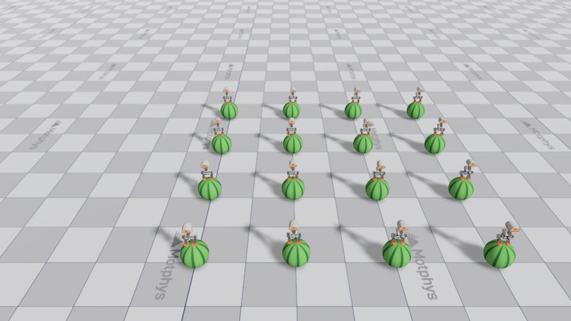
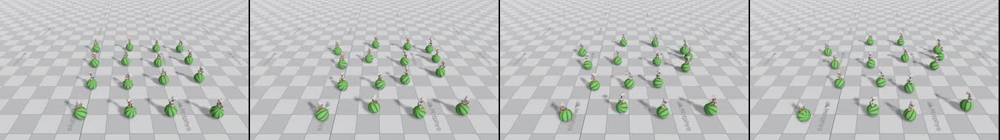
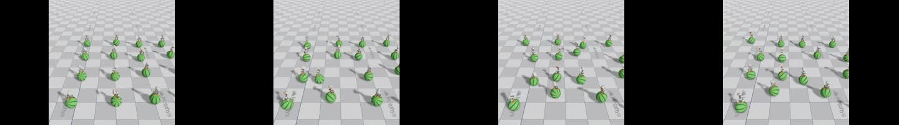
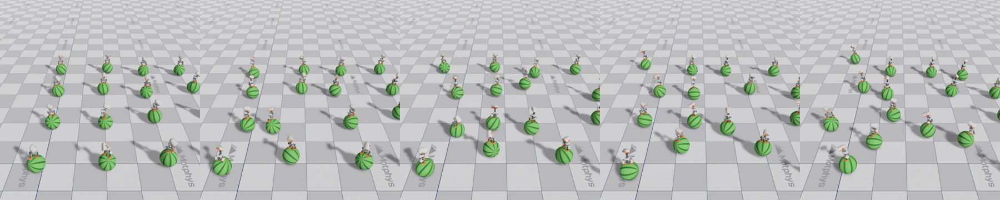
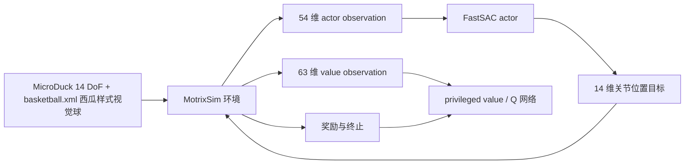

# MotrixLab：MicroDuck 球平衡与 FastSAC 训练

## 这一节解决什么问题

Every Embodied 已经有一篇基于 `microduck-playground` 的篮球平衡教程。本节补充另一条实现路线：使用 Motphys 开源的 **MotrixLab**，直接运行它内置的 `microduck-ball-balance` manager-based 任务和 Motrix FastSAC 训练器。

两条路线都在研究“鸭子站在自由滚动球面上保持平衡”，但并不是同一个 checkpoint、同一套 observation 或同一种算法。把它们并排看，反而更容易理解：**环境、观察、奖励和训练器的改变，会直接改变策略学到的控制方式。**

## 1. 官方资源和本地结果



**图 1：** MotrixLab 官方球平衡任务海报。视频资源来自 MotrixLab 文档的 `_static/videos/microduck-ball-balance.mp4`，不是本教程重新训练的结果。



**图 2：** MotrixLab 官方示例视频，适合先确认任务长什么样，再开始自己的训练。





**本地复现结果：** 使用 MotrixLab 官方 `microduck-ball-balance` 任务，在 Windows CUDA eager 路径下训练到约 5000 迭代后，从 `model_0005002.pt` 录制了 10 秒、720×720 的回放。这个 checkpoint 用来验证“环境—训练—保存—回放—视频导出”链路，不把短训练结果包装成已经收敛的最佳策略。

终止本地训练时控制台记录的状态如下，方便读者理解这个结果的强弱：

| 项目 | 本地记录 |
|---|---:|
| 训练进度 | `5,202 / 20,000` iterations |
| 最近回合 return | `+68.71` |
| 最近回合长度 | `570.6` steps |
| 采样吞吐 | `14,334 env-steps/s` |
| 回放视频 | 10 s，720×720，H.264 |

这些数字是一次 Windows 兼容路径的过程记录，不是 MotrixLab 官方基准，也不等价于跨 seed 的收敛成功率。

官方仓库：

- [MotrixLab GitHub](https://github.com/Motphys/MotrixLab)
- [MotrixLab 中文文档](https://motrixlab.readthedocs.io/zh-cn/stable/)
- [球平衡中文文档](https://motrixlab.readthedocs.io/zh-cn/latest/user_guide/envs/ball_balance.html)
- [MicroDuck 机器人模型](https://github.com/pollen-robotics/microduck)

## 2. 先澄清：任务名叫篮球，但画面里的物体是西瓜样式

用户看到的“西瓜”是有依据的：MotrixLab 官方视频和本地回放中的物体都是绿色条纹球，视觉上就是一个西瓜样式的球体。不过当前公开代码的命名仍然是 `microduck-ball-balance`、`basketball.xml`、`Basketball` 和 `basketball_visual`。这说明 **任务语义是 ball balance，源码命名沿用了 basketball，视觉材质却是西瓜样式**；不能只看文件名判断画面内容。

当前任务的物理球仍然是半径 `0.14 m`、质量 `0.45 kg` 的自由球体，条纹只是视觉 mesh/texture。因而本节已经完成的是：**直接复刻官方西瓜样式球平衡任务**。如果后续要研究“真实西瓜”的质量、惯量、摩擦或不规则外形，则需要另外建模和重新训练，不能仅仅替换贴图。

## 3. MotrixLab 的任务结构



**图 3：** MotrixLab 的球平衡调用链。这里的环境和训练后端由 MotrixLab 统一管理，和 `microduck-playground` 的 PPO/LSTM 方案是两条不同实现。

### 3.1 场景和动力学

配置文件位于：

```text
motrix_envs/src/motrix_envs/locomotion/ball_balance/microduck.py
motrix_envs/src/motrix_envs/locomotion/ball_balance/assets/basketball.xml
```

机器人基座的初始高度设置为 `0.12 + 2 × 0.14 = 0.40 m`，让双脚从球顶附近开始。这个西瓜样式球是自由刚体，不是把一个固定的“平衡台”贴在脚下；一旦脚底的水平投影偏离球心，球就会滚动，机器人必须通过全身关节重新把球拉回双脚下方。

### 3.2 Actor 和 value 的观察

MotrixLab 这个任务不是盲球 actor。actor 会读取球相对机器人坐标系的位置和速度：

| 观察项 | Actor | Value | 说明 |
|---|---:|---:|---|
| 投影重力 | 3 | 3 | 判断身体是否直立 |
| 基座角速度 | 3 | 3 | 判断倾倒趋势 |
| 球相对位置 | 3 | 3 | 球在身体坐标系中的位置 |
| 球相对速度 | 3 | 3 | 球相对机器人如何滚动 |
| 关节位置 | 14 | 14 | 相对默认姿态的偏移 |
| 关节速度 | 14 | 14 | 脚和身体的运动速度 |
| 上一动作 | 14 | 14 | 约束动作连续性 |
| 基座线速度/球世界状态 | — | 9 | value 的特权状态 |

合计为 actor 54 维、value 63 维。它与之前篮球教程中的 61 维 LSTM blind actor 不是同一接口，两个 ONNX 不能直接互换。

### 3.3 动作和底层执行器

动作是 14 维关节位置目标，通过统一的 `action_scale=0.5` 加到默认站立姿态上，再由机器人模型里的位置执行器、PD 增益和力矩限制完成底层控制。训练器输出的是控制目标，不是直接修改球的位置，也不是给球施加脚本化速度。

### 3.4 奖励和终止

配置中的主要奖励包括：

- `upright`：身体保持直立；
- `base_height`：基座高度维持在站球高度附近；
- `ball_under_feet`：球心保持在双脚中点下方；
- `dof_default`：避免关节无意义地大幅偏离默认姿态；
- `action_rate_l2`、`limits_dof_pos`：抑制抖动和撞限位；
- `undesired_contacts`：惩罚躯干等非足端部位发生不期望接触。

终止条件包括基座过低、姿态严重倾斜、球滚出脚底范围、关节角/速度异常。默认回合长度是 20 秒。物理域没有做质量、摩擦和执行器增益随机化；这里的随机性主要来自初始状态和 actor 观察噪声，因此不能直接把训练结果当成 sim-to-real 保证。

## 4. 安装与运行：使用 mxlab 入口

**2026-10-25 更新：MotrixLab 已将训练、推理和导出迁移到统一的 `mxlab` 命令。** 新版仓库没有 `scripts/train.py`，遇到 `can't open file .../scripts/train.py` 时，应更新启动命令，不需要换到 Windows，也不需要补建这个文件。Linux、Ubuntu 和 WSL 都可以训练。

以下命令对照 MotrixLab `0.4.0` 源码整理。在 MotrixLab 仓库根目录操作，避免混用其它项目的虚拟环境。建议使用 Python 3.10；当前框架声明支持 Python 3.10–3.13。

### 版本与复现基线

| 项目 | 本节新版命令 | 已有 Notebook 环境与视频基线 |
|---|---|---|
| MotrixLab 版本 | `0.4.0` | `0.4.0b0` |
| 固定 Git 提交 | [`24796cff1c00`](https://github.com/Motphys/MotrixLab/tree/24796cff1c00591bd327378df93461e1c4a9f89c) | [`d093f94fbd87`](https://github.com/Motphys/MotrixLab/tree/d093f94fbd8770e1d98a222de84915caafed40e6) |
| Python 要求 | `>=3.10,<3.14`，入门建议 `3.10` | `3.10.x` |
| MotrixSim | 该版 `motrixlab` 依赖固定为 `0.10.1` | 使用旧提交配套的 `uv.lock` |
| 训练入口 | `mxlab train` | `python scripts/train.py` |
| 策略推理入口 | `mxlab play` | `python scripts/play.py` |
| ONNX 导出入口 | `mxlab export-onnx` | `python scripts/export_onnx.py` |
| 本教程记录 | 新版命令按上述固定源码核对，启动器兼容新旧入口 | 已有训练模型、GPU/BPU 视频及旧环境入口检查 |

**新建环境按左列安装，复用已有模型与视频环境时按右列保留。** 不把两版的依赖和启动命令混用。下方安装步骤固定 Git 提交，并使用 `--frozen` 读取该提交的锁文件，避免直接跟随 `main` 更新导致入口再次变化。

先获取代码和安装 CUDA 环境，PowerShell 与 Bash 都使用下面这组命令：

```powershell
git clone https://github.com/Motphys/MotrixLab.git
cd MotrixLab
git checkout --detach 24796cff1c00591bd327378df93461e1c4a9f89c
git lfs pull
uv sync --frozen --all-packages --extra cuda
```

这里的 `cuda` extra 很重要。默认 FastSAC 的异步 collector 会请求 CUDA。依赖没有安装为 CUDA 配置时，可能出现：

```text
collector_inference_device='cuda' requested CUDA, but CUDA is unavailable
```

接着激活虚拟环境。Ubuntu / Linux / WSL：

```bash
source .venv/bin/activate
```

Windows PowerShell：

```powershell
.\.venv\Scripts\Activate.ps1
```

激活后检查入口与 CUDA：

```bash
git rev-parse HEAD
python --version
mxlab --version
python -c "import sys, torch; print(sys.executable); print(torch.__version__); print(torch.cuda.is_available())"
mxlab --help
```

按上方安装的新环境，Git 提交应为 `24796cff1c00591bd327378df93461e1c4a9f89c`，`mxlab --version` 应显示 `mxlab 0.4.0`。旧版没有 `mxlab` 命令，按表中的 Git 提交识别版本。交流报错时附上 Git 提交、Python 和 PyTorch 版本，便于对照环境。

若终端找不到 `mxlab`，可在同一环境中使用 `python -m motrixlab.cli --help`。二者调用相同入口；如果模块也找不到，先检查是否激活了上一步安装的 `.venv`。

| 操作 | 新版命令 |
|---|---|
| 查看环境 | `mxlab view env=microduck-ball-balance` |
| 训练球平衡 | `mxlab train task=microduck-ball-balance/motrix.fastsac` |
| 策略闭环推理 | `mxlab play env=microduck-ball-balance` |
| 导出 ONNX | `mxlab export-onnx run_dir=<训练目录> output=outputs/ball_balance.onnx opset=11` |

以下训练示例关闭两个 `torch.compile` 开关，使用 CUDA eager 路径，便于 Windows 和 WSL 入门。Linux 上也可以使用；安装好兼容的 Triton 后，可以恢复默认编译配置。

### 4.1 直接训练官方任务

Ubuntu / Linux / WSL，激活环境后运行：

```bash
mxlab train \
  task=microduck-ball-balance/motrix.fastsac \
  play=true \
  algo.agent.compile=false \
  algo.trainer.async_options.collector_compile=false
```

Windows PowerShell 的续行符是反引号，不是 Bash 的反斜杠：

```powershell
mxlab train `
  task=microduck-ball-balance/motrix.fastsac `
  play=true `
  algo.agent.compile=false `
  algo.trainer.async_options.collector_compile=false
```

`play=true` 表示**训练结束后**载入策略并打开仿真窗口，不是跳过训练直接推理。远程服务器没有图形桌面时使用 `play=false`，再按 4.3 节录制视频。

不要在已经安装 CUDA extra 后直接执行不带 extra 的 `uv run`，它可能重新同步默认依赖。需要由 `uv` 启动时，写成 `uv run --no-sync mxlab train ...`，复用已安装环境；需要同步 CUDA 依赖时写 `uv run --extra cuda mxlab train ...`。

默认配置位于：

```text
configs/task/microduck-ball-balance/motrix.fastsac.yaml
```

当前公开配置使用：

| 参数 | 默认值 |
|---|---:|
| 并行环境 | 2048 |
| play 环境 | 16 |
| FastSAC 学习迭代 | 20000 |
| 控制步长 | 0.02 s |
| 仿真步长 | 0.005 s |
| replay batch | 2048 |

它不是“5 到 10 分钟在任何机器上必然完成”的承诺。实际时间会受到 CUDA wheel、显卡、MotrixSim 版本、磁盘和是否打开渲染的影响。首次运行还要等待 Git LFS 资源和 CUDA kernel 缓存。

### 4.2 先做小规模 smoke test

完整训练前，先运行 64 个环境、10 轮更新，观察训练日志与模型保存。Ubuntu / Linux / WSL：

```bash
mxlab train \
  task=microduck-ball-balance/motrix.fastsac \
  num_envs=64 \
  play_num_envs=4 \
  algo.asynchronous=false \
  algo.agent.learning_starts=0 \
  algo.agent.buffer_size=8 \
  algo.agent.batch_size=64 \
  algo.agent.num_updates=1 \
  algo.trainer.num_learning_iterations=10 \
  algo.agent.compile=false \
  algo.trainer.async_options.collector_compile=false \
  play=false
```

Windows PowerShell：

```powershell
mxlab train `
  task=microduck-ball-balance/motrix.fastsac `
  num_envs=64 `
  play_num_envs=4 `
  algo.asynchronous=false `
  algo.agent.learning_starts=0 `
  algo.agent.buffer_size=8 `
  algo.agent.batch_size=64 `
  algo.agent.num_updates=1 `
  algo.trainer.num_learning_iterations=10 `
  algo.agent.compile=false `
  algo.trainer.async_options.collector_compile=false `
  play=false
```

这组参数缩小经验池并取消前 10 轮预热等待，让短程运行就能进入参数更新；同步模式便于观察日志。完整训练时移除这些小规模覆盖项，使用官方默认配置。本教程此前的旧版环境曾完成 5 轮检查并写出 `checkpoints/latest.pt`；上方表格和视频记录的是另一次训练到约 5000 轮的模型。

### 4.3 策略推理、录制与导出

训练产物写入：

```text
runs/microduck-ball-balance/motrix/torch/fastsac/<timestamp>/
```

训练结束后，载入最近一次带 `metadata.json` 的策略，持续读取仿真观测、计算动作并推进物理仿真：

```bash
mxlab play env=microduck-ball-balance num_envs=16
```

录制 10 秒、640×480 的真实推理视频，无需打开桌面窗口：

```bash
mxlab play env=microduck-ball-balance num_envs=1 record_video=true record_seconds=10 record_width=640 record_height=480
```

视频写入本次选中的训练目录 `play_video.mp4`。要指定某个 checkpoint，给 `mxlab play` 增加 `policy=/实际训练目录/checkpoints/latest.pt`，并保留训练目录中的 `metadata.json`。单独复制一个 `.pt` 文件可能缺少环境和归一化配置。

导出时指定实际训练目录，不是 checkpoint 文件：

```bash
mxlab export-onnx run_dir=runs/microduck-ball-balance/motrix/torch/fastsac/<本次训练目录> output=outputs/motrix_ball_balance_latest.onnx opset=11
```

将 `<本次训练目录>` 替换成训练输出的目录名；导出报告会打印输入输出形状和 PyTorch/ONNX 数值误差。

### 4.4 常见启动问题

- **找不到 `scripts/train.py`：** 新版改用 `mxlab train`；同样把旧 `scripts/play.py`、`scripts/export_onnx.py` 命令改为 `mxlab play`、`mxlab export-onnx`。
- **出现 `collector booting...`、`learner ready`：** 表示已进入异步训练启动流程。首次运行会编译 Numba 环境内核；继续观察 collector 日志及训练计数，不要把启动等待当成文件缺失。
- **`if-necessary-or-explicit` 警告：** 这是 `uv` 对上游预发布配置的弃用提醒，不是本次找不到文件的原因。
- **画面变成弹球示例：** `scripts/test_all_demos.py --demos bounce_ball` 启动的是另一项任务。球平衡使用 `task=microduck-ball-balance/motrix.fastsac`，平地行走使用 `task=microduck-walk-flat/motrix.fastsac`，不要混用。

本专题 [05 号 Notebook](../../03-Notebook/05_球平衡_FastSAC_ONNX_BPU.ipynb) 通过配套 `motrix_runner.py` 自动选择新版模块入口或旧版脚本入口，无需手动补建文件。已有的训练结果和视频保留；新运行使用当前 MotrixLab 环境。

## 5. 和已有篮球教程如何对照

| 项目 | `microduck-playground` 篮球任务 | MotrixLab 球平衡 |
|---|---|---|
| 训练算法 | PPO | Motrix FastSAC |
| actor | 带记忆的 LSTM blind actor | manager-based MLP actor |
| actor 是否读球状态 | 主要依赖本体感觉 | 读取球相对位置/速度 |
| 观察契约 | 61 维 recurrent 接口 | actor 54 维、value 63 维 |
| 主要用途 | 更接近公开 MicroDuck 既有策略接口 | 学习 MotrixSim + FastSAC 任务工程链路 |
| 直接互换 checkpoint | 不可以 | 不可以 |

这不是谁“替代”谁的问题。前者适合讲本体感觉和时序记忆，后者适合讲 manager-based 环境、统一配置、异步 collector 和 FastSAC。两边都需要以自己的 observation/action contract 运行。

## 6. 如果要研究“真实西瓜”物理，还需要做什么

当前官方任务已经是西瓜样式视觉球；若要进一步研究真实西瓜，而不是沿用球体近似，需要把它当成一个物理模型扩展：

1. 用 MuJoCo XML 或 mesh 定义西瓜的几何、半径、质量、惯量和摩擦；
2. 决定西瓜是自由滚动、被切平面约束，还是有局部凹槽；
3. 重新定义球相对位置/速度查询和奖励；
4. 重新检查脚底接触、基座高度和终止阈值；
5. 先跑 5–20 个环境的物理 smoke，再扩大到并行训练；
6. 只有拿到跨 seed 的稳定率和视频，才把它称为“西瓜平衡复现”。

当前仓库没有单独命名为 `watermelon` 的任务配置，因此本节不声称已经完成真实西瓜材质、质量和不规则形状的独立研究；本节复现的是官方提供的西瓜样式球平衡任务。

## 7. 参考资料

- [MotrixLab 源码](https://github.com/Motphys/MotrixLab)
- [MotrixLab 球平衡任务源码](https://github.com/Motphys/MotrixLab/blob/main/motrix_envs/src/motrix_envs/locomotion/ball_balance/microduck.py)
- [MotrixLab FastSAC 配置](https://github.com/Motphys/MotrixLab/blob/main/configs/task/microduck-ball-balance/motrix.fastsac.yaml)
- [MotrixLab 统一 CLI 入口](https://github.com/Motphys/MotrixLab/blob/main/motrixlab/src/motrixlab/cli.py)
- [Every Embodied：MicroDuck 篮球平衡 PPO 教程](../01-MicroDuck篮球平衡强化学习/README.md)
- [Pollen Robotics MicroDuck](https://github.com/pollen-robotics/microduck)
