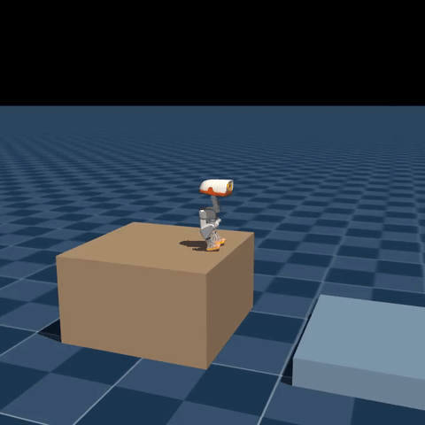

# MicroDuck 跨缝跳跃

从高平台起跳，跨过 30 cm 间隙，在低 25 cm 的目标平台落地并站稳。

打开 [第 9 本 Notebook](../../03-Notebook/09_跨缝跳跃_PPO_GPU_ONNX.ipynb)，依次体验原始模型、10 轮 PPO 续训、ONNX 导出与完整仿真视频。环境准备见[配套代码说明](../../02-可运行代码/long-jump-learning/README.md)。本实验作为拓展任务，原有 8 天与月度学习计划保持不变。

## 1. 模型与场景

使用社区发布的 `Mjlab-PlatformJump-MicroDuck` 任务。起点平台和目标平台长、宽均为 60 cm；目标顶面高 10 cm，起点顶面高 35 cm。起点前沿是 `x=0`，目标近沿是 `x=0.30`，中间地面视为落入间隙。

- [任务源码与说明](https://github.com/Vottivott/microduck-playground/tree/b6aed572587b52e41a452a9b2be517c95d2b3d96/experiments/parkour/long-jump)
- [PPO 检查点、ONNX 和配置](https://huggingface.co/HannesVonEssen/microduck-long-jump)
- [训练恢复与课程](https://github.com/Vottivott/microduck-playground/blob/b6aed572587b52e41a452a9b2be517c95d2b3d96/experiments/parkour/TRAINING.md)

Notebook 固定源码和模型版本，检查点 SHA-256 为 `114ab38724b1bea789b0d3f12a1a18a5981b40572863117e212a2a0601f9ed4a`。模型包采用 Apache-2.0；本教程运行 GPU 仿真，尚未验证实机或 BPU 部署。

## 2. 61 维观测怎样组成

| 下标区间 | 信息 | 维度 |
| --- | --- | --- |
| `[0:3]` | 身体角速度 | 3 |
| `[3:6]` | 身体坐标系重力方向 | 3 |
| `[6:20]` | 关节位置相对默认姿态 | 14 |
| `[20:34]` | 关节速度 | 14 |
| `[34:48]` | 上一步有界动作 | 14 |
| `[48:51]` | 速度与转向命令 | 3 |
| `[51:55]` | 头部命令 | 4 |
| `[55:61]` | 身体命令，前两项编码间隙与高差 | 6 |

身体命令是 `[gap / 0.3, drop / 0.3, 0, 0, 0, 0]`。它由仿真场景提供，不通过摄像头估计。

Actor 是 `61 → 512 → 256 → 128 → 14` 的 ELU MLP，不使用 LSTM。Critic 是 `74 → 512 → 256 → 128 → 1`，额外读取训练信息。Actor 输出关节目标偏移，执行器模型计算后续运动。ONNX 已包含观测归一化和动作边界，最终目标是 `joint_offset + bounded_action`。

## 3. 起跳与落地如何学习

上游 `microduck_platform_jump_env_cfg.py` 定义配置，`platform_jump_mdp.py` 定义奖励、接触和跳跃阶段：

1. 在起点支撑，积累起跳动作。
2. 双脚离开平台，进入腾空阶段。
3. 飞行后脚接触目标平台，进入落地阶段。
4. 脚触碰间隙地面、错误落点或失稳时，触发失败或终止。

`pj_launch` 与 `pj_takeoff` 鼓励起跳，`pj_progress` 鼓励向目标推进，`pj_landing` 鼓励正确落地，`pj_stand` 鼓励落地后站稳。动作变化率、关节限位、身体碰撞和摔倒项约束动作质量。

训练课程逐步扩大间隙和高差；Notebook 的视频评测固定为 30 cm / 25 cm，不把训练的课程范围当成已验证的跳跃范围。

## 4. 实际训练与结果对照

默认恢复完整 PPO 状态，在 64 个环境中更新 10 轮，每轮采样 24 个控制步，共 15,360 条 transition。原始模型保留，续训结果覆盖本教程的最新候选。

| 原始模型 | 续训 10 轮 | 导出 ONNX |
| --- | --- | --- |
|  |  |  |

视频、位置轨迹、目标平台脚部接触、身体竖直程度和终止原因均由本次仿真记录。默认使用固定种子 28，最长 12 秒，不自动挑选成功片段。完整结果保存在 `03-Notebook/outputs/long_jump/lesson_summary.json`。

本次从头执行的结果如下，记录见[实验报告](./assets/validation.json)：

| 模型 | 跨缝落地 | 回合结束时脚部支撑 | 回合长度 | 终止原因 |
| --- | --- | --- | --- | --- |
| 原始模型，GPU | 已触及目标平台 | 目标平台 | 0.96 秒 | 落地后跌倒 |
| 续训 10 轮，GPU | 完成 | 目标平台 | 12 秒 | 时间上限 |
| 续训模型导出 ONNX，CPU | 完成 | 目标平台 | 12 秒 | 时间上限 |

[ONNX 对照记录](./assets/onnx_validation.json)使用 200 条观测和 100 个实时仿真控制步，记录最大动作绝对误差。模型加载后重新按种子重置环境，再分别评测原始模型、续训候选和 ONNX；不同训练轮次和初始状态仍需分别检验。

10 轮演示采样、更新和导出流程；模型质量通过完整动作对照判断。从零训练入口在 Notebook 第 12 节，默认只展示命令，避免误启动长时间训练。

部署选择以任务评测为准：候选须完成跨缝、目标平台支撑和 12 秒回合；未通过时保留通过评测的基线，两者都未通过则停止部署。原始模型和候选视频都保留，方便比较训练前后的变化。

## 5. 复现与展示

在 Ubuntu/Jupyter 中从头运行 Notebook。模型、环境、完整 MP4 和日志放在仓库外或 `outputs/`，GitHub 保存执行输出和压缩 GIF。重复运行会重新生成视频。

Notebook 的主线使用 GPU/PyTorch；最后的 ONNX 单元使用 CPU 运行时检查导出模型的闭环接口。视频渲染和编码均由工作站完成。
