<!-- Generated by the offline translation workflow.
Source: 03-机器人硬件、lerobot及地瓜RDK-X5开发板控制教程/09犀牛派X1板卡与手柄的使用.md
Source SHA-256: ac10fd2a030d4f18dd94ef8e5b09fd6a1b4f7ba7c7e093459c9b92fe1008eae5
Model: tencent/Hy-MT2-1.8B-GGUF:Q4_K_M
Review machine-translated technical claims before relying on them.
-->
# RhinoPai X1 Card and Controller Usage Guide

## Table of Contents

- [ Tutorial on Using the Rhino派 X1 Card and Controller](#犀牛派-x1-板卡与手柄使用教程)
  - [ Directory](#目录)
  - [ System Usage](#系统使用)
    - [ Basic ADB Usage](#adb-基本使用)
      - [ Basic ADB Commands](#adb-基本命令)
    - [ Confirming IP Address](#ip-地址确认)
      - [ Getting IP Address via ADB](#通过-adb-获取-ip-地址)
      - [ Getting IP Address via Ubuntu Interface](#通过-ubuntu-界面获取-ip-地址)
      - [ WiFi Connection (Optional)](#wifi-连接可选)
    - [ Web Login](#web-登录)
      - [ Logging in via Browser](#通过浏览器登录)
    - [ SSH Login](#ssh-登录)
      - [ Logging in via SSH](#通过-ssh-登录)
    - [ File Transfer](#文件传输)
      - [ Using SCP for File Transfer](#使用-scp-文件传输)
      - [ Using AidLux File Explorer for File Transfer](#使用-aidlux-文件浏览器传输文件)
  - [ Connecting Bluetooth Controller](#连接蓝牙手柄)
    - [ Configuring Bluetooth Controller Driver](#配置蓝牙手柄驱动)
    - [ Command Line Connection to Bluetooth](#命令行连接蓝牙)
    - [ Connecting Monitor to Bluetooth](#显示器连接蓝牙)
    - [ Correct Connection Status](#正确连接状态)
    - [ Reconnecting](#重新连接)
  - [ Controller Testing](#手柄测试)
    - [ Testing Steps](#测试步骤)
    - [ Common Error Solutions](#常见报错解决方法)
  - [ Conclusion](#结语)

## System Usage

The Rhino Party X1 comes pre-installed with the Ubuntu 22.04 system by default. This section introduces common system usage features: ADB debugging, IP address verification, Web/SSH login, and file transfer.

> Official reference document: [ System Usage | APLUX Doc Center](https://rhinopi.docs.aidlux.com/rhino-x1-ubuntu/getting-started/system-use/)

### Basic Usage of ADB

ADB (Android Debug Bridge) is a command-line tool used for communication between a computer and a device. It supports app installation, debugging, file transfer, log viewing, and device control via USB or network.

> Official reference: [Basic Use of ADB | APLUX Doc Center](https://rhinopi.docs.aidlux.com/rhino-x1-ubuntu/getting-started/system-use/adb_use)

#### ADB Basic Commands

```bash
# 查看当前连接设备
adb devices

# 如果发现多个设备
adb -s 设备号 其他指令

# 安装 apk 文件
adb install xxx.apk

# 传递文件：
# 往设备 SDCard 传递文件
adb push PC端文件路径 /sdcard

# 从设备下载文件到 PC
adb pull 设备上文件路径 本地保存路径

# 进入 shell 环境
adb shell

# 重启设备
adb reboot
```

### IP Address Confirmation

#### Obtain IP address via ADB

For the installation and use of ADB, please refer to "[Basic Use of ADB ](#adb-基本使用)" above.

If a network cable has been inserted, execute the following command to get the IP address:

```bash
# 进入设备
adb shell

# 获取 IP 地址
ifconfig eth0
```

The following output can be seen:

<p align="center">
  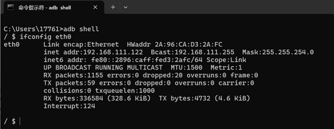
</p>

`inet addr` parameter represents the IP address of the device.

> Official reference: [ IP address acquisition | APLUX Doc Center](https://rhinopi.docs.aidlux.com/rhino-x1-ubuntu/getting-started/system-use/ip_get)

#### Obtain IP address through Ubuntu interface

When the developer can access the Ubuntu system interface, enter the following command in the Terminal to query the IP address:

```bash
# 获取 IP 地址
ifconfig eth0
```

#### WiFi Connection (Optional)

If you need to connect via WiFi, use the following command:

```bash
nmcli dev wifi connect "APLUX" password "iro2021420"
```

<p align="center">
  
</p>

After the connection is successful, obtain the IP address again:

```bash
# 获取 IP 地址
ifconfig
```

<p align="center">
  
</p>

### Web Login

After the device connects to the network, developers can log in to the system via the local area network web interface. The specific manipulation steps are as follows.

#### Log in via browser

Ensure that the computer and device are in the same local network. Enter `http://<设备IP>:8000/login` in the browser (replace `ip` with the actual IP address of the device):

- **Username / Password**: `aidlux` / `aidlux`

<p align="center">
  
</p>

> Official reference: [Web Login | APLUX Doc Center](https://rhinopi.docs.aidlux.com/rhino-x1-ubuntu/getting-started/system-use/web_login)

### SSH Login

#### Log in via SSH

Ensure that the computer and device are on the same local network. Enter the command `ssh aidlux@ip` in the Terminal (replace `ip` with the actual IP address of the device) to access the system.

- **Access password**: `aidlux`

<p align="center">
  
</p>

> Official reference: [SSH Login | APLUX Doc Center](https://rhinopi.docs.aidlux.com/rhino-x1-ubuntu/getting-started/system-use/ssh)

### File Transfer

#### Use SCP file transfer

After confirming the device IP address, files can be transferred using SCP commands:

```bash
scp -r -P2222 .\test.txt aidlux@192.168.110.194:/home/aidlux/
```

You can also use WinSCP for graphical file transfer. Download and install WinSCP:

<p align="center">
  
</p>

Open WinSCP and log in to the device using the following information:

- **Username**: `aidlux`
- **Password**: `aidlux`

<p align="center">
  
</p>

<p align="center">
  
</p>

<p align="center">
  
</p>

#### Transfer files using AidLux file browser

Access the AidLux interface via a browser and click the file browser icon:

<p align="center">
  
</p>

Click the upload button in the upper right corner to upload a file or directory into the `/home/aidlux` directory:

<p align="center">
  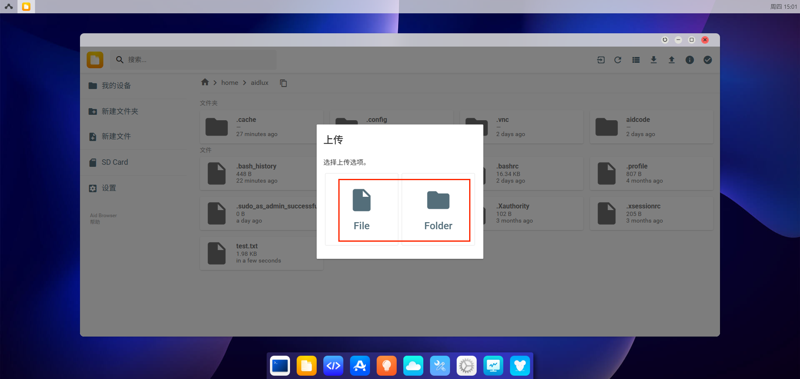
</p>

Click the download button in the upper right corner to download the files or directories under the `/home/aidlux` directory to your local device:

<p align="center">
  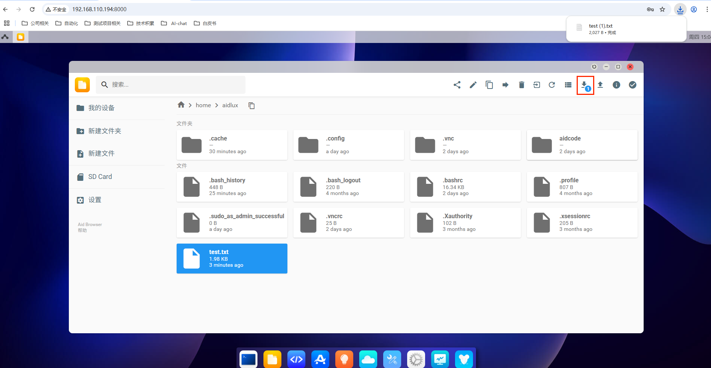
</p>

> Official reference: [ File transfer | APLUX Doc Center](https://rhinopi.docs.aidlux.com/rhino-x1-ubuntu/getting-started/system-use/file_upload)

## Connect to Bluetooth controller

This section uses the Joy-Con controller as an example to introduce the driver configuration and connection methods for Bluetooth controllers.
> Official reference: [LeRobot-JoyCon](https://rhinopi.docs.aidlux.com/rhino-x1-ubuntu/getting-started/system-use/file_upload](https://github.com/box2ai-robotics/lerobot-joycon))

### Configure Bluetooth controller driver

In the device terminal (accessible via [ SSH login to ](#ssh-登录) or by connecting an external monitor), clone and install the driver library:

```bash
git clone https://github.com/box2ai-robotics/joycon-robotics.git
```

<p align="center">
  
</p>

```bash
cd joycon-robotics
pip install -e .
```

<p align="center">
  
</p>

Install compilation dependencies (sudo password: `aidlux`):

```bash
sudo apt-get update
sudo apt-get install -y libevdev-dev libudev-dev cmake
```

<p align="center">
  
</p>

> [!IMPORTANT]
> Before executing `make install`, you need to complete the following two steps first.

1. Open `Makefile`, delete `install_nintendo` in the second-to-last line, and save the modification.

<p align="center">
  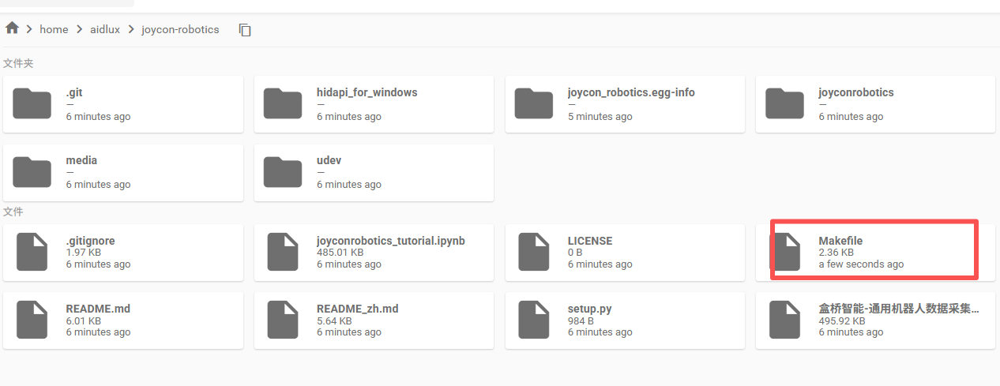
</p>

2. Create a temporary installation directory:

```bash
mkdir /tmp/joycon-install-temp
```

<p align="center">
  
</p>

After completing the above steps, perform the installation:

```bash
make install
```

<p align="center">
  
</p>

### Command-line Bluetooth connection

Check if there is a Bluetooth module:

```bash
hciconfig
```

<p align="center">
  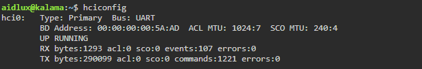
</p>

Enter the Bluetooth console:

```bash
bluetoothctl
```

<p align="center">
  
</p>

Enable Bluetooth:

```bash
power on
```

<p align="center">
  
</p>

Register the agent in sequence and start scanning:

```bash
agent on
default-agent
scan on
```

Then:

1. Enter pairing mode: Long press the circular button on the side of the Joy-Con for 3 seconds.
2. Connect to Joycon (L) or Joycon (R) in the system Bluetooth settings.

<p align="center">
  
</p>

<p align="center">
  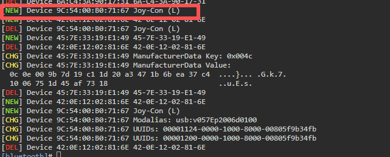
</p>

Pair and connect:

```bash
pair 12:34:56:78:9A:BC
connect 12:34:56:78:9A:BC
```

```bash
pair 9C:54:00:E0:6C:B2
connect 9C:54:00:E0:6C:B2
```

Stop scanning:

```bash
scan off
```

### Display Bluetooth Connection

If the device is connected to a monitor, it can also connect to a Bluetooth controller in the desktop environment:

1. Insert the HDMI port into the board's HDMI-OUT port.

<p align="center">
  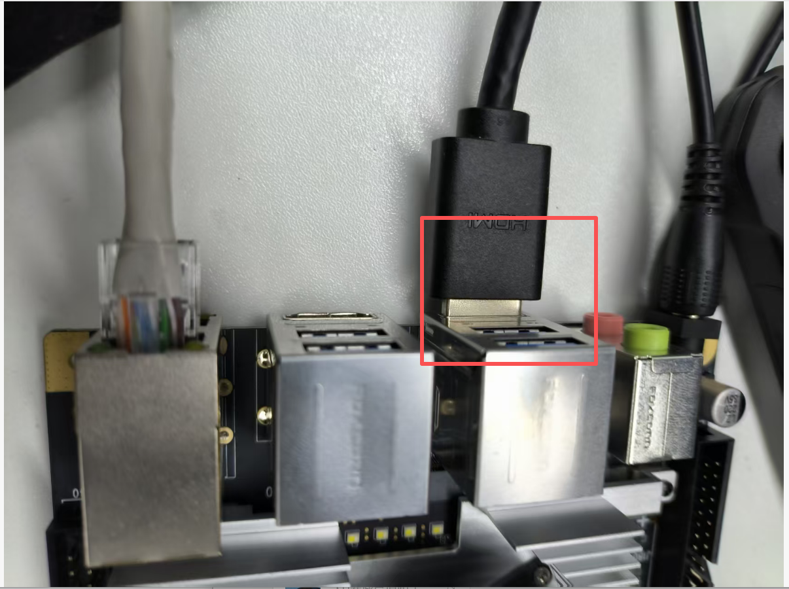
</p>

2. Insert the USB mouse and keyboard.

<p align="center">
  
</p>

3. Enter the password `aidlux` to enter the system.

4. Click on the top right corner to select Bluetooth.

<p align="center">
  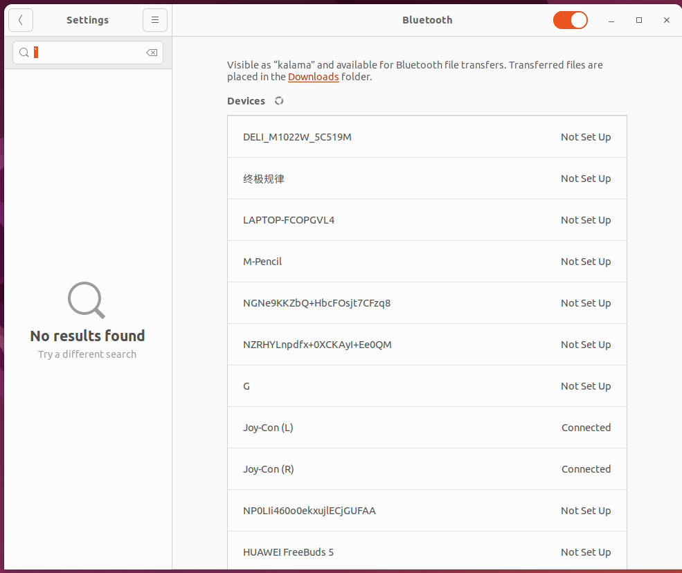
</p>

5. Enter pairing mode: Long press the circular button on the Joy-Con side for 3 seconds.

6. Connect the Joycon (L) or Joycon (R) in the system Bluetooth settings.

<p align="center">
  
</p>

### Correct connection status

1. The Joy-Con vibrates when the connection is established.
2. Single controller mode: Long press R + ZR (both shoulder buttons) for 3 seconds.
3. Dual controller mode: After both Joy-Cons vibrate, press L (top shoulder button) on the left controller and R (top shoulder button) on the right controller simultaneously.

### Reconnect

<p align="center">
  
</p>

- The paired devices will automatically reconnect by pressing the L or R key.
- After waiting for the vibration prompt, repeat step 2 above.

## Handle Testing

### Testing Steps

1. Download and install VS Code from the application center.

<p align="center">
  
</p>

<p align="center">
  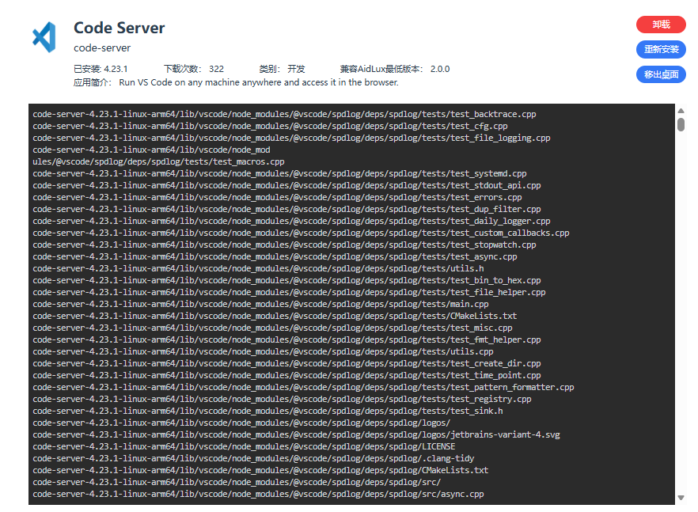
</p>

2. Open the `/home/aidlux/joycon-robotics/` folder using VS Code.

<p align="center">
  
</p>

3. Create a new Python file and enter the following test code:

```python
from joyconrobotics import JoyconRobotics
import time

joyconrobotics_right = JoyconRobotics("right")

for i in range(1000):
    pose, gripper, control_button = joyconrobotics_right.get_control()
    print(f'{pose=}, {gripper=}, {control_button=}')
    time.sleep(0.01)

joyconrobotics_right.disconnnect()
```

<p align="center">
  
</p>

4. Open the command line and execute in the `/home/aidlux/joycon-robotics/` directory:

```bash
python3 test.py
```

<p align="center">
  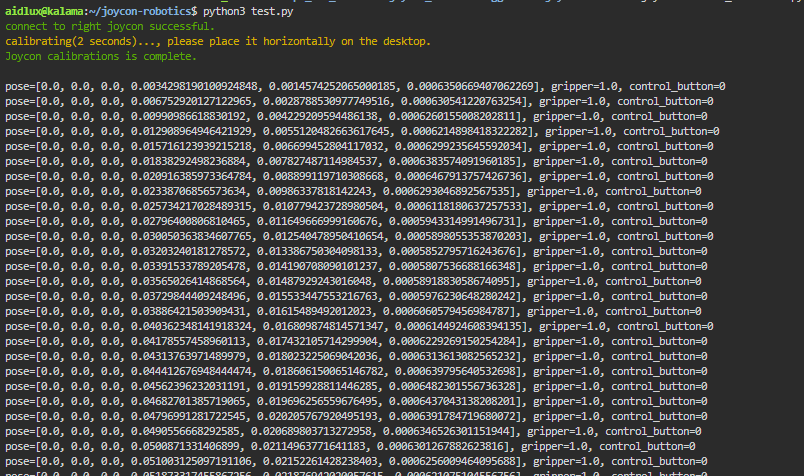
</p>

### Common Error Solutions

**Error 1: Missing `glm` module**

```text
Traceback (most recent call last):
  File "/home/aidlux/Xlebot/lerobot/examples/1.py", line 1, in <module>
    from joyconrobotics import JoyconRobotics
  File "/home/aidlux/Xlebot/lerobot/examples/joyconrobotics/__init__.py", line 1, in <module>
    from .joyconrobotics import JoyconRobotics
  File "/home/aidlux/Xlebot/lerobot/examples/joyconrobotics/joyconrobotics.py", line 5, in <module>
    from glm import vec3, quat, angleAxis
ModuleNotFoundError: No module named 'glm'
```

Run the following command to install PyGLM:

```bash
python -m pip install PyGLM
```

<p align="center">
  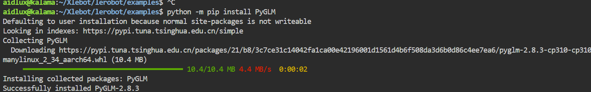
</p>

**Error 2: Missing `hid` module**

```text
Traceback (most recent call last):
  File "/home/aidlux/Xlebot/lerobot/examples/1.py", line 1, in <module>
    from joyconrobotics import JoyconRobotics
  File "/home/aidlux/Xlebot/lerobot/examples/joyconrobotics/__init__.py", line 1, in <module>
    from .joyconrobotics import JoyconRobotics
  File "/home/aidlux/Xlebot/lerobot/examples/joyconrobotics/joyconrobotics.py", line 7, in <module>
    from .joycon import JoyCon
  File "/home/aidlux/Xlebot/lerobot/examples/joyconrobotics/joycon.py", line 3, in <module>
    import hid
ModuleNotFoundError: No module named 'hid'
```

Run the following command to install hidapi:

```bash
python -m pip install hidapi
```

## Conclusion

This is all the content regarding the usage tutorials for boards and controllers. For more system usage instructions (such as monitor usage and CPU performance settings), please refer to the official documentation center:

- The [ system uses | APLUX Doc Center](https://rhinopi.docs.aidlux.com/rhino-x1-ubuntu/getting-started/system-use/)
- [ APLUX Doc Center (official documentation center) ](https://rhinopi.docs.aidlux.com/)
