<!-- Generated by the offline translation workflow.
Source: 03-机器人硬件、lerobot及地瓜RDK-X5与犀牛派X1开发板控制教程/08犀牛派X1系统准备.md
Source SHA-256: dcf5618a5ea824e86bfb0438a07fb54f739ba3ea1b92bf119b1186e6969a8a67
Model: tencent/Hy-MT2-1.8B-GGUF:Q4_K_M
Review machine-translated technical claims before relying on them.
-->
# Rhino Party X1 Beginner's Tutorial

## Table of Contents

- [ Rhinoceros Party X1 Super Novice Introduction Tutorial](#犀牛派-x1-超新手入门教程)
  - [ Directory](#目录)
  - [ How to Purchase](#如何购买)
  - [ Product Introduction](#产品介绍)
    - [ Product Overview](#产品概述)
    - [ Product Specifications](#产品规格)
    - [ Product Appearance](#产品外观)
    - [ Interface Instructions](#接口说明)
  - [ System Flashing](#系统烧录)
    - [ Flashing Preparation](#烧录准备)
    - [ Image Download](#镜像下载)
    - [ Install Tools on Computer](#安装电脑端工具)
      - [ USB Driver Installation](#usb-驱动安装)
      - [ System Flashing Tool Installation](#系统刷机工具安装)
      - [ ADB Tool Installation](#adb-工具安装)
    - [ Switch to Flashing Mode](#切换到刷机模式)
    - [ Configure QFIL's Configuration Item](#配置-qfil-的-configuration-项)
    - [ Select Flashing Port](#选择刷机端口)
    - [ Select Build Type](#选择-build-type)
    - [ Select Flashing File](#选择刷机文件)
    - [ Select Flashing XML File](#选择刷机-xml-文件)
    - [ Start Flashing](#开始刷机)
  - [ AI Application Experience](#ai-应用体验)
    - [ YOLOv5 Object Detection Deployment](#yolov5-目标检测部署)
    - [ VLM Vision-language Model Deployment](#vlm-视觉语言模型部署)
  - [ Common Questions](#常见问题)
  - [ Conclusion](#结语)

## How to Purchase

Rhino Pi-X1 can be purchased through Agah Rhino's Taobao store:

- **Purchase link**: [ Rhino Party X1 official Taobao store ](https://item.taobao.com/item.htm?id=951866832556)

Actual photos of received equipment and packaging:


<p align="center">
  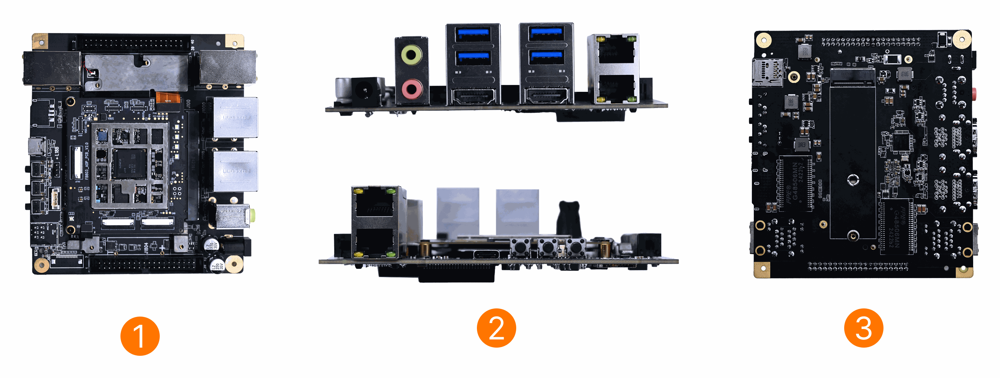
</p>

## Product Introduction

### Product Overview

Rhino Pi-X1 is a high-performance embedded computing device based on the Qualcomm® QCS8550 platform, designed for edge artificial intelligence, industrial IoT, and smart computing terminals.

Rhino Pi-X1 is equipped with Qualcomm® QCS8550 SoC and adopts a 1+2+3 tri-cluster architecture (1× Kryo Prime @ 3.2GHz, 2× Kryo Gold @ 2.8GHz, 3× Kryo Silver @ 2.0GHz), offering powerful performance and low power consumption. It features an Adreno 740 GPU and a high-efficiency AI acceleration engine, with AI computing power reaching 48 TOPS (INT8), providing excellent multimedia processing and AI inference capabilities.

X1 supports 4K/8K video encoding and decoding, multi-channel CSI camera interfaces, HDMI input/output, and Wi-Fi 7 / Bluetooth 5.3 wireless connections. It offers comprehensive interface expansion options, including USB 3.0, CAN, SPI, I2C, PWM, UART, LAN/WAN, etc. The system supports the AidLux integrated system (Android 13 + Ubuntu 22.04) or Ubuntu 22.04, providing flexible support for AI application development and edge computing deployment.

### Product Specifications

| Item | Parameter |
| --- | --- |
| Platform | Qualcomm® QCS8550 |
| AI Performance | ~48 TOPS INT8 |
| Operating System | Ubuntu 22.04 (supports AidLux integrated system: Android 13 + Ubuntu 22.04) |
| CPU | 1× Kryo Prime 3.2 GHz + 2× Kryo Gold 2.8 GHz + 3× Kryo Silver 2.0 GHz |
| GPU | Adreno 740 |
| RAM | 16GB LPDDR5X |
| Storage | 128GB |
| Video Encoding & Decoding | Decoding: 4K@240fps or 8K@60fps H.264/H.265; Encoding: 4K@120fps or 8K@30fps H.264/H.265 |
| Cameras | ×3 (MIPI CSI) |
| HDMI | HDMI OUT ×1 (HDMI 1.4, supports 1080P@60Hz); HDMI IN ×1 (HDMI 1.4, supports 4K@30Hz) |
| Wireless Connection | Wi-Fi 7 (802.11be, 2.4G/5G/6G, 2×2 MIMO); Bluetooth 5.3 |
| USB | USB-A 3.0 ×4; USB 3.0 Type-C ×1 (supports DP 1.4) |
| Audio | Line in ×1 (3.5mm); Line out ×1 (3.5mm) |
| Network Interfaces | LAN ×3; WAN ×1 |
| RTC | ×1 (CR2032, 225mAh) |
| Power Supply | DC12V 5A |
| Operating Temperature | -20℃ ~ +50℃ |
| Dimensions | 125 × 110 × 35.5 mm |
| Other Interfaces | 40PIN connector, MIPI-DSI |

### Product Appearance

<p align="center">
  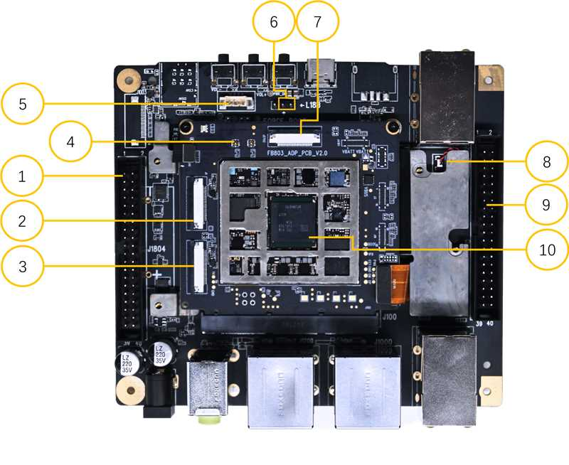
  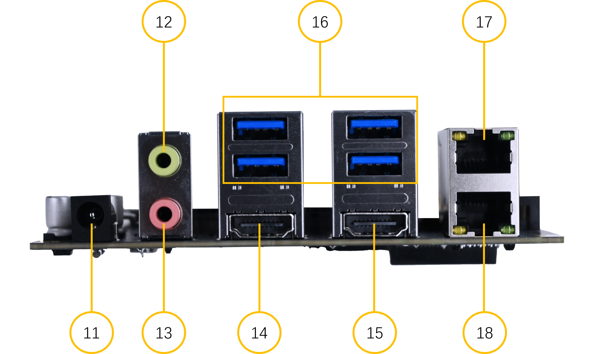
</p>

<p align="center">
  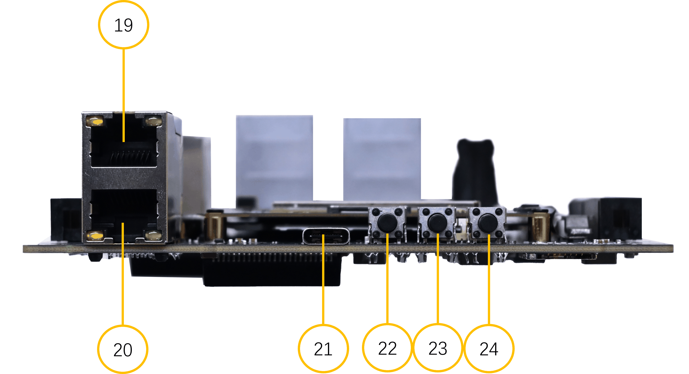
  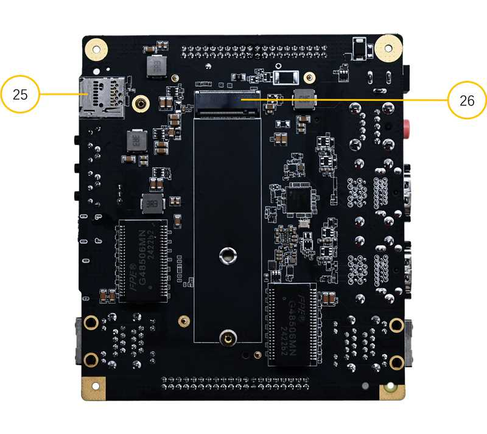
</p>

### Interface Description

| Serial Number | Interface Name | Description |
| --- | --- | --- |
| 1 | 40 PIN 3.3V GPIO | Defined as the same 40-PIN function interface as the Raspberry Pi |
| 2 / 3 / 7 | Camera Interface | MIPI CSI DPHY 4-lane interface, defined similarly to the Raspberry Pi |
| 4 | WiFi/BT Antenna | WiFi/BT antenna interface, Ipex 4 generation |
| 5 | Fan Interface | 5V fan drive interface |
| 6 | EDL Interface | For forced setting download (used in emergencies) |
| 8 | RTC Battery Interface | RTC battery interface |
| 9 | 40 PIN 1.8V GPIO | 40-PIN 1.8V GPIO expansion interface |
| 10 | QCS8550 Core Board | QCS8550 core board |
| 11 | DC_IN | Device power input, voltage range: 12V, typical value: 12V@5A |
| 12 | LINE OUT | Audio output |
| 13 | LINE IN | Audio input |
| 14 | HDMI_OUT | HDMI signal output, resolution/frame rate: 2K/120fps |
| 15 | HDMI_IN | HDMI signal input, resolution/frame rate: 2K/30fps |
| 16 | USB3.0 | 4-channel USB3.0 interface |
| 17 | WAN | RJ45 network port, capable of connecting to the internet |
| 18 | LAN | RJ45 network port |
| 19 | LAN | RJ45 network port |
| 20 | LAN | RJ45 network port |
| 21 | TYPE-C | USB TYPE-C interface |
| 22 | POWER | Power on button |
| 23 | Volume + | Volume increase button |
| 24 | Volume - | Volume decrease button |
| 25 | TF Card Interface | Micro SD card slot |
| 26 | M.2 Interface | M.2 M Key 2280 interface |

## System Burning In

This section explains how to burn the Ubuntu 22.04 system firmware and perform initialization for the Rhino Party X1.

> Official reference document: [ System Burn-in | APLUX Doc Center](https://rhinopi.docs.aidlux.com/rhino-x1-ubuntu/getting-started/system-install/)

### Burn-in Preparation

Before starting the burning, please ensure the following hardware is ready:

| Item | Description |
| --- | --- |
| Rhino Party X1 | Target device to be flashed |
| Power adapter | DC12V 5A |
| USB cable | USB TYPE-A to TYPE-C (TYPE-A connects to the computer's USB port, TYPE-C connects to the device) |
| Windows computer | Used for installing flashing tools and performing flashing |

In terms of software, developers need to prepare the following tools on a local Windows computer in advance:

- **USB driver**: `USB_Driver_qud.win.1.1_installer_10061.1.zip`
- **System flashing tool**: `QPST_2.7.496.zip`
- **ADB tool**: `platform-tools.zip`
- **Software download link**: [APLUX file center](https://file.aidlux.com/files?folder_id=eda4c1da)

### Image Download

The system image file needs to be downloaded before burning:

| Serial Number | Image Name | Version Download Path |
| --- | --- | --- |
| 1 | Rhino Party X1 Linux Image | [APLUX File Center](https://file.aidlux.com/files?folder_id=57c4dc73) |

### Install the desktop tool

#### USB driver installation

1. Unzip the `USB_Driver_qud.win.1.1_installer_10061.1.zip` file.

2. After unzipping, double-click the `setup.exe` program. Wait until the Qualcomm USB Drivers installation interface appears, and click "next" as prompted.

<p align="center">
  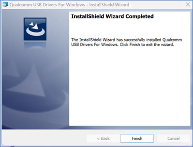
</p>

#### Installation of System Flash Tool

1. Unzip the `QPST_2.7.496.zip` file to the current folder.

2. Enter the extracted `QPST_2.7.496` directory, double-click `QPST.2.7.496.1.exe` program, and proceed with installation.

<p align="center">
  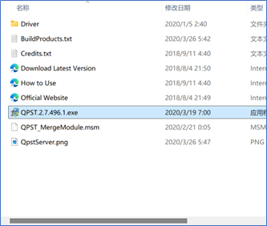
</p>

3. Follow the prompts and click "next" repeatedly to complete the installation.

4. Default path after installation: `C:\Program Files (x86)\Qualcomm\QPST\bin`. You can enter this directory and send the `QFIL.exe` program to the desktop.

<p align="center">
  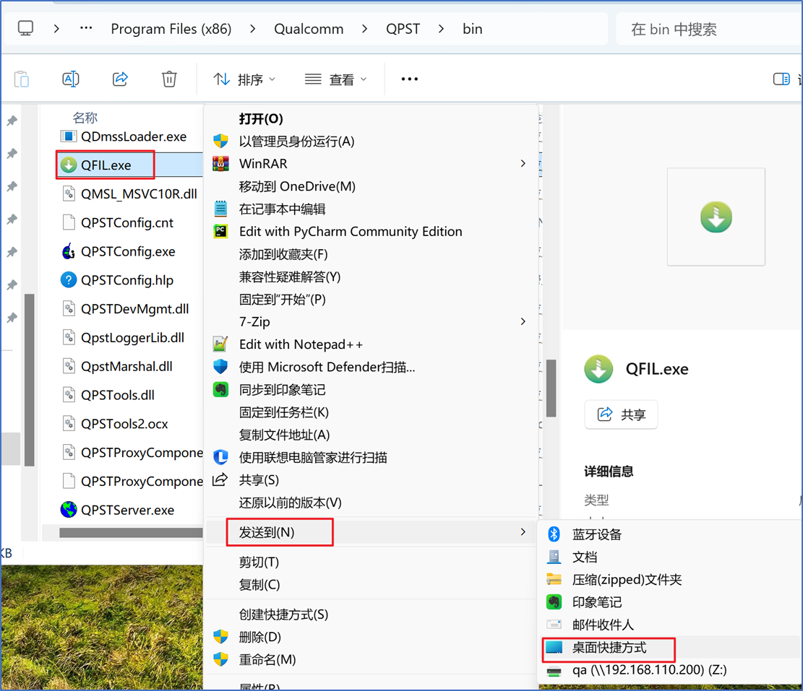
</p>

Desktop icons are as follows:

<p align="center">
  
</p>

#### ADB Tool Installation

Unzip the `platform-tools.zip` file to drive D, and then configure the adb environment variables:

1. Copy the path of the extracted platform-tools.

<p align="center">
  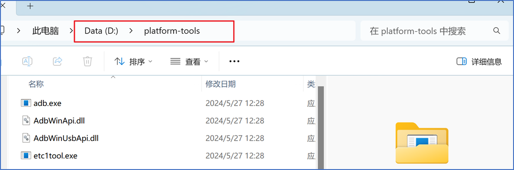
</p>

2. Right-click on "Computer-Properties".

<p align="center">
  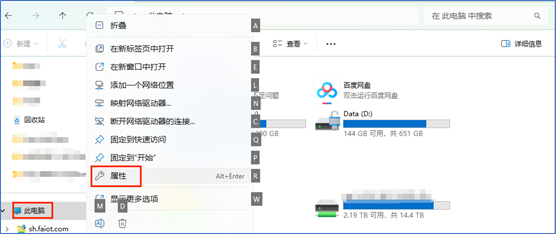
</p>

3. In the pop-up settings window, click "Advanced System Settings".

<p align="center">
  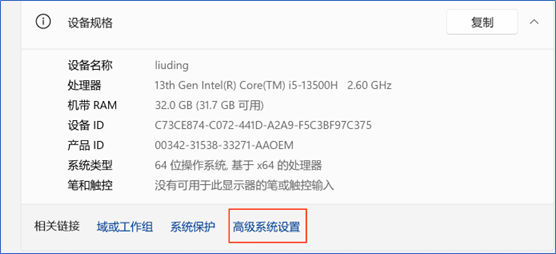
</p>

4. In the pop-up System Properties window - Advanced tab, click "Environment Variables".

<p align="center">
  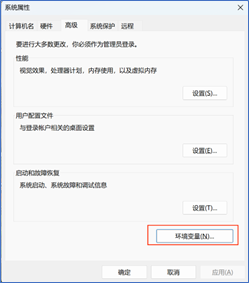
</p>

5. In the pop-up Environment Variable window, select the Path variable in the "System Variables" tab, and click "Edit" below.

<p align="center">
  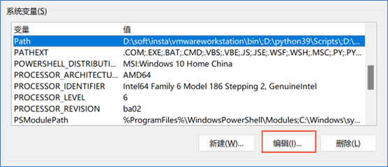
</p>

6. In the pop-up Environment Variable Editor window, click "New" and add the path to platform-tools that was copied earlier.

<p align="center">
  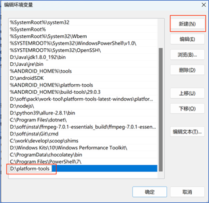
</p>

7. Click "Confirm" in order to save the set variables and exit.

Verify whether the adb environment configuration is available: Open the cmd window and enter `adb`. If there are no errors, the configuration is successful.

<p align="center">
  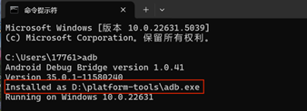
</p>

### Switch to bootloader mode

1. After the device is turned on, use a USB TYPE-A to TYPE-C cable to connect the computer and the device. The TYPE-A end connects to the USB port of the computer, and the TYPE-C end connects to the device.

2. After connecting, on the Windows computer, enter `WIN + R` and then `cmd`. Execute `adb devices` in the opened window, and the connected devices will be listed.

<p align="center">
  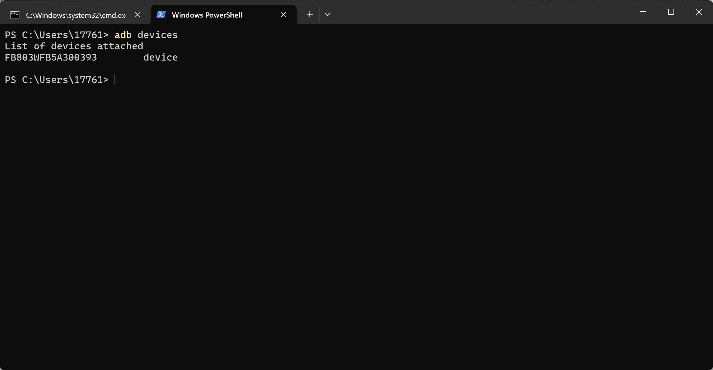
</p>

> [!TIP]
> If `adb devices` does not list the device, wait a little longer, or plug in and unplug the TYPE-C cable before executing the command.

3. Switch to the flashing mode and execute:

```bash
adb root
adb reboot edl
```

> For more information on the complete flashing process, refer to the official documentation: [ Full Package Installation | APLUX Doc Center](https://rhinopi.docs.aidlux.com/rhino-x1-ubuntu/getting-started/system-install/install_system)

### Configure the Configuration item of QFIL

- Open QFIL and click the **Configuration → FireHose Configuration** option above.

<p align="center">
  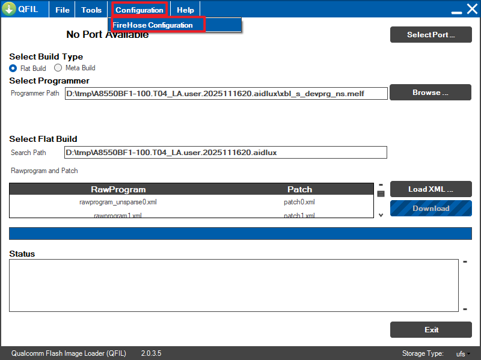
</p>

- Make the following settings in the popped-up Download Configuration window:
  - Select `0-Sahara`(https://example.com/ee_keep_0000) for Download Protocol.
  - Select `ufs`(https://example.com/ee_keep_0001) for Device Type.
  - Check the Reset After Download option.

- Other options can be kept consistent with the following screenshot:

<p align="center">
  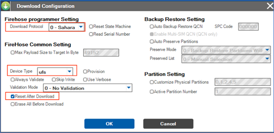
</p>

- After the configuration is completed, click OK to save it.

### Select Flash Port

- Click the Select Port option. In the pop-up window, select the 9008 port that appears, and click OK.

<p align="center">
  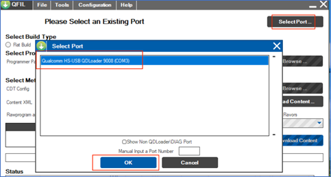
</p>

- Switch to the flashing mode ](#切换到刷机模式) through [. The window should automatically display port 9008; if it does not appear, power off and restart, then perform the switch again and wait for it to appear.

### Select Build Type

- Find the "Select Build Type" item and select "Flat Build".

<p align="center">
  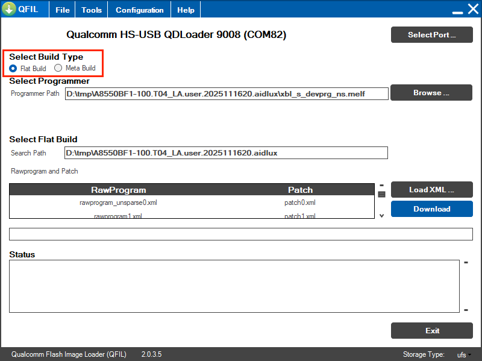
</p>

### Select flashing file

- Unzip the ROM file. Take the A8550BF1-Ubuntu-2025102910 version as an example for installation.

- Find the "Select Programmer" item, click "Programmer Path" > "Browse...", find the extraction path, and select the extracted ROM file.

<p align="center">
  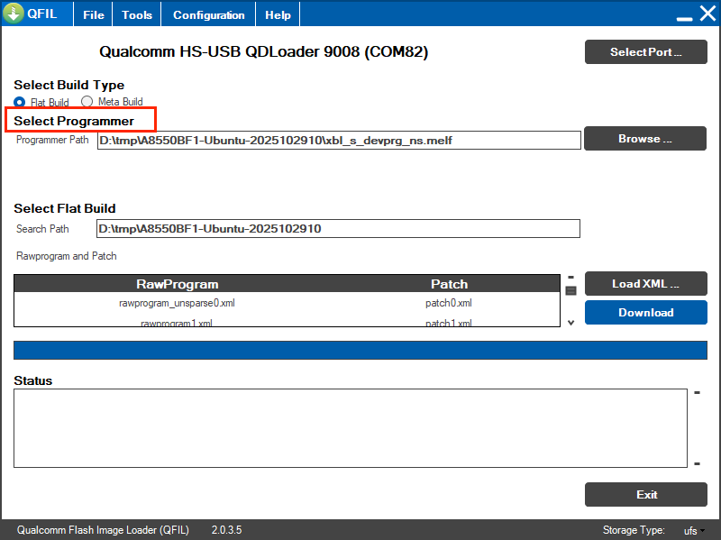
</p>

- Change the suffix of the viewing file to All Files (*.*).

<p align="center">
  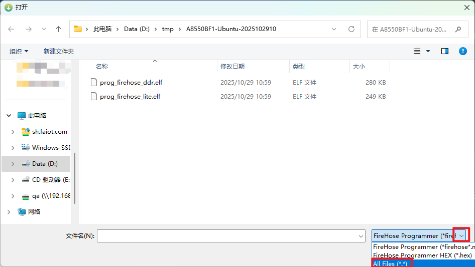
</p>

- Select the xbl_s_devprg_ns.melf file and click "Open".

<p align="center">
  
</p>

### Select the bootloader XML file

- Find the "Select Flat Build" item, click "Load XML..." below, and select the flash xml file.

<p align="center">
  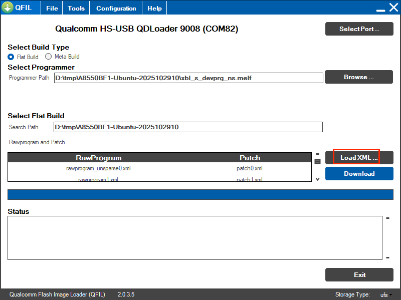
</p>

- In the pop-up window, select all files and click "Open".

<p align="center">
  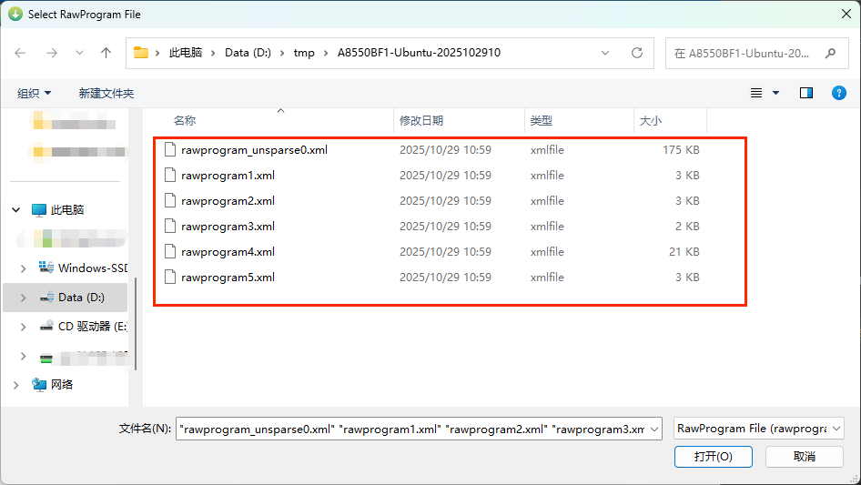
</p>

- A new window will automatically appear on the interface. Select all files and click "Open".

<p align="center">
  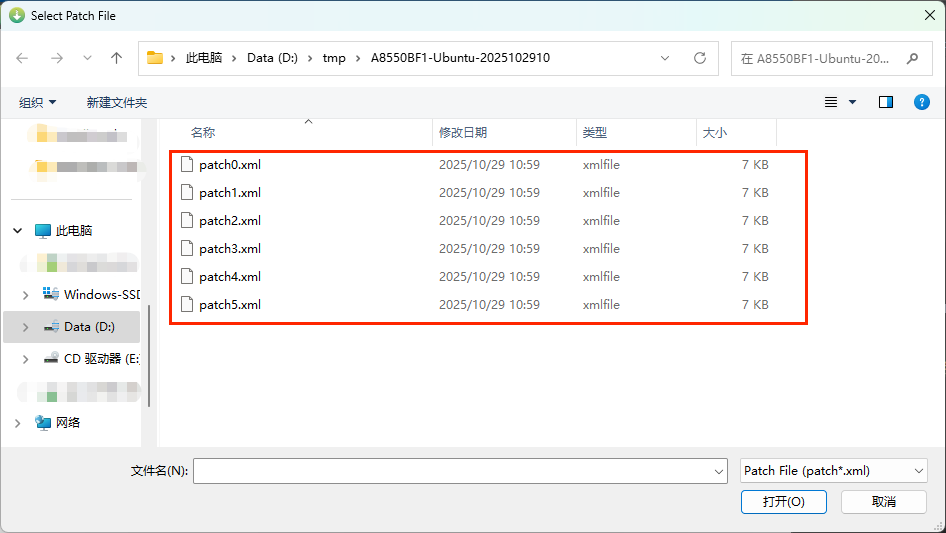
</p>

### Start flashing the firmware

- After selecting all the above options, click Download to start flashing the system.

<p align="center">
  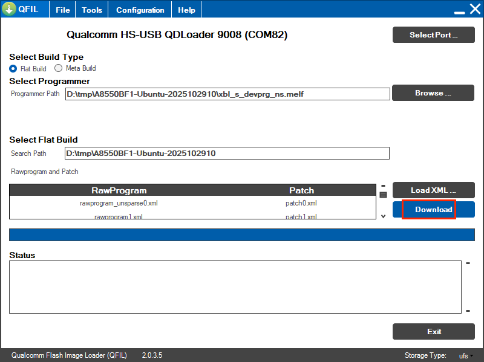
</p>

- After about 5 minutes, when "successful" appears, it indicates that the flashing is complete.

<p align="center">
  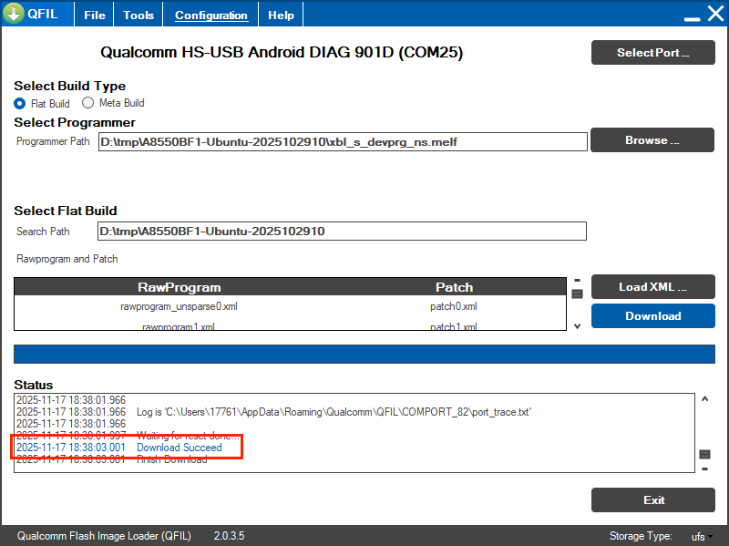
</p>

> [!WARNING]
> If the flashing fails, please contact Aga Xi's after-sales staff.

- After the flashing is completed, the system will restart automatically.

## AI Application Experience

After the system is burned and started, you can run the official AI examples to quickly experience the on-device AI capabilities of Rhino Party X1 (all reasoning is performed on the device's NPU, without the need for internet connection).

### YOLOv5 Object Detection Deployment

YOLOv5 is a single-stage structure object detection network framework. This case demonstrates the deployment, loading, and recognition process of YOLOv5s on the device. It supports two deployment methods: AidLite Python API and C++ API (INT8 quantized model).

**1. Download the YOLOv5s-INT8 model resources**

```bash
# 查询 YOLOv5s 模型
mms list yolov5s

# 下载 QCS8550 平台的 INT8 模型
mms get -m YOLOv5s -p int8 -c qcs8550 -b qnn2.31 -d /home/aidlux/yolov5s
cd /home/aidlux/yolov5s

# 解压
unzip YOLOv5s_qcs8550_w8a8.zip
```

> [!NOTE]
> Developers can also search and download model resources on the [Model Farm](https://aiot.aidlux.com/zh/models/detail/16?name=yolov5s&precisionShow=1) web page.

**2. Check / Install AidLite SDK** (Requires QNN backend version ≥ 2.31, aidlite 2.3.x)

```bash
# AidLite & QNN 版本检查
dpkg -l | grep aidlite
```

If the version is lower than required, execute the following command to update:

```bash
sudo aid-pkg update
sudo aid-pkg install aidlite-sdk
sudo aid-pkg install aidlite-qnn236
```

**3. Run the Python API example**

```bash
cd /home/aidlux/yolov5s/code

# --target_model: 模型文件路径
# --imgs: 图片输入
# --invoke_nums: 循环次数
python3 python/run_test.py \
  --target_model /home/aidlux/yolov5s/models/QCS8550/W8A8/cutoff_yolov5s_qcs8550_w8a8.qnn231.ctx.bin \
  --imgs ./python/bus.jpg --invoke_nums 10
```

After running, the model inference time and detection results can be seen in the command line, and the rendering results are output to `./python/yolov5s_result.jpg`:

```text
=======================================
QNN inference 10 times :
 --mean_invoke_time is 1.5697240829467773
 --max_invoke_time is 2.2764205932617188
 --min_invoke_time is 1.477956771850586
 --var_invoketime is 0.05570707855895307
=======================================
检测到5个区域
1 [668, 385, 141, 500] 0.86635846 person
2 [219, 407, 125, 465] 0.86257815 person
3 [55, 393, 178, 515] 0.845101 person
4 [3, 207, 812, 601] 0.8401416 bus
5 [0, 551, 73, 325] 0.5058796 person
图片保存在 ./python/yolov5s_result.jpg
=======================================
```

The test result rendering is as follows:

<p align="center">
  
</p>

> For detailed instructions and C++ API deployment, see the official documentation: [YOLOv5 Deployment | APLUX Doc Center](https://rhinopi.docs.aidlux.com/rhino-x1-ubuntu/ai-dev/tutorial/ai-dev/yolov5_aidlite)

### VLM vision-language model deployment

In addition to target detection, X1 can also run 8B-level vision-language models (VLM) without any local computation. This section takes Qwen3-VL-8B (QNN 2.48 / W4A16 quantization, approximately 5.2 GB) as an example. It is deployed based on the AidGenSE inference engine and provides an HTTP inference service compatible with OpenAI.

**1. Update and install the SDK**

```bash
# 更新软件包索引
sudo aid-pkg update

# 安装 AidGenSE（生成式 AI 推理引擎服务）
sudo aid-pkg -i aidgense

# 安装 AidGen SDK 与 QNN 运行时
sudo aid-pkg -i aidgen-sdk
sudo aid-pkg -i aidgen-qnn248
```

> [!TIP]
> `aid-pkg -i` can only install one package at a time; the installation process will interactively ask for confirmation via `[y/n]`, so simply follow the prompts.

**2. Query and download the model**

```bash
# 查看当前支持的模型（自动按板卡 SoC 过滤）
aidllm remote-list api

# 下载模型（约 5.2 GB）
aidllm pull api qwen3-vl-8b-instruct-qnn2.48-w4a16-qcs8550
```

**3. Start the inference service**

```bash
aidllm start api \
  -m qwen3-vl-8b-instruct-qnn2.48-w4a16-qcs8550 \
  -d dsp \
  --qnn_ver 248
```

> [!IMPORTANT]
> **The `qnn2.xx` in the model name is the value to be filled for `--qnn_ver`** (236 / 240 / 248). The default value for `aidllm start api` is 240. If it does not match the model, the service will remain stuck at `Api server starting...`.

After seeing `Api server start successfully.`, the service starts successfully. Verify the service status (default port 8888):

```bash
curl -s http://127.0.0.1:8888/v1/models
```

(Optional) If you want a quick experience of image conversations via the web interface:

```bash
sudo aidllm install ui
aidllm start ui    # 浏览器访问 http://<板卡IP>:51104
```

**4. Image Understanding Measurement**

After converting the image to base64, call the interface in the OpenAI multimodal message format (`image_url`) to enable image understanding. Here is the actual testing result:

<p align="center">
  
</p>

> This image shows a surfer riding on a spectacular wave. In the scene, the surfer is wearing dark surfing attire, standing on the crest of the wave with his legs slightly bent and body leaning forward... (The maximum length for a single response is 256 tokens. In actual deployment, you can increase `max_tokens` to get a complete response.)

> For the complete deployment process and actual performance results, refer to the supporting documents: [ "Deploying Qwen3-VL-8B on Rhino Pi-X1" ](11-rhino-party-x1-deploys-vlm-method.md); official tutorial: [ Using AidGen to deploy VLM ](https://rhinopi.docs.aidlux.com/software/tutorial/genai-dev/vlm_chat_aidgen)

## Common Questions

**Q: Why can't I find port 9008 during flashing?**

After powering off and restarting the device, repeat step "[ switch to flashing mode ](#切换到刷机模式)" (`adb root; adb reboot edl`), and continue the operation after the port appears.

**Q: Why isn't the device listed for `adb devices`?**

Wait for a while longer, or plug in and unplug the TYPE-C cable and then run the command again; also ensure that the USB driver is properly installed.

**Q: What if the flash fails?**

Please contact Agari after-sales staff to handle this issue.

> For more questions, please refer to the official documentation: [ Common Questions | APLUX Doc Center](https://rhinopi.docs.aidlux.com/rhino-x1-ubuntu/faq/)

## Conclusion

This is all the content of the Ryno Party X1 beginner tutorial. After completing the system flashing, you can continue to run end-side AI examples such as YOLOv5 and Qwen3-VL, or visit the official documentation center to explore more hardware, system, and AI development materials.

- [ APLUX Doc Center (Official Documentation Center) ](https://rhinopi.docs.aidlux.com/)
