<!-- Generated by the offline translation workflow.
Source: 03-机器人硬件、lerobot及地瓜RDK-X5与犀牛派X1开发板控制教程/10犀牛派X1机械臂的遥操控制.md
Source SHA-256: 7fa5594ab2980c144d23deb212b74e7231f845b19ae6fd94797ff83fc9dd6422
Model: tencent/Hy-MT2-1.8B-GGUF:Q4_K_M
Review machine-translated technical claims before relying on them.
-->
# RhinoPai X1 robotic arm remote manipulation tutorial

This article describes the complete process of **manipulation setup → parameter calibration → remote manipulation via controller** on RhinoPai X1.

> [!NOTE]
> Before reading, please complete the **Joy-Con controller driver installation and Bluetooth connection** in 《[ Rhino Party X1 Card and Controller Usage Guide ](09-use-of-rhino-party-x1-board-and-controller.md)》, and ensure that the controller can be recognized by the card properly.

> Official reference: [ Robot Application Development | APLUX Doc Center](https://rhinopi.docs.aidlux.com/rhino-x1-ubuntu/robot-dev/)

## Table of Contents

- [ Environment setup ](#环境搭建)
  - [ Connect the robotic arm ](#连接机械臂)
  - [ Change device permissions ](#更改设备权限)
  - [ Install Python dependencies ](#安装-python-依赖)
- [ Run code to manipulate the robotic arm ](#运行代码操控机械臂)
  - [ Download the code ](#下载代码)
  - [ Copy the handle control library ](#复制手柄控制库)
  - [ Test the handle ](#测试手柄)
  - [ Calibrate the robotic arm ](#机械臂标定)
  - [ Remote manipulation of the handle ](#手柄遥操作)
- [ Remote control instructions ](#遥控说明)
- [ Problem resolution ](#问题解决)
- [ Conclusion ](#结语)

## Environment Setup

### Connect the robotic arm

1. Connect the robotic arm and power it on first:

<p align="center">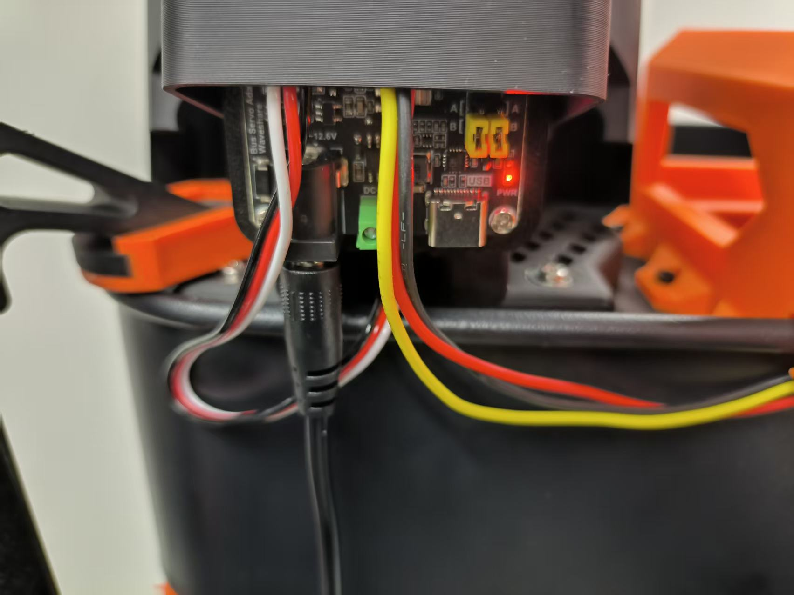</p>

2. Insert the USB control cable, **first connect the left arm, then the right arm** (otherwise the robotic arm cannot be configured):

<p align="center">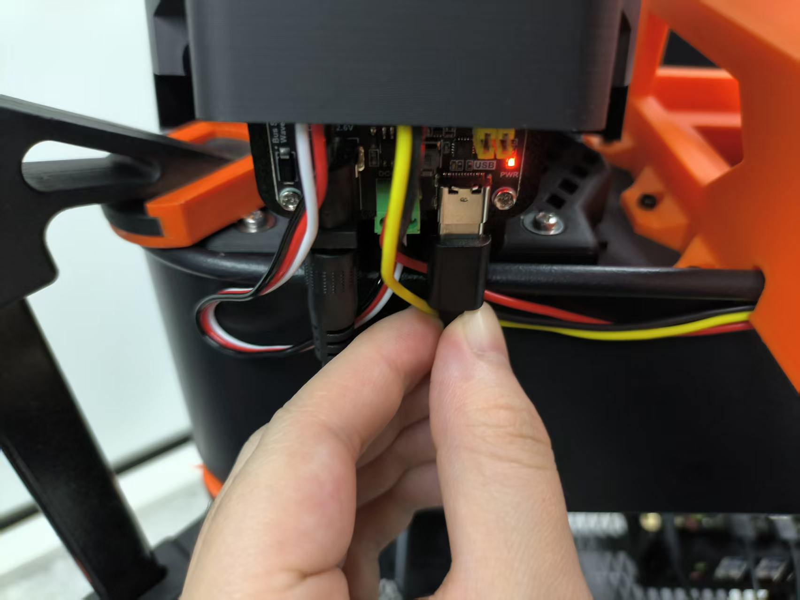</p>

<p align="center">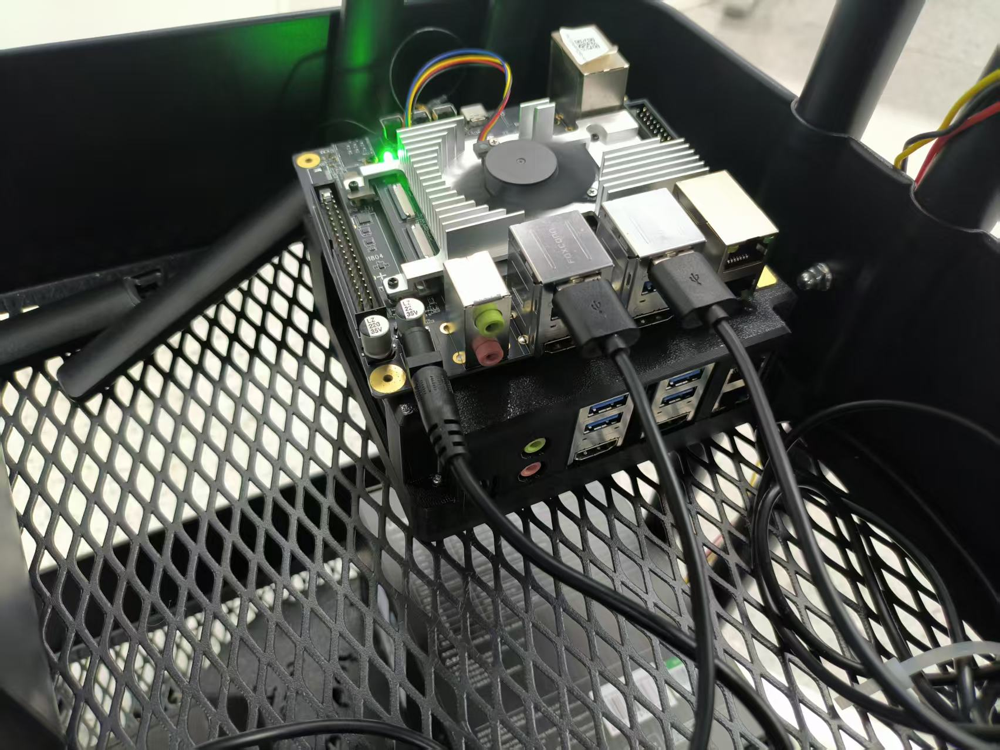</p>

> [!IMPORTANT]
> The USB control cable must be inserted into the **left arm first, then the right arm**. A wrong order will prevent the robotic arm from being configured properly.

### Change device permissions

Check the CH343 serial port device recognized by the system:

```bash
sudo dmesg | grep ttyCH343
```

<p align="center">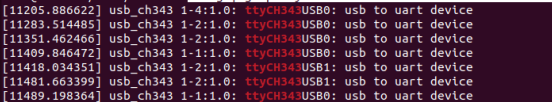</p>

```bash
ls /dev/ttyCH343USB*
```

Normal output should be:

```text
/dev/ttyCH343USB0  /dev/ttyCH343USB1
```

<p align="center"></p>

Grant read and write permissions to two serial port devices:

```bash
sudo chmod 666 /dev/ttyCH343USB0
sudo chmod 666 /dev/ttyCH343USB1
```

> [!NOTE]
> `ttyCH343USB0` / `ttyCH343USB1` correspond to the insertion order (left arm first, right arm later); after re-plugging or restarting the device, the above authorization command needs to be executed again.

> Official reference: [USB to serial device | APLUX Doc Center](https://rhinopi.docs.aidlux.com/rhino-x1-ubuntu/robot-dev/peripheral/serial-port-device)

### Install Python dependencies

Install lerobot:

```bash
pip install lerobot
```

<p align="center">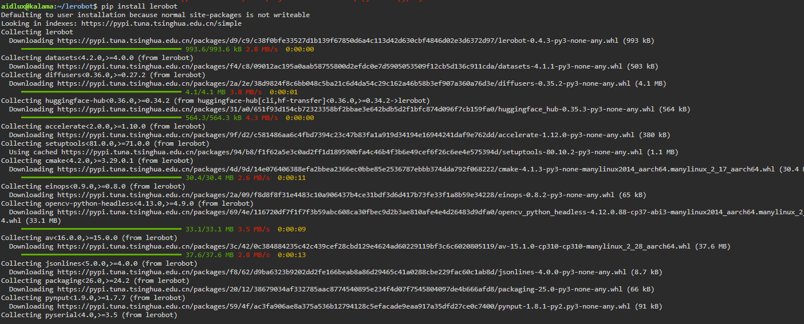</p>

Install the servo SDK (specify the `1.0.0` version):

```bash
pip install feetech-servo-sdk==1.0.0
```

<p align="center">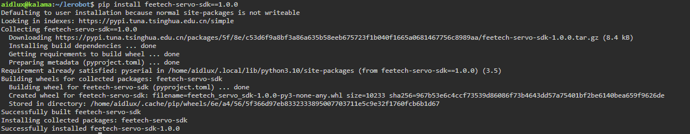</p>

## Run code to control the robotic arm

### Download code

XLeRobot-X1 Code repository address: [APLUX-Official/XLerobot-X1 (Code_Resources/XLeRobot-X1) ](https://github.com/APLUX-Official/XLerobot-X1/tree/main/Code_Resources/XLeRobot-X1)

### Copy the controller control library

Copy `/home/aidlux/joycon-robotics` to `/home/aidlux/lerobot/examples`:

```bash
cp -r /home/aidlux/joycon-robotics /home/aidlux/lerobot/examples/
```

> [!NOTE]
> `joycon-robotics` is the Joy-Con controller library. For installation instructions, see 《[ Rhino Party X1 Card and Controller Usage Guide](09-use-of-rhino-party-x1-board-and-controller.md)》.

### Test Handle

Create a `1.py` file under `/home/aidlux/lerobot/examples/`, with the following content:

```python
from joyconrobotics import JoyconRobotics
import time

joyconrobotics_right = JoyconRobotics("right")

for i in range(1000):
    pose, gripper, control_button = joyconrobotics_right.get_control()
    print(f'{pose=}, {gripper=}, {control_button=}')
    time.sleep(0.01)

joyconrobotics_right.disconnnect()
```

<p align="center">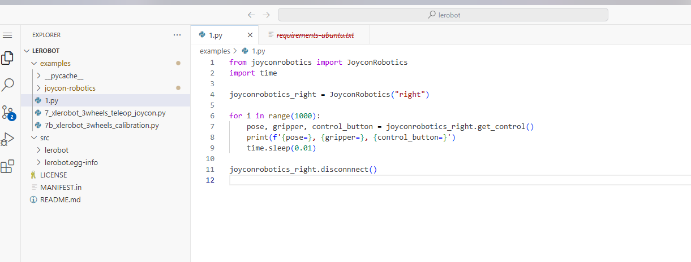</p>

Run the code:

<p align="center">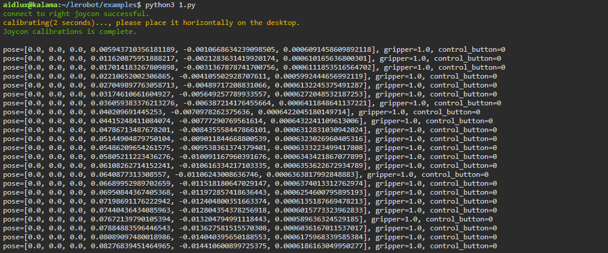</p>

### robotic arm calibration

Enter the example directory and run the calibration script to create a calibration file. Enter `y` according to the prompts:

```bash
cd /home/aidlux/lerobot/examples
python3 7b_xlerobot_3wheels_calibration.py
```

<p align="center">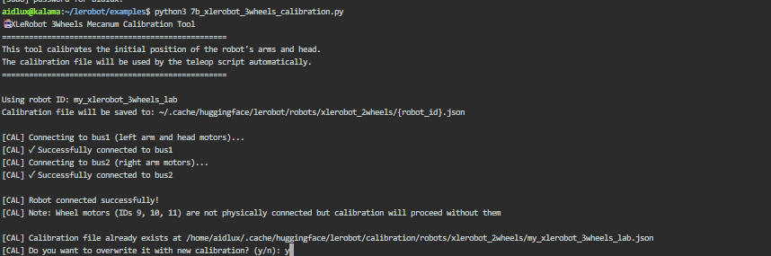</p>

> [!WARNING]
> Do not move the servo too quickly during calibration. Please move each joint of the robotic arm slowly.

Calibration process:

1. Adjust the left arm:

<p align="center">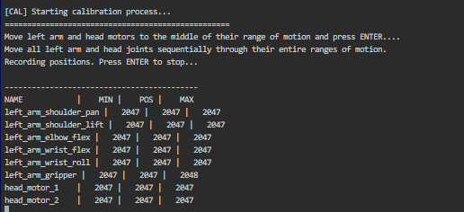</p>

Calibrate each joint of the robotic arm (note: the position definitions below are for reference only). Press Enter to enter calibration for the right arm:

<p align="center">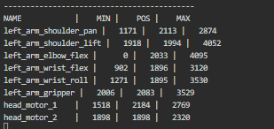</p>

2. Adjust the right arm:

<p align="center">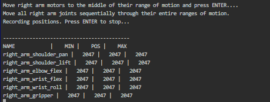</p>

Calibrate each joint of the robotic arm (note: the position definitions below are for reference only). Press Enter to complete the calibration:

<p align="center">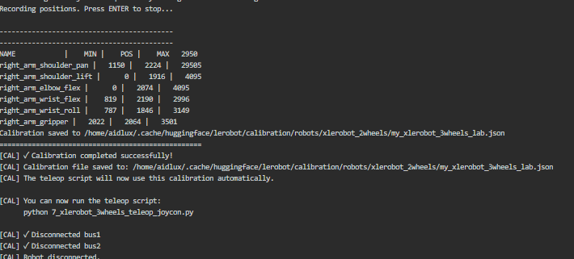</p>

### Handle Remote Manipulation

Run remote manipulation script and manipulate the robotic arm using the controller:

```bash
python3 7_xlerobot_3wheels_teleop_joycon.py
```

Enter `n` to indicate whether to recalibrate (since it has already been calibrated):

```text
Do you want to re-calibrate the robot now? (y/n): n
```

<p align="center">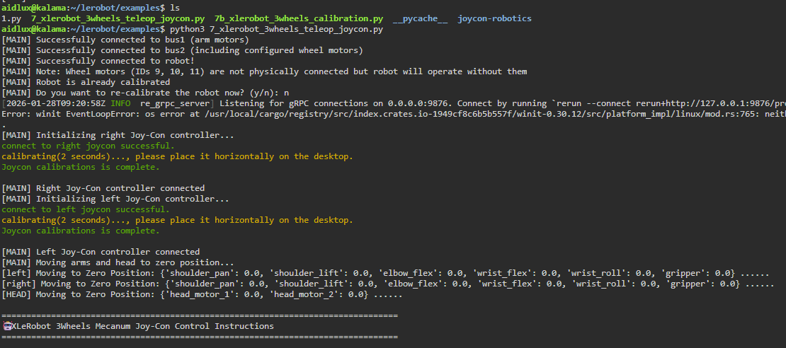</p>

## Remote Control Instructions

### Chassis Control (Mecanum Wheel Drive)

| Key | Function |
| --- | --- |
| X button | Forward |
| B button | Backward |
| Y button | Rotate left |
| A button | Rotate right |

### Right arm control

| Manipulation | Function |
| --- | --- |
| Vertical Joystick | Controls the movement (front/back) of the X and Z axes |
| Horizontal Joystick | Controls the movement (left/right) of the Y axis |
| R Button | Raises the Z axis |
| Right Joystick Button | Lowers the Z axis |
| ZR Button | Gripper control: Hold to switch between opening and closing, continue holding for linear opening/closing |

### Left Arm Control

| Manipulation | Function |
| --- | --- |
| Vertical Joystick | Controls the movement (front/back) of the X and Z axes |
| Horizontal Joystick | Controls the movement (left/right) of the Y axis |
| L Button | Raises the Z axis |
| Left Joystick Button | Lowers the Z axis |
| ZL Button | Gripper control: Hold to switch between opening and closing, continue holding for linear opening/closing |

### Head control (left Joy-Con D-pad)

| Manipulation | Function |
| --- | --- |
| Up / Down | Control head motor 2 +/- |
| Left / Right | Control head motor 1 +/- |

### Reset Function

Press the reset button on the Joy-Con (the Home button on the right Joy-Con or the O button on the left Joy-Con) to reset the robot to zero position.

<p align="center"></p>

## Problem Solving

### Problem 1: Prompt indicates serial connection failure

The error message indicates that this interface is missing:

```text
Could not connect on port '/dev/ttyCH343USB0'. Make sure you are using the correct port.
Try running `lerobot-find-port`
```

<p align="center">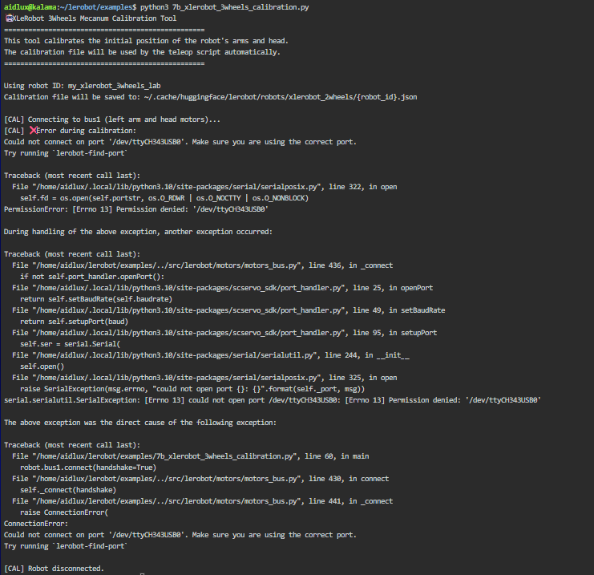</p>

**Solution**: Ensure that the robotic arm has the connection cable attached and the insertion order is correct (left arm first, right arm later); if not, unplug it again and re-authorize the serial port:

```bash
sudo chmod 666 /dev/ttyCH343USB0
sudo chmod 666 /dev/ttyCH343USB1
```

<p align="center"></p>

### Problem 2: The robotic arm does not move to the preset position after calibration

If `7_xlerobot_3wheels_teleop_joycon.py` is executed after calibration, and the robotic arm does not move to the preset position, please re-calibrate. Move the robotic arm joints slowly during the calibration process.

## Conclusion

- XLeRobot-X1 code repository: [APLUX-Official/XLerobot-X1 (Code_Resources/XLeRobot-X1) ](https://github.com/APLUX-Official/XLerobot-X1/tree/main/Code_Resources/XLeRobot-X1)
- Hardware description: [USB to serial port device | APLUX Doc Center ](https://rhinopi.docs.aidlux.com/rhino-x1-ubuntu/robot-dev/peripheral/serial-port-device)
- Related documents: [Nihux X1 board and controller usage guide ](09-use-of-rhino-party-x1-board-and-controller.md)
