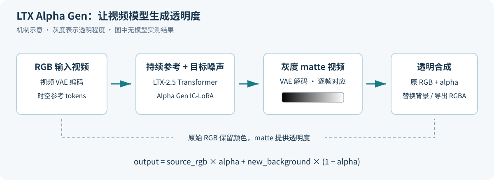

<!-- Generated by the offline translation workflow.
Source: 04-具身场景的计算机视觉、3D重建/05-LTX-Alpha-Gen视频抠像与透明合成.md
Source SHA-256: e2eaa23d1fa9e176cd9a572928b098e2b95a8f4088157d430e31b09888f8f05c
Model: tencent/Hy-MT2-1.8B-GGUF:Q4_K_M
Review machine-translated technical claims before relying on them.
-->
# 05-LTX Alpha Gen: Video cutout, translucent edges and transparent synthesis

For a normal video, retain the hair strands of the characters, the thin edges of the smoke, and the transparent transitions of the flames, and then place the main subject on a new background. **LTX-2.5 Alpha Gen** represents this task as "generating a transparent video based on an RGB video", providing an open weight path for video material layering and offline visual data processing.

This chapter follows [ SAM segmentation and monocular depth estimation ](01-sam-and-depth-estimation.md) and [ Locate Anything visual language localization ](04-locate-anything-visual-language-localization.md), to further understand the differences between segmentation and compositing, and to learn how to generate alpha matte and synthetic transparent videos using the official ComfyUI workflow or Python pipeline.

This chapter is based on the official release materials and source code dated 2026-10-21. The code reading, dimension calculation, and e-book construction checks have been completed; pre-processing and ProRes 4444 transparent export were verified using synthetic materials on a CPU. Details are recorded in [; command check is performed via ](../../04-具身场景的计算机视觉、3D重建/assets/ltx-alpha-gen/command-check.json). The GPU inference steps are for readers to execute and are not included as local measurement results.

## 1. First, see what it outputs

The input of Alpha Gen is a normal RGB video, and the output is a grayscale **alpha matte** that aligns with the input frame by frame:

| Color on the transparency map | Value | Role during synthesis |
| --- | ---: | --- |
| Black | 0 | Use a new background |
| White | 1 | Keep the foreground intact |
| Gray | Between 0 and 1 | Mix the foreground and background proportionally |

The edges of hair, smoke, flames, sheer fabrics, and motion blur contain a large number of intermediate values. Continuous transparency allows these areas to blend naturally into the new background. Compared to simply answering "Which object does this pixel belong to?", segmentation requires also answering "What proportion of foreground elements does this pixel contain?"



Figure 1: A schematic diagram of the mechanism drawn in this tutorial, showing the data flow, not the actual model output. The actual example can be viewed in the [ official model card ](https://huggingface.co/Lightricks/LTX-2.5-22b-IC-LoRA-Alpha-Gen).

The ideal image synthesis relationship is:

$$
C = \alpha F + (1-\alpha)B
$$

Here, $C$ represents the observed pixels, $F$ is the foreground color, $B$ is the background color, and $\alpha$ is the transparency. It is officially recommended to use the predicted matte as the alpha of the original RGB video:

```python
output = source_rgb * alpha + new_background * (1 - alpha)
```

The original RGB video handles colors, while grayscale matte handles transparency. The generated black-and-white MP4 does not have a transparent channel encapsulated, so it needs to be used in a compositing software or further output as a format with alpha such as ProRes 4444.

## II. Its Position in the Embodied Visual Chain

| Module | Typical Input | Typical Output | Suitable for |
| --- | --- | --- | --- |
| Locate Anything | Image, natural language | box / point | Locate specified targets |
| Segmentation models such as SAM | Image, point, or box | Target region mask | Instance selection, region extraction |
| Alpha Gen | RGB video | Continuous transparency video | Preserving fine edges, material layering, background synthesis |
| Depth estimation / RGB-D | Image or sensor data | Depth | Restoring spatial geometric information |

The value of Alpha Gen in the embodied direction mainly lies in **offline visual material processing**: such as extracting the visual layers of robots or objects, creating teaching demonstrations, and attempting data augmentation with background changes. When using the synthesized materials for policy training, annotation should be processed simultaneously, and it is necessary to observe whether transparent edges and new backgrounds alter task cues.

The currently available adapter automatically identifies the subject, and cannot select a specific object through text, clicking, or inputting a mask. If there are multiple people or objects in the scene, it is necessary to confirm whether the selected foreground matches the task requirements. It outputs transparency only; it does not provide depth, grasping pose, or robot motion.

## III. What is the relationship between projects, papers, and code?

| Material | Entry Point | Usage Method in This Chapter |
| --- | --- | --- |
| Alpha Gen 0.9 Model | [Hugging Face](https://huggingface.co/Lightricks/LTX-2.5-22b-IC-LoRA-Alpha-Gen) | Check weights, recommended settings, and input ranges |
| Alpha Gen Official Documentation | [Alpha Gen Beta](https://docs.ltx.io/open-source-model/vfx-post-production/alpha-gen) | Compare with Python and ComfyUI release guidelines |
| Base Model | [LTX-2.5](https://huggingface.co/Lightricks/LTX-2.5) | Provides components such as Transformer, VAE, and text encoder |
| Official Python Implementation | [Lightricks/LTX-2](https://github.com/Lightricks/LTX-2) | Read reference conditions, reasoning, and general training framework |
| ComfyUI Nodes | [ComfyUI-LTXVideo](https://github.com/Lightricks/ComfyUI-LTXVideo) | Import official single-stage workflows |
| Basic Paper | [LTX-2: Efficient Joint Audio-Visual Foundation Model](https://arxiv.org/abs/2601.03233) / [PDF](https://arxiv.org/pdf/2601.03233) | Understand the audio-visual generation backbone |

As of the verification date, no independent papers on Alpha Gen have been found in official references or arXiv searches. The associated LTX-2 paper was published on 2026-01-06, with 14 pages, and focuses on joint audio-video generation. Currently, Alpha Gen is based on the later released LTX-2.5 22B model, and video denoising is performed using IC-LoRA. When reading this, it is important to distinguish between the infrastructure and the specific denoising adapter.

The main design of the LTX-2 paper includes: independent VAEs for video and audio, asymmetric dual-stream Transformer, bidirectional audio-video attention, multi-layer text features and thinking tokens, as well as guidance that can be adjusted separately for text and cross-modal effects. Alpha Gen uses empty prompt words and generates target videos by referencing reference videos.

## IV. Why Video Generation Models Can Perform Blurring

### 4.1 Represent Transparency as a Video Too

The RGB input is first encoded into latent tokens using a video VAE. The generated grayscale matte is also represented in video latent form. It is generated step by step starting from noise, and then decoded by VAE to obtain black-and-white video.

In this way, the spatiotemporal expression capabilities originally used for video generation can be utilized for transparency estimation. The reference video input throughout the denoising process provides the content and position conditions for each frame in the output.

### 4.2 IC-LoRA: Processing reference tokens and target tokens together

IC is In-Context. The public code combines the reference video token and the target token into the same sequence, exchanging information through attention:

- **The reference section remains clean.** The denoising mask for the reference token is set to 0, which is used as a continuous condition.
- **The target section is denoised step by step.** The model generates a matte latent under the reference conditions.
- **Coordinates are maintained accordingly.** Time and spatial position encodings place the reference in the target coordinate system; the reference space scaling factor given by the Alpha Gen model card is 1.

LoRA adapts the base model using a low-rank matrix and can be written as $W' = W + sBA$. It reduces the number of training parameters required for task adaptation; inference still requires running a large base Transformer, and the resource requirements for the entire process cannot be estimated with a "small adapter file".

### 4.3 Reading the objective function from general training code

The current V2V configuration uses `FlexibleStrategy`: noise is added to the target latent, while the reference latent remains unchanged. The loss is calculated only for the generated target part.

$$
z_\sigma=(1-\sigma)z_{target}+\sigma\epsilon,\qquad
v_{target}=\epsilon-z_{target}
$$

The training uses the masked MSE on the target token. By treating RGB as reference and matte as target, the basic structure of this task can be understood. The public materials do not provide the composition of the Alpha Gen-specific training set, the complete training configuration, or the dedicated loss; the rank equivalents in the general template should not be directly regarded as the actual training parameters. The model card explicitly states that the checkpoint is at the 25,000th training step.

## 5. First, select computing resources and experience routes

**This is a video processing route that deviates from the standard.** High-definition clips require more memory and computation, and the actual time consumption varies depending on resolution, frame rate, quantization method, and unloading policy.

| Requirement | Resource information for reference | Selection suggestions |
| --- | --- | --- |
| Understand the functionality first | Read the official examples and this chapter’s workflow | No weight download required |
| Local small segment experience | Reduce resolution and shorten duration; consider quantization and CPU offloading when memory is limited | Start with 960×544, 49, or 121 frames |
| High-definition full specification | The official model cards indicate that 1080p, 145 frames require H100/B200-level GPUs | Check the memory first, then try the maximum configuration |
| Cameras, live streaming, or robots online processing | Use the current release route for multi-step diffusion on video segments | Plan for offline processing |

The component download volume listed in the official basic inference example is approximately 66GiB, which is storage capacity, not the actual VRAM usage. Based on an estimate of 22B parameters and 2 bytes per BF16 parameter, the parameter storage amounts to about 44GB. Operation also involves other components, intermediate activations, and workpaces. Quantization and on-demand loading can reduce the weight of simultaneously resident VRAM, but they alter the deployment method and time consumption.

As a reference for speed levels, according to the third-party service [TryH3](https://tryh3.com/generator/ltx-alpha-gen) report for the 2026-10-06 sample, for a 5-second material in matte, it takes approximately 3 minutes at 720p and about 8 minutes at 1080p. Additional time is required for startup, queuing, and transparent export. The service does not specify the GPU; these numbers are from its sample, not official benchmarks or local performance in this chapter.

The 1.22 seconds/diffusion step in the base paper is a measurement for LTX-2 under specified conditions such as H100, 121 frames, and 720p; it should not be directly regarded as the complete processing time of Alpha Gen. When conducting your own benchmarking, record the times for model loading, video preprocessing, inference, decoding, and synthesis export separately.

## VI. Route A: Using the Official ComfyUI Workflow

Readers who have used ComfyUI can start from this path:

1. Install or update the LTX node according to the official repository instructions [ in ](https://github.com/Lightricks/ComfyUI-LTXVideo).
2. Complete the access conditions for LTX-2.5 and Alpha Gen as prompted on Hugging Face, and download the corresponding components.
3. Import the official single-stage IC-LoRA workflow [ preserved in this chapter ](../../04-具身场景的计算机视觉、3D重建/assets/ltx-alpha-gen/LTX-2.5_V2V_ICLoRA_Single_Stage_Distilled.json), and updates can also be obtained from the upstream workflow ](https://github.com/Lightricks/ComfyUI-LTXVideo/blob/master/example_workflows/2.5/LTX-2.5_V2V_ICLoRA_Single_Stage_Distilled.json) [.
4. Use the LTX-2.5 distilled base model, place `ltx-2.5-22b-ic-lora-alpha-gen-0.9.safetensors` into `ComfyUI/models/loras/`, select it in the IC-LoRA node, and set the strength to `1.0`.
5. Connect the RGB reference video, **clear the prompt**, and retain the single-stage generation settings.
6. Run and save the matte, then use it as the alpha of the original video in the synthesis software.

The input dimensions should be multiples of 32, and the number of frames should be `8n+1`. Use segments with no more than 121 frames preferentially; 145 frames is the upper limit for model memory. Exceeding 121 frames may reduce stability. If more than 145 frames are used, RGB content may leak into the matte, requiring material splitting.

This chapter preserves the original general official workflow file. After importing, select the Alpha Gen adapter and clear the original prompt. The workflow outputs ordinary video objects, which need further synthesis or export to files with transparent channels.

## VII. Route B: Fixed-Version Python Inference

Below, we will follow the distilled version route recommended by the model card: `ltx_pipelines.ic_lora`. The commands use Linux / Bash; Windows users can prefer ComfyUI, or change the paths and multi-line commands to match their environment's syntax.

### 7.1 Prepare the environment and weights

Place the source code, model, and output outside the tutorial repository. You need a NVIDIA GPU, a PyTorch/CUDA environment compatible with the driver, and FFmpeg.

```bash
export LTX_ROOT=/path/to/large_disk/ltx-alpha-gen
mkdir -p "$LTX_ROOT"
git clone https://github.com/Lightricks/LTX-2.git "$LTX_ROOT/LTX-2"
cd "$LTX_ROOT/LTX-2"
git checkout e98f6d927d83c92ef2be6aec76c8440b19306e39
uv sync --extra natten
source .venv/bin/activate

hf auth login
hf download Lightricks/LTX-2.5 \
  diffusion_models/ltx-2.5-22b-distilled-transformer-bf16.safetensors \
  text_encoders/gemma4-12b-with-proj-ltx-2.5-bf16.safetensors \
  vae/ltx-2.5-video-vae-bf16.safetensors \
  vae/ltx-2.5-audio-vae-bf16.safetensors \
  latent_upscale_models/ltx-2.5-latent-spatial-upscaler-x2-bf16-1.0.safetensors \
  --local-dir "$LTX_ROOT/models/ltx-2.5"

hf download Lightricks/LTX-2.5-22b-IC-LoRA-Alpha-Gen \
  ltx-2.5-22b-ic-lora-alpha-gen-0.9.safetensors \
  --local-dir "$LTX_ROOT/models/alpha-gen"
```

If the laboratory uses a dedicated resource download entry, let `uv` Dependency preparation and `hf download` Executed through this entry. The general commands are provided above, without modifying the system proxy.`natten` Accelerate the backend dependency platform and CUDA; for rollback behavior on other platforms, see[Official installation and optimization instructions](https://github.com/Lightricks/LTX-2/tree/main/packages/ltx-pipelines/docs)。

### 7.2 Preprocessing a short video segment

Select a clear subject with no camera switching, and a source video of at least about 5.1 seconds. Set `INPUT_VIDEO`. Keep the aspect ratio when scaling down, then expand to 960×544, and take the first 121 frames at 24fps:

```bash
export INPUT_VIDEO=/path/to/input.mp4
mkdir -p "$LTX_ROOT/runs"
ffmpeg -i "$INPUT_VIDEO" \
  -vf "fps=24,scale=960:540:force_original_aspect_ratio=decrease,pad=960:544:(ow-iw)/2:(oh-ih)/2" \
  -frames:v 121 -an -c:v libx264 -crf 18 -pix_fmt yuv420p \
  "$LTX_ROOT/runs/input_960x544.mp4"

ffprobe -v error -count_frames -select_streams v:0 \
  -show_entries stream=width,height,r_frame_rate,nb_read_frames \
  -of default=noprint_wrappers=1 "$LTX_ROOT/runs/input_960x544.mp4"
```

The inspection result should be 960 wide, 544 high, with a frame rate of 24/1 and 121 frames. If the source clip has less than 121 frames, select a素材 that is long enough, or adjust the number of frames to not exceed the actual length `8n+1` value, and simultaneously modify the subsequent inference parameters.

### 7.3 Generate Transparency Video

```bash
cd "$LTX_ROOT/LTX-2"
uv run python -m ltx_pipelines.ic_lora \
  --transformer-path "$LTX_ROOT/models/ltx-2.5/diffusion_models/ltx-2.5-22b-distilled-transformer-bf16.safetensors" \
  --text-encoder-path "$LTX_ROOT/models/ltx-2.5/text_encoders/gemma4-12b-with-proj-ltx-2.5-bf16.safetensors" \
  --video-vae-path "$LTX_ROOT/models/ltx-2.5/vae/ltx-2.5-video-vae-bf16.safetensors" \
  --audio-vae-path "$LTX_ROOT/models/ltx-2.5/vae/ltx-2.5-audio-vae-bf16.safetensors" \
  --spatial-upsampler-path "$LTX_ROOT/models/ltx-2.5/latent_upscale_models/ltx-2.5-latent-spatial-upscaler-x2-bf16-1.0.safetensors" \
  --lora "$LTX_ROOT/models/alpha-gen/ltx-2.5-22b-ic-lora-alpha-gen-0.9.safetensors" 1.0 \
  --video-conditioning "$LTX_ROOT/runs/input_960x544.mp4" 1.0 \
  --prompt "" --width 1920 --height 1088 \
  --num-frames 121 --frame-rate 24 --seed 1234 \
  --skip-stage-2 --output-path "$LTX_ROOT/runs/matte_960x544.mp4"
```

**Why is the input size set to 960×544, but the command fills in 1920×1088?** The first stage of this general pipeline is generated based on half of the requested size; `--skip-stage-2` skips further scaling, so the actual output returns to 960×544. This chapter has checked this relationship using the size expressions in the downloaded source code. If the input size is directly entered into these two CLI parameters, the resulting matte will be smaller than the input.

Even when the prompt is empty, the publishing interface still requires a text encoder; this general interface also requires the audio VAE and spatial amplifier paths. When changing the resolution, ensure that the pre-processed video, actual matte, and RGB frames during synthesis correspond one by one.

### 7.4 Exporting Video with Transparent Channels

The preprocessed RGB and matte will be combined into ProRes 4444 MOV. First, ensure that both videos have the same size, frame count, and frame rate:

```bash
ffmpeg -i "$LTX_ROOT/runs/input_960x544.mp4" \
  -i "$LTX_ROOT/runs/matte_960x544.mp4" \
  -filter_complex "[0:v]format=rgb24[rgb];[1:v]format=gray[a];[rgb][a]alphamerge[v]" \
  -map "[v]" -an -c:v prores_ks -profile:v 4 -pix_fmt yuva444p10le \
  "$LTX_ROOT/runs/foreground_alpha.mov"
```

Import a editing or compositing software that supports alpha to observe the edges with light and dark backgrounds respectively. The original RGB values in the transparent areas have mixed into the old background, and direct compositing may leave residual background colors. You can increase the material to remove the contamination or restore the foreground color. A black background display by a regular video player does not necessarily mean that the transparent channel is lost; check with tools that support alpha.

## VIII. Which source code to continue reading from

The following link is fixed for submission during this chapter reading. The general V2V configuration starts from `packages/ltx-trainer/configs/v2v_ic_lora.yaml`.

| File | Key Location | Key Points to Understand |
| --- | --- | --- |
| [ic_lora.py](https://github.com/Lightricks/LTX-2/blob/e98f6d927d83c92ef2be6aec76c8440b19306e39/packages/ltx-pipelines/src/ltx_pipelines/ic_lora.py) | `DEFAULT_IC_LORA_STAGES`, `_resolve_active_stages` | Phase 1 includes reference conditions; size relationships are skipped after Phase 2 |
| [iclora_utils.py](https://github.com/Lightricks/LTX-2/blob/e98f6d927d83c92ef2be6aec76c8440b19306e39/packages/ltx-pipelines/src/ltx_pipelines/iclora_utils.py) | `append_ic_lora_reference_video_conditionings` | Read reference video, VAE encoding, and construct reference conditions |
| [reference_video_cond.py](https://github.com/Lightricks/LTX-2/blob/e98f6d927d83c92ef2be6aec76c8440b19306e39/packages/ltx-core/src/ltx_core/conditioning/types/reference_video_cond.py) | `VideoConditionByReferenceLatent.apply_to` | Concatenation of reference tokens, position encoding, and noise removal mask |
| [flexible.py](https://github.com/Lightricks/LTX-2/blob/e98f6d927d83c92ef2be6aec76c8440b19306e39/packages/ltx-trainer/src/ltx_trainer/training_strategies/flexible.py) | `_initialize_noisy_target`, `_apply_reference_condition`, `_compute_modality_loss` | Target noise addition, reference kept clean, loss calculated only for the target |
| [alpha_gen.py](https://github.com/Lightricks/LTX-2/blob/e98f6d927d83c92ef2be6aec76c8440b19306e39/packages/ltx-pipelines/src/ltx_pipelines/alpha_gen.py) | `AlphaGenPipeline` | New full checkpoint single-stage entry, directly accepts target size |
| [encode.py](https://github.com/Lightricks/LTX-2/blob/e98f6d927d83c92ef2be6aec76c8440b19306e39/packages/ltx-pipelines/src/ltx_pipelines/utils/media_io/encode.py) | SDR video saving logic | Defaultly saves H.264/yuv420p videos; transparent packaging is for subsequent synthesis steps |

Note the difference between the two Python entry points: **The commands in this chapter follow the `ic_lora + distilled + skip-stage-2` recommended by the model card**; the `alpha_gen.py` in the source code indicates the use of a full model, and the output is generated directly based on the request width and height in a single stage. The models and sizes for the two paths are different; do not mix the parameters.

The default distillation phase has 8 denoising intervals. The latest universal pipeline also includes `stream_chunks` and `chunk_config` segmentation capabilities, but the default remains a single window. When processing long videos, it splits them into short segments according to the Alpha Gen documentation, and then checks the main content selection and boundary continuity of adjacent segments.

## 9. Complete this small exercise

1. Find a single-subject material, generate a matte version, and play it frame-by-frame aligned with the original video.
2. Use the same matte to switch between light and dark backgrounds, and observe hair, motion blur, and translucent areas.
3. Record the GPU model, resolution, frame rate, quantization and unloading settings, as well as the total time. Change one setting and then compare the image and speed.

If comparing different methods, standardize the input segments, output dimensions, and timing ranges. When there is a true value for transparency, errors such as SAD, MSE, Gradient, and Connectivity can be calculated; when there is no true value, keep the original image, matte, synthesized preview, and time records to clearly show the actual effect.

Continue learning: [ Mapping of SAM and deep integration ](01-sam-and-depth-estimation.md) · [ Visual language target positioning ](04-locate-anything-visual-language-localization.md) · [ LingBot-Map video mapping ](03-lingbot-map-video-streaming-3d-reconstruction.md).

## References and Document Sources

- [Alpha Gen official model card ](https://huggingface.co/Lightricks/LTX-2.5-22b-IC-LoRA-Alpha-Gen), 0.9 checkpoint; [official feature documentation ](https://docs.ltx.io/open-source-model/vfx-post-production/alpha-gen).
- Yoav HaCohen et al., [*LTX-2: Efficient Joint Audio-Visual Foundation Model*](https://arxiv.org/abs/2601.03233), arXiv:2601.03233, 2026.
- [Lightricks/LTX-2](https://github.com/Lightricks/LTX-2), this chapter reading version `e98f6d927d83c92ef2be6aec76c8440b19306e39`, v1.5.0.
- This chapter's ComfyUI JSON is the original upstream workflow file. For source submission and SHA-256, see [SOURCE.json](../../04-具身场景的计算机视觉、3D重建/assets/ltx-alpha-gen/SOURCE.json); follow the upstream project and model licenses when using it. Model weights and third-party source code are not distributed with this tutorial.
- [TryH3 sample duration ](https://tryh3.com/generator/ltx-alpha-gen), used only to illustrate the time scale of offline processing.
