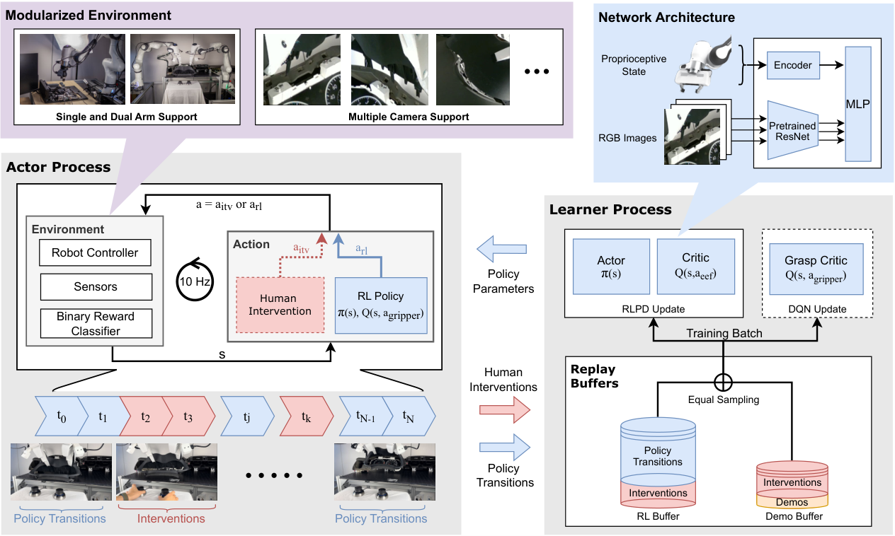

<!-- Generated by the offline translation workflow.
Source: 05-具身场景的深度和强化学习/08-HIL-SERL人机协同强化学习与MuJoCo插孔/README.md
Source SHA-256: 3ec4570f4db2a001d1f473c841123fe1de1ca6b0f9a19b223f79b4ae9628ce92
Model: tencent/Hy-MT2-1.8B-GGUF:Q4_K_M
Review machine-translated technical claims before relying on them.
-->
# HIL-SERL: Human-Computer Collaborative Reinforcement Learning and MuJoCo Port Introduction

**A small number of examples provides a starting point, while online reinforcement learning continues to improve. Humans take over when the policy gets stuck and demonstrate recovery actions.** This chapter explains how HIL-SERL uses correction data for policy updates, and how to collect, train, and transfer plug-in tasks through official MuJoCo simulation learning. It is suitable for readers who have already worked with MuJoCo, Gymnasium, and SAC, and wish to transition from imitation learning to online robot reinforcement learning.

## 1. Learning objectives: From complete demonstrations to online correction

The jack needs a policy that continuously adjusts during the contact process: first align the pin with the hole, then push in along the insertion direction. When deviation occurs, it can retract and realign. A few successful demonstrations can provide a basic path; online interaction will reveal the state after deviating from the path, and human intervention can complement the recovery actions in these states.

This chapter focuses on the following learning process:

| Phase | Work Completed by the Reader | Focus Areas |
| --- | --- | --- |
| Environmental Interaction | Checking images, status, and teleoperation in the official Panda block environment | Whether actions are executed as expected |
| Demonstration Collection | Recording a complete successful trajectory | Whether data, camera, and action dimensions match |
| Online Training | Starting the actor/learner and taking over when needed | Whether actual human actions are included in the replay |
| Junction Transfer | Configuring contact scenarios, position changes, and success criteria | Whether insertion depth, posture, and termination markers are consistent |
| Autonomous Evaluation | Setting the policy and disabling manual intervention | Success rate, completion time, and recovery ability |

After completing this chapter, you should be able to carry out exercises following the process of "demonstration collection → online trial → human correction → autonomous evaluation". The chapter provides method descriptions and official practice links, and the experimental results are recorded by readers after execution.

## 2. The Key to HIL-SERL: How Intervention Actions Enter Learning

HIL-SERL corresponds to Berkeley’s paper *Precise and Dexterous Robotic Manipulation via Human-in-the-Loop Reinforcement Learning*. It integrates human oversight into the online learning process based on RLPD: the policy accumulates experience during autonomous exploration, while humans provide more useful actions under current conditions when taking over. [ paper §3 ](https://arxiv.org/html/2410.21845v1#S3)



Figure 1: The actor on the left interacts with the environment and receives human corrections; the learner on the right uses mixed demonstrations and online data update policies. Source: Jianlan Luo, Charles Xu, Jeffrey Wu, Sergey Levine, [ HIL-SERL paper v1 Figure 2 ](https://arxiv.org/html/2410.21845v1#S3.F2). The original figure is retained, [ CC BY 4.0 ](https://creativecommons.org/licenses/by/4.0/).

### 2.1 Two buffers, and actual execution actions

The original implementation uses two playback buffers. `demo buffer` stores the initial demonstration and online intervention data, while `RL buffer` stores online interactions, including autonomous actions and intervention movements; the learner takes half a batch from each of them. When manual control is applied, the transition action written must be a **human action that truly affects the environment**.

The data flow can be understood by referring to the following teaching pseudocode. It omits communication, batch processing, and control details, and is not an upstream interface:

```python
proposed = policy(observation)
executed = human_action if takeover else proposed
next_observation, reward, terminated, truncated, info = env.step(executed)
transition = (observation, executed, reward, next_observation,
              terminated, truncated)
rl_buffer.add(transition)
if takeover:
    demo_buffer.add(transition)
batch = mix(demo_buffer.sample(batch_size // 2),
            rl_buffer.sample(batch_size // 2))
learner.update(batch)
```

In [[`examples/train_rlpd.py`](https://github.com/rail-berkeley/hil-serl/blob/main/examples/train_rlpd.py) in Berkeley, the actor retrieves the actual action from `intervene_action` returned by the environment, intervenes in the transition, and sends it to two types of data stores; the learner then performs a 50/50 sampling. The human signal here directly changes the actions and state transitions in the training data, rather than merely temporarily taking over on the interface. The original training code for [ is ](https://github.com/rail-berkeley/hil-serl/blob/main/examples/train_rlpd.py).

### 2.2 Rewards, Action Space, and Controller

The original paper trained a binary classification reward model using success/failure samples, generating sparse positive rewards during tasks; continuous end-point movements and discrete gripper decisions are processed separately, with an additional DQN critic used for the gripper. Contact manipulation also relies on underlying impedance control and reference clipping, while the relative coordinate representation of states and actions serves for control under position changes. [ paper §3.3–3.5 ](https://arxiv.org/html/2410.21845v1#S3.S3)

These designs present three specific issues for plug-in exercises: Can the status of the camera and robot be distinguished between “near the port” and “already inserted”? Is the reward consistent with the insertion depth? Can the small-step end action of the policy continue to be stable after contact? When adapting, you should clarify the rewards and controller configurations item by item based on your environment.

### 2.3 Actors and learners run separately

The actor interacts with the simulation and receives manual intervention; the learner consumes replay data, updates the network, and sends parameters to the actor. The two communicate asynchronously, and environment sampling and gradient update can proceed independently. [Berkeley code structure ](https://github.com/rail-berkeley/hil-serl#overview-and-code-structure)

```text
初始示范 ──────────────→ demo buffer ─┐
                                    ├→ learner → 新参数 → actor
actor → MuJoCo → 在线交互 → RL buffer ┘                 │
                   └─ 人类干预数据 → demo buffer        │
                         ↑                              │
                         └──── 人类接管 / 自主执行 ←────┘
```

## 3. Practice Entry: First run the official MuJoCo block extraction, then modify the jack.

| Route | Purpose | Upstream Entry |
| --- | --- | --- |
| Berkeley HIL-SERL | Learn the original JAX, RLPD, reward classifier, and Franka real robot workflow | [ Code and Installation ](https://github.com/rail-berkeley/hil-serl) |
| LeRobot + gym-hil | Use PyTorch and MuJoCo to learn demonstration collection, intervention, and actor/learner workflows | [ Official Simulation Guide ](https://huggingface.co/docs/lerobot/hilserl_sim) |

This chapter recommends starting with the **LeRobot + gym-hil Panda block catching environment**. It already has a basic controller and keyboard setup. You can first verify the interaction flow, and then engage tasks that require more sensitive contact with the jack; the official default task is block catching, while the jack task needs to be implemented separately. [ Description of the gym-hil environment ](https://github.com/huggingface/gym-hil)

### 3.1 Installation and Version

Perform manipulation in a separate learning environment from the already running experiments. First, follow the [LeRobot installation documentation ](https://huggingface.co/docs/lerobot/installation) to prepare the corresponding version of Python and PyTorch, then install the HIL-SERL extension in the LeRobot source directory:

```bash
python -m pip install -e ".[hilserl]"
git rev-parse HEAD
python -m pip show lerobot gym-hil torch mujoco
```

Save the version output in your own experiment record. Use the designated download entry on the machine where you are located for downloading dependencies, data, and weights; start training and evaluation separately.

**Do not mix two installation environments.** The Berkeley README uses Python 3.10 and JAX; during verification in this chapter, `pyproject.toml` of LeRobot `main` requires Python ≥3.12. The Python 3.10 examples in the gym-hil README are for a separate environment and cannot replace the requirements of the new LeRobot directly. [ Berkeley installation ](https://github.com/rail-berkeley/hil-serl#installation), [ LeRobot dependency definitions ](https://github.com/huggingface/lerobot/blob/main/pyproject.toml)

### 3.2 Check the environment first, then collect samples

Check the Panda scene, front/arm images, and end control using [ gym-hil Quick Start](https://github.com/huggingface/gym-hil#franka-environment-quick-start). The random actions in the example are only used to test environmental responses. When remote operation via keyboard or controller is required, use its `PandaPickCubeKeyboard-v0` or `PandaPickCubeGamepad-v0` environment.

Then, follow the [LeRobot simulation guide ](https://huggingface.co/docs/lerobot/hilserl_sim) to configure and execute the following steps. The paths below indicate the configurations that readers should save by themselves and match the LeRobot version used:

```bash
# mode=null：检查环境；mode="record"：采集示范。
python -m lerobot.rl.gym_manipulator --config_path path/to/env_config.json

# 终端 A：先启动 learner。
python -m lerobot.rl.learner --config_path path/to/train_config.json

# 终端 B：再启动 actor，使用同一份训练配置。
python -m lerobot.rl.actor --config_path path/to/train_config.json
```

The simulation document references the [ environment configuration example ](https://huggingface.co/datasets/lerobot/config_examples/blob/main/rl/gym_hil/env_config.json) and the [ training configuration example ](https://huggingface.co/datasets/lerobot/config_examples/blob/main/rl/gym_hil/train_config.json). Before running, check the dataset path, camera keys, state/action dimensions, and checkpoint saving frequency: The environment example defaults to `push_to_hub`, while local practice should use `false`; the training example contains the author’s dataset ID, which should be replaced with your own data. The example also has a `wandb.enable` switch that can be turned off for local practice.

These examples and source code may be updated independently. The fields shall follow the configuration classes of the fixed code version. The startup order is as described in [ actor source code ](https://github.com/huggingface/lerobot/blob/main/src/lerobot/rl/actor.py): after the learner is ready, the actor connects.

### 3.3 Converting the correction records into learnable data

First, record several complete successful demonstrations, and then start online manipulation attempts. When a human takes over, focus on demonstrating “how to recover from the current deviation and complete the task”, and then return the policy. Test the takeover and release based on the remote operation mapping of the current environment, and check the actual actions and intervention markers in the logs. The field names for different implementations are not consistent: Berkeley uses `intervene_action`, and the gym-hil README describes `is_intervention` and `teleop_action`. [ is the gym-hil data description ](https://github.com/huggingface/gym-hil#franka-environment-quick-start)

## 4. From clamping blocks to jack connectors, which interfaces need to be changed

Below is the transplantation scheme recommended by this tutorial. The task parameters are determined by the reader's own jack scenario.

| Interface | Contents to be clarified for socket manipulation practice |
| --- | --- |
| Scenario and contact | Pins, holes, collision geometry, clearance, friction, and gripping methods; confirm via remote operation that insertion is feasible first |
| Reset | Add position variation after the fixed position test passes; record whether the change occurs at the pin or the hole seat, as well as the sampling shape and coordinate system |
| Observation and action | Frontal/wrist image, end pose, and gripper status; end translation/rotation increments, units, coordinate system, and clipping |
| Reward and termination | Distinguish insertion depth, lateral error, pose error, and stabilization hold time; time expiration is expressed via `truncated` |
| Intervention data | Pair actual human actions with the next observation, and save takeover markers; ensure these data are fed into the learner |
| Autonomous evaluation | Set the checkpoint, disable manual intervention, record successful attempts, total rounds, and completion time |


Figure 2: Geometric diagram drawn in this tutorial. Alignment, insertion, and success are different states; the green conditions represent the task design template, and each threshold should be set according to the pin hole size and control accuracy.

The reward can first be determined using a simulation state, clarifying the insertion depth and contact process; then switch to an image success classifier to verify whether the visual reward matches the physical state. This is the phased exercise recommended in this chapter.

**The position changes should be described with clear reset rules.** For example, a disk with a radius of 0.02 m has a different coverage range compared to a square sampled uniformly within ±0.02 m in x/y directions. The practice report should record the sampled shape, coordinate system, and whether it is the pin or the hole base that is changing; the values here are examples from task configuration.

When the message "appears to have been inserted, but the end still swings," first replay the physical depth, successful marking, and motion amplitude simultaneously. If the insertion is indeed completed but the successful marking does not trigger, identify the geometric threshold or reward detection; if the depth and posture continue to change, examine the motion scale and contact control. Recording these values in sync can help distinguish between successful detection and contact control issues.

## 5. Recommended recorded results

| Record Item | Purpose |
| --- | --- |
| Number of demonstrations, environment steps, and gradient update times | To clarify the data volume and the counting object of `step` |
| Total training duration, manual intervention duration and ratio | To measure computing/interaction time and human effort separately |
| Number of autonomous successes / total evaluation rounds, completion time | To measure the performance of the policy after control transfer |
| Reset distribution, success threshold, random seed | To explain the results under position changes |
| Synchronized images, actions, rewards, and termination markers | To review the process of getting stuck, recovery, and completion |

First, complete the grab blocks at fixed positions, then add the plug holes at fixed positions, and finally incorporate position changes. Save a continuous record for each step that includes failures, manual corrections, and subsequent autonomous attempts, so as to understand what has been actually learned from the policy.

## 6. Further Reading

- [HIL-SERL Official Project Page](https://hil-serl.github.io/) and [ Paper v1](https://arxiv.org/html/2410.21845v1): Understanding the original method and real robotic arm tasks.
- [Berkeley HIL-SERL Source Code](https://github.com/rail-berkeley/hil-serl): Following the intervention actions, dual buffer, and parameter synchronization in `examples/train_rlpd.py`.
- [LeRobot Real Robot Workflow](https://huggingface.co/docs/lerobot/hilserl): Continuing to learn demonstration collection, reward classifier, and online intervention.
- [This tutorial: MuJoCo robotic arm and ACT / Pi0 / SmolVLA practice](../../06-manipulation-and-vla/large-model-control-vla-vlm/04-mujoco-reproduction-act-pi0-smolvla/README.md): Connecting with existing imitation learning paths.
- ["Robots That Know What to Ask" Reward Alignment Guide](../04-robots-that-know-what-to-ask-reward-alignment-introduction/README.md): Continuing to understand the relationship between human correction and reward definition.
