<!-- Generated by the offline translation workflow.
Source: 06-策略抓取或抓取VLA/大模型控制、VLA、VLM/11Agnes-Harness多设备Demo/README.md
Source SHA-256: b7825dd9a1cefff097ed9f1562efd1ff2a6a7c31155e2d243bbd080d39908b67
Model: tencent/Hy-MT2-1.8B-GGUF:Q4_K_M
Review machine-translated technical claims before relying on them.
-->
# Agnes Harness: Multi-device Collaboration from Plugins to Mars Base

This chapter integrates the [ Agnes Harness (AGH) ](https://github.com/AgnesAI-Labs/agnes-harness) demo with open-source code into Every Embodied, providing a fixed version, a unified startup script, and Chinese tasks. First, manually manipulate the virtual device, then connect to the model to perform natural language tasks. There is no need to purchase robots, train a policy, or download large model weights.

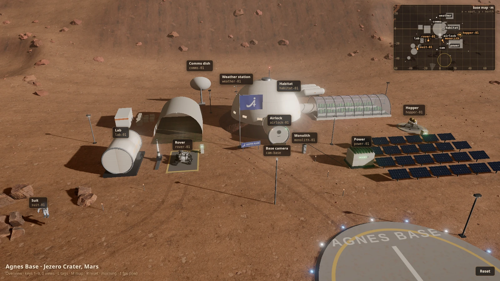

Figure 1: Mars base running on Ubuntu. All running screenshots are directly from the web viewport of a standalone testing browser, without the desktop, other applications, or personal accounts.

## 1. What can be played

| Demo | Public implementation | Chapter entrance | Requires model API? |
| --- | --- | --- | --- |
| MHS office four devices | Development Hub of `packages/mhs`: mobile robot, light, environmental sensor, robotic arm | `mhs-build` → `devices` | No, manipulate the panel and terminal directly |
| Manual interaction on Mars base | `examples/mars-world`: 11 virtual devices, 3D scene, status, and camera | `mars-manual` | No, send commands via the development hub |
| Mars rescue, sampling transmission, sandstorm preparation | Three collaborative tasks in the same Mars scenario | `build` → `mhs-install` → `web` + `mars-world` | Requires a model that supports image and tool calls |
| Backend tool plugin | `examples/packages/hot-tool-plugin` | `plugins-test`, or call `demo_text_stats` after installation in AGH | Component testing is not required; free conversation is needed |
| Frontend panel plugin | `examples/packages/client-panel` | `plugins-test`, or load the panel according to upstream tutorials | The panel itself is not required |
| Front-end and back-end linkage plugin | `examples/packages/client-service-panel` | `plugins-test`, or connect services according to upstream tutorials | Service queries are not required |

The office cart in the news that searches for books and reads aloud is not included in this chapter as a separate reproduction project: what is connected here are examples that can be located using public source codes. The Mars Three missions share one world, rather than three independent simulators.

## 2. How it runs

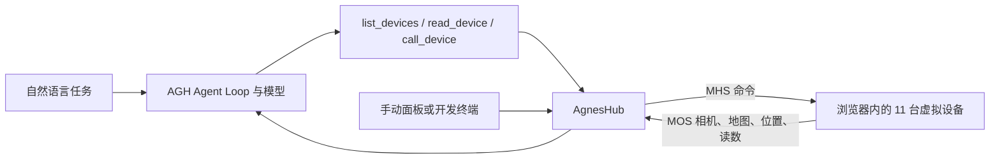

The key to this demo is **device-driven calls and feedback**. The device actively registers tools, status, and data sources with the Hub. The model uses a fixed device tool interface to pass the device ID, actions, and parameters to the Hub. The Hub then forwards the calls, and the device updates the scene, returning progress and results. For example, the rover's `drive_to` changes position, while `collect_sample` changes the payload; the aircraft consumes propellant, the airlock has pressure and door status, and ground communication is limited by a time window.

MHS (Model Hardware Standard) handles device interactions, and MOS (Model Observation Standard) transmits observations. This includes interactive state and action logic, not pre-recorded animations; it is suitable for learning device orchestration and does not treat browser scenarios as robot dynamics evaluation. For implementation details, refer to the upstream `examples/mars-world/src/live/`. The Jev version from this upstream still integrates, and task execution uses the built-in Core loop.

## 3. Fixed Version and Preparation

Verification date: 2026-10-23. The baseline is recorded in [upstream.json](../../../../06-策略抓取或抓取VLA/大模型控制、VLA、VLM/11Agnes-Harness多设备Demo/upstream.json), and the fixed upstream commit is `98bc11572ba162bcdf6ce2b29612a44508faf951`. This chapter only maintains its own script and task descriptions. The complete upstream source code is placed in the `third_party/agnes-harness` that has been ignored by the project, to avoid including upstream dependencies, textures, and build outputs in the tutorial repository.

Require Python 3.10+ (the launcher uses only the standard library), Git, Node.js **24.10+**, and pnpm **10.34.5**. For a complete AGH, platform-native build tools are also required; see [ upstream installation instructions ](https://github.com/AgnesAI-Labs/agnes-harness/blob/98bc11572ba162bcdf6ce2b29612a44508faf951/docs/guide/install.zh-CN.md). If the versions do not meet the requirements, the launcher will directly indicate this, without modifying global Node, pnpm, or PATH.

The actual environment is **Ubuntu x86_64, Node 24.19.0, pnpm 10.34.5, Google Chrome**. Node and pnpm are placed in separate experimental directories; the built-in Node 18 on the system remains unchanged. `bwrap`, the C compiler, and Node API headers were successfully built using the workstation's native helpers and the full AGH. No training GPU is required, and browser screenshots are rendered by software.

Run from **this chapter directory**. `--source` can specify other dedicated upstream directories; all commands in the same experiment use the same path.

```bash
python demo.py list
python demo.py prepare
python demo.py check
```

`prepare` obtains a fixed commit; it only checks existing directories without resetting or overwriting. `check` checks if the commit and tracked source code have been modified and the runtime version. It views the startup plan but does not execute it:

```bash
python demo.py mars-manual --dry-run
```

### Download Dependencies and Resources

Installation and resource preloading are executed separately, through the download entry on the machine. The lab machine uses the良心 Cloud Direct Connect as per the agreement; first, confirm that the direct connect is ready. The following Windows commands can complete the preparation steps:

```powershell
$lane = 'C:\Users\kewei\Documents\2026\07重要学术项目\15wifi扩展\LabDownload.cmd'
python demo.py install --download-wrapper $lane
python demo.py assets --download-wrapper $lane
```

Configured entry used by Ubuntu:

```bash
python demo.py install --download-wrapper "$HOME/.local/bin/lab-download"
python demo.py assets --download-wrapper "$HOME/.local/bin/lab-download"
```

Other machines can provide their own command wrappers: they must support `--download-exec pnpm install --frozen-lockfile` and `curl ...`, and configure the appropriate download routes themselves. The wrappers are used only for dependency installation and asset prefetching, and do not cover model invocation or simulation execution.

The asset is approximately 26.5 MB. Download it item by item from the upstream `assets/manifest.json`, check the size and MD5, and write it to the native cache location. Correct files can be reused directly. The upstream Node `fetch()` script does not explicitly configure a proxy, so curl within the wrapper is used in this chapter. Verify again before starting the world; stop if any issues are found to avoid implicit downloads during runtime.

**Platform selection:** For the fixed version of Mars `dev.mjs` and `start.mjs`, use the URL pathname to construct file paths. When including Windows drive letters or URL-encoded spaces and Chinese directories, path issues may occur. This chapter provides clear instructions for native Windows Mars startup. Use Mars routes in Linux, macOS, or a configured WSL environment, and use ASCII paths without spaces in the source code. For example, set `export AGNES_DEMO_SOURCE=/tmp/agnes-source` in a POSIX terminal first, then execute `prepare` and subsequent commands; the same variable should be set in each terminal. WSL requires its own Node/pnpm, source directory, and download entry point, and cannot directly use Windows' dedicated address 127.0.0.1. This addition has verified `plugins-smoke` on Linux; the native Windows version still does not run this Unix socket process.

## 4. First stop: Four devices, no API required

```bash
python demo.py mhs-build
python demo.py devices
```

Open the [ four-device panel ](http://127.0.0.1:4191/?lang=zh-CN). `robot-01`, `lamp-01`, `env-01`, and `arm-01` should be visible. Check the device status on the three pages: Devices, Data Flow, and Map. Enter `help` in the terminal running the Hub, and you can also enter `health robot-01 hot` and `pose robot-01 lost` to observe changes in health and positioning. This station verifies the device protocol and interface without requiring AGH model configuration.

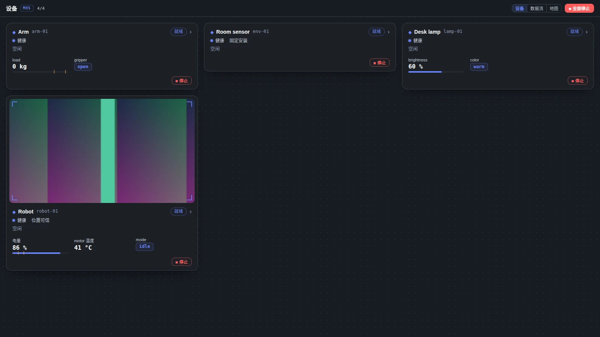

Actual verification passed the operation of the desk lamp, robot movement, and camera reading. The desk lamp is set to on, brightness 30%, and cool color; the robot moves from its initial position to `(5, 4)`, the Hub returns, and the result is displayed on the page. The office camera uses the test pattern generated upstream.

| Panel after the desk lamp status is written | Coordinates and camera after the robot moves |
| --- | --- |
| 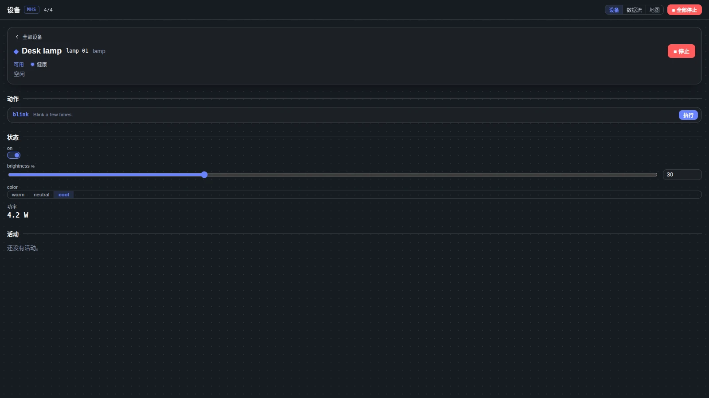 | 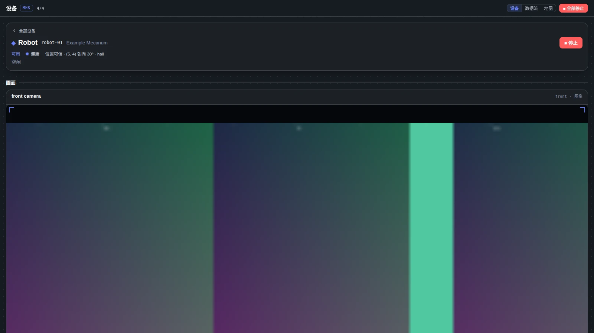 |

## 5. Second stop: Play Mars Base manually, without an API

Complete resource prefetching first. Run it on supported platforms:

```bash
python demo.py mars-manual
```

Open [ Mars Base ](http://127.0.0.1:4200/?hub=ws://127.0.0.1:4180). The development hub is at 4180, and the world is at 4200. Enter `help` in the terminal to list devices, read status, and invoke tools according to its displayed format. For device parameter definitions, see [. For upstream devices, refer to ](https://github.com/AgnesAI-Labs/agnes-harness/blob/98bc11572ba162bcdf6ce2b29612a44508faf951/examples/mars-world/README.md).

It is recommended to first find `drive_to {x,y}` under `rover-01`, then look at `take_off {alt}` and `land {pad}` under `hopper-01`. After each call, compare the scene location, device status, and return results. The page is viewed through `1`–`9`, `0` follows Monolith, `M` toggles the mini map, and `R` resets. If there is a freeze, add `&quality=low` after the URL.

## 6. Third Stop: Model Command for the Three Mars Missions

First, close the manual Mars process started by yourself at the previous station, and release 4180/4200. Choose either the Manual Hub or the AGH Plugin Hub; 4180 cannot be occupied by both.

```bash
python demo.py build
python demo.py mhs-install
python demo.py web
```

Confirm the installation by using the upstream preview. Configure the model in the printed web address, go to Settings → Plugin Management, enable `@agnes/mhs`, and confirm. Run it in the second terminal, within the same directory of this chapter:

```bash
python demo.py mars-world
```

Open the Mars base URL again. The launcher is set uniformly for commands such as `mhs-install`, `web`, etc., with `AGH_HOME=上游目录的父目录/agnes-demo-home`, `AGNES_PROFILE=local-dev` and Hub origin. Keep the session and plugin configurations consistent. The operation records and model configurations are kept in this dedicated directory, and the API Key is not included in this tutorial. When manually executing the commands in the upstream plugin tutorial, these two same environment variables must also be set in this terminal first; the capability configuration for the full-stack example is written in `profiles/local-dev/profile.yaml` of this dedicated home.

**No mandatory GPT API.** You can choose a provider supported by AGH, and the model must support both image input and tool invocation. Manual mode does not invoke the model; the free planning on this round will invoke the configured model service, and whether it is paid depends on that service. Models that only support text cannot complete the camera observation process.

Before each task, reset the world using `R` and create a new AGH conversation:

| Task | Instructions copyable into the dialogue | Which feedback to check |
| --- | --- | --- |
| Basic inspection | Check the base's air, power, and weather conditions, then read the base cameras and summarize the current situation. | Whether device status and camera content are included in the tool results |
| Astronaut rescue | First, send a vehicle to the western wilderness to find the missing astronaut, then have Monolith transport them back to the habitat via airlock. | Reconnaissance, movement, carrying, airlock occupation and pressurization progress |
| Sample return | Survey the rocks in the western wilderness, plan the route for the rover, return the samples to the dock, and send the analysis results to the laboratory. Report when the communication window opens. | Route around obstacles, sample payload, laboratory results, feedback transmission |
| Dust storm preparation | Check weather and power conditions, prepare the base for a dust storm, and explain what each device is doing. | Weather readings, solar panels, vehicle, rover and hatch status; multiple reasonable options allowed |

The ground communication for the sampling task is closed for the first two minutes after the world is opened, and then open for three minutes every four minutes; the waiting window is a scene mechanism. Use Trace and the device panel's dynamic records to check the actual call order. Save prompts, model names, result summaries, and key screenshots for each round, which facilitates comparison between different models.

### These three tasks can be verified without loading the model

The `verify-mars` in this chapter calls the device tools sequentially through the real Hub WebSocket interface, and checks the task based on the returned results and device status. The route comes from the real-time survey returns of the aircraft, and the actions are actually executed in the scene; the script does not directly modify the internal state of the simulator. This route does not call the language model, making it suitable for confirming the connection between the device and the scene first.

The sequence of the airlock for rescue is: `cycle_out` → `open_outer` → Put the person into the airlock by Monolith → `close_outer` → `cycle_in`. Reducing pressure alone does not automatically open the outer door; if omitted, the device will return to `x_door_closed`. The final check ensures that the astronaut actually enters the habitat module, rather than just checking that the robot reaches the door.

All three script tasks have been successfully executed on Ubuntu. During sampling, the aircraft returned four obstacle avoidance routes; the rover reached `(-45.75, -46.21)`, collected `rock-1`, and docked back. The laboratory return scenario preset the mineral composition and analysis results, and the communication device confirmed that 186 characters were sent. The sandstorm checked the solar panels `stowed`, the habitat module `storm_shelter`, and the aircraft `landed`.

| Monolith lifts the astronaut | Placing the astronaut into the opened airlock |
| --- | --- |
| 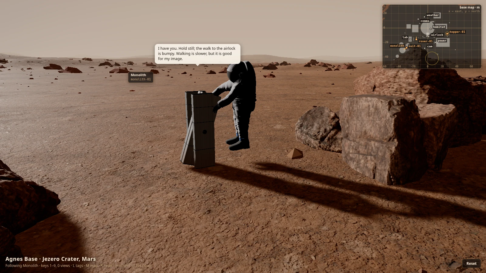 | 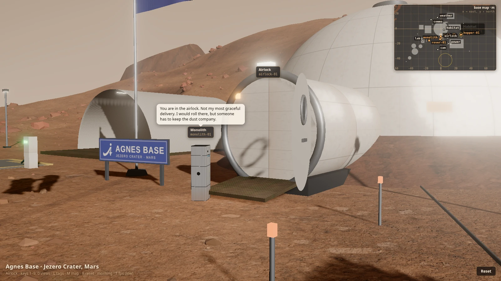 |

| Sample docking, unloading and analysis completed in the lab | Sandstorm preparation: Solar panels are retracted |
| --- | --- |
| 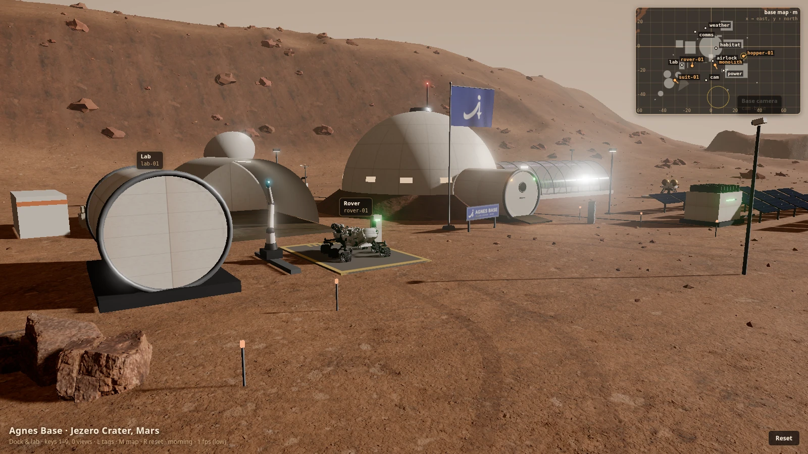 | 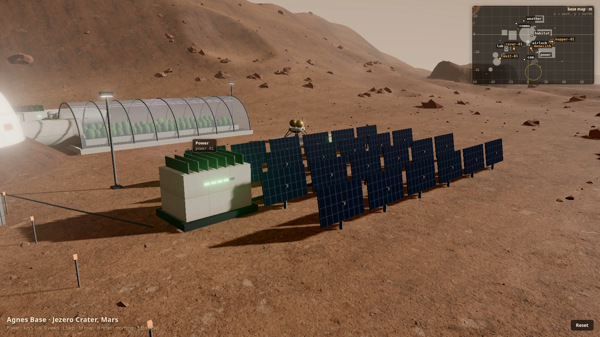 |

## 7. Fourth stop: Three plugin demos

After installing dependencies, run the component check of the upstream real example module first:

```bash
python demo.py plugins-test
```

Then, follow the fixed version tutorial below to install and view the interaction in the upstream dedicated trial configuration:

| Example | Tutorial | Observation Target |
| --- | --- | --- |
| Backend tool | [backend.zh-CN.md](https://github.com/AgnesAI-Labs/agnes-harness/blob/98bc11572ba162bcdf6ce2b29612a44508faf951/docs/develop/backend.zh-CN.md) | `demo_text_stats` returns 11 characters and 2 words for `hello world` |
| Frontend panel | [frontend.zh-CN.md](https://github.com/AgnesAI-Labs/agnes-harness/blob/98bc11572ba162bcdf6ce2b29612a44508faf951/docs/develop/frontend.zh-CN.md) | Loading, updating, and uninstalling of panel v1/v2 |
| Full-stack integration | [fullstack.zh-CN.md](https://github.com/AgnesAI-Labs/agnes-harness/blob/98bc11572ba162bcdf6ce2b29612a44508faf951/docs/develop/fullstack.zh-CN.md) | Displaying the backend version after selecting a session; updates and rollbacks change query behavior |

The complete build for Linux/macOS can also run `python demo.py plugins-smoke`: the upstream script uses a mock model to drive the installation, execution, update, rollback, and deletion of real plugins, and outputs `result.json`, without relying on the real API. The original process on Ubuntu has been fully passed.

Here are the three interfaces actually loaded by the browser. The model names in the screenshot come from the upstream directory, and the responses are provided by this machine's loopback simulation service. No DeepSeek or other external model services are called.

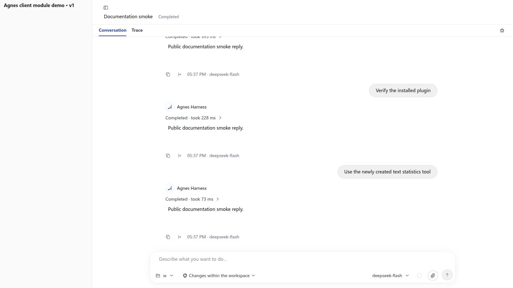

| Full-stack plugin connection to backend 1.0.0 | Connection to backend 2.0.0 after update |
| --- | --- |
|  | 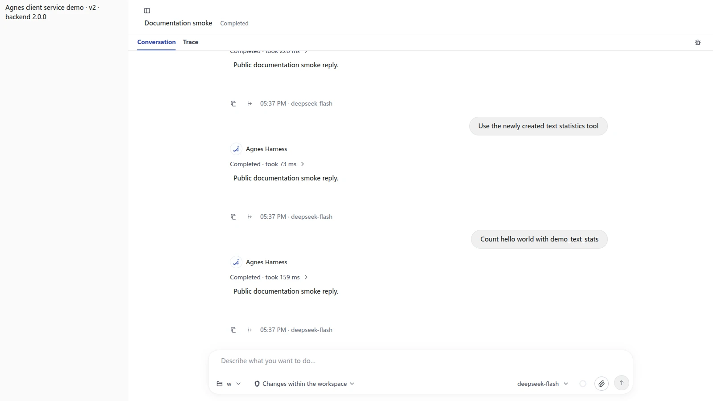 |

Note: Upstream rollback applies to profile snapshots. Inserting the start and stop of other plugins between the "Update v2" and "Rollback v1" checks will change the snapshot order. In this chapter, the screenshot verification requires completing the original update and rollback checks first, then switching the panel for a photo to maintain the original process assertion.

## 8. One-click Review and Screenshot

After completing the installation, resource prefetching, and building, run it in the chapter directory. The source code directory can use `AGNES_DEMO_SOURCE` or specify `--source` for each command:

```bash
python demo.py plugins-test
python demo.py verify-office --output ./runs/office
python demo.py verify-mars --output ./runs/mars
python demo.py verify-plugins --output ./runs/plugins
```

The three verifications will start the required services individually, and shut down the processes they initiate after completion or failure. The output includes web page screenshots, status assertion reports, and device call records; the existing daily AGH configuration is not overwritten by default. Before running, turn off the manual demonstrations that started earlier and occupy ports 4180/4191/4200. The browser uses `google-chrome` by default, and the executable file can be specified via `CHROME=/path/to/chrome`.

`capture.mjs` creates an independent browser configuration for testing, capturing only web page content. Headless Chrome requires `Emulation.setFocusEmulationEnabled` to keep the page visible, so MHS will subscribe to observations and the Mars scene will be rendered continuously; the script waits for the scene to load and reach sufficient frames to avoid treating an empty scene or "waiting for data" as a running result.

## 9. Verification status of this integration

| Check | Result for this time | Record |
| --- | --- | --- |
| Fixed submission, version, and full build | Passed, Ubuntu / Node 24.19.0 / pnpm 10.34.5 | [ Total record: ](../../../../06-策略抓取或抓取VLA/大模型控制、VLA、VLM/11Agnes-Harness多设备Demo/verification.json) |
| Plugin and Mars scenario component tests | All 6 files and 23 tests passed | Commands in the total record |
| Office four devices | Status writing, movement, and camera reading passed | [ office.json](../../../../06-策略抓取或抓取VLA/大模型控制、VLA、VLM/11Agnes-Harness多设备Demo/evidence/office.json) |
| Three Mars missions | Rescue, sampling analysis transmission, and dust storm preparation all passed | [ mars.json](../../../../06-策略抓取或抓取VLA/大模型控制、VLA、VLM/11Agnes-Harness多设备Demo/evidence/mars.json), [ device invocation | ](../../../../06-策略抓取或抓取VLA/大模型控制、VLA、VLM/11Agnes-Harness多设备Demo/evidence/mars-calls.json) |
| Original simulation model process | All passed, including updates, rollbacks, and deletions | Total record |
| Plugin process with browser checks | 20 checkpoints passed, front-end and back-end v1/v2 actually displayed | [ plugins.json](../../../../06-策略抓取或抓取VLA/大模型控制、VLA、VLM/11Agnes-Harness多设备Demo/evidence/plugins.json) |
| Page screenshots | 11 screenshots, content and framing checked individually | All images in this chapter |

All 39 resource files (26,504,508 bytes) passed the size and MD5 checks of the upstream manifest. The validation script stopped the services it started, and ports 4180/4191/4200 were released. The autonomous planning for the real model API was left for later configuration in this round; no model service calls occurred this time.

The upstream code follows Apache-2.0 license. Third-party code and assets retain their respective licenses. Specifically, it is subject to the fixed version [LICENSE](https://github.com/AgnesAI-Labs/agnes-harness/blob/98bc11572ba162bcdf6ce2b29612a44508faf951/LICENSE), [NOTICE](https://github.com/AgnesAI-Labs/agnes-harness/blob/98bc11572ba162bcdf6ce2b29612a44508faf951/NOTICE), and resource manifest. This chapter includes its own startup and verification scripts, run logs, and screenshots of scenarios. The complete upstream source code and assets are stored in an external directory.

Continue reading: [ Embodied AI Reasoning and Deployment Framework ](../09-embodied-ai-reasoning-and-deployment-framework/README.md) · [ Every Embodied Homepage ](../../../../README.md).
