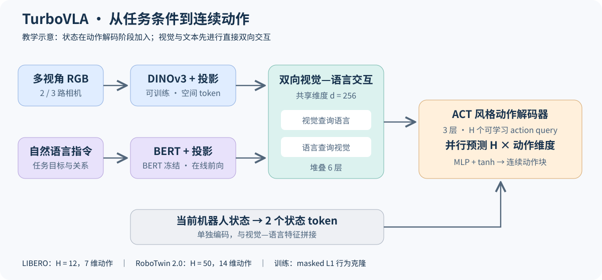

<!-- Generated by the offline translation workflow.
Source: 06-策略抓取或抓取VLA/大模型控制、VLA、VLM/21-TurboVLA轻量视觉语言动作模型精读/README.md
Source SHA-256: 434395b2dc473ab5e7616ae1afdcc1751d4d7036a7476d78cf0eede8c573dc90
Model: tencent/Hy-MT2-1.8B-GGUF:Q4_K_M
Review machine-translated technical claims before relying on them.
-->
# TurboVLA Paper Deep Reading: How Lightweight Visual-Language Interaction Achieves Real-time Manipulation

With a policy of approximately 0.2B parameters, TurboVLA achieves a **97.6% average success rate, 31.2 ms policy inference latency, and 0.9 GiB inference memory usage** on LIBERO. The 0.4B version with a larger visual backbone achieves a **88.06% average success rate** on 50 two-armed tasks in RoboTwin 2.0. It offers a practical design approach: when the task objective is clear, lightweight language encoding combined with visual interaction supports high-frequency action generation.

This chapter carefully reads the paper in the order of “problem → network and tensor → experiment → training resources → code and reproduction”. The results are based on **arXiv v3, 2026-09-27**; the verified code version is [`a3365e8`](https://github.com/H-EmbodVis/TurboVLA/tree/a3365e8f1787d30bafd99d2806edbf4dc82b5370), with a review date of 2026-10-23. The experimental numbers in the paper come from the author’s report, and the reproduction commands are organized according to public interfaces.

## 1. Papers and Official Resources

| Resource | Entry | Reading Purpose |
| --- | --- | --- |
| Paper | [TurboVLA v3 main text and appendices ](https://arxiv.org/html/2607.27205v3), [PDF ](https://arxiv.org/pdf/2607.27205v3) | Architecture, experiments, training, and timing protocols |
| Source Code | [H-EmbodVis/TurboVLA ](https://github.com/H-EmbodVis/TurboVLA) | Training, model, data, and evaluation |
| Weights | [Hugging Face model repository ](https://huggingface.co/H-EmbodVis/TurboVLA) | LIBERO/RoboTwin checkpoint and normalization metadata |
| Project Page | [TurboVLA official homepage ](https://h-embodvis.github.io/TurboVLA/) | Real robot videos, models, and scenario illustrations |
| Reproduction Guide | [LIBERO ](https://github.com/H-EmbodVis/TurboVLA/blob/a3365e8f1787d30bafd99d2806edbf4dc82b5370/experiments/libero/README.md), [RoboTwin 2.0 ](https://github.com/H-EmbodVis/TurboVLA/blob/a3365e8f1787d30bafd99d2806edbf4dc82b5370/experiments/robotwin/README.md) | Environment, data format, startup, and evaluation parameters |

The paper title is *TurboVLA: Real-Time Vision-Language-Action Model at 32 Hz on an RTX 4090 with <1 GB VRAM*, and its arXiv ID is `2607.27205`. This is presented here as a public preprint.

**Version Note:** The project page and some models still retain old versions such as 97.7% for LIBERO and 60.2% for RoboTwin Clean50. In this chapter, 97.6% / 88.06% of version v3 is used uniformly, and the numbers for each sub-task also follow the same version.

## 2. Core Question: Where Should the Large Model Be Place During Manipulation

Many VLAs feed images and language into a large multi-modal backbone, then generate discrete action tokens, or connect to continuous action experts. TurboVLA has chosen a different information path for the execution policy:

```text
多视角 RGB → DINOv3 → 视觉投影 ─┐
                               ├→ 6 层双向视觉—语言交互 ─┐
任务指令   → 冻结 BERT → 文本投影 ┘                       │
                                                        ├→ ACT 风格解码器 → H 步连续动作
当前机器人状态 → 状态投影 → 2 个状态 token ────────────────┘
```

For example, when the instruction is "place the bowl on the plate," the execution policy first needs to locate the bowl and plate, determine the current status of the robotic arm, and predict the action. TurboVLA enables direct interaction between these pieces of information, enabling control through compact motion heads. The paper summarizes this as a transition from `V → L → A` to `V + L → A`.

You can combine the [ official format and the performance comparison chart ](https://github.com/H-EmbodVis/TurboVLA/blob/a3365e8f1787d30bafd99d2806edbf4dc82b5370/assets/figures/paradigm-and-performance.png) to understand the differences between the two approaches. The results in the chart should be read in conjunction with the version notes above.

It retains the language, pre-trained representations, and Transformer components; the main savings are in the overhead of executing large-scale generative language cores during execution, as well as the overhead of autoregressive or multi-turn action generation. For tutorial readers, what is worth learning is **reallocating model capacity based on execution tasks**.

## 3. Model Structure and Tensor Flow



Figure 1: The instructional diagram drawn in this tutorial based on Section 3 of the paper and the public model code. Visuals and instructions are encoded separately. After bidirectional interaction, they are sent to the action decoder along with the robot state. Refer to the original official architecture diagram ](https://github.com/H-EmbodVis/TurboVLA/blob/a3365e8f1787d30bafd99d2806edbf4dc82b5370/assets/figures/architecture-overview.png) for reference [.

### 3.1 Visual encoding: Preserve object and spatial information

DINOv3 extracts patch tokens from each camera image, then projects them into the shared `d=256` dimensional feature space, along with position and perspective information. The spatial tokens are retained so that subsequent modules can select local information related to the target object, attributes, and positional relationships.

| Setting | LIBERO | RoboTwin 2.0 |
| --- | --- | --- |
| Visual backbone | DINOv3 ViT-B/16 | DINOv3 ViT-L/16 |
| RGB perspective | Main view and wrist, 2 streams | Head and left/right wrists, 3 streams |
| Input resolution | 256×256 per stream | 224×224 per stream |
| State dimensions | 8 | 14 |
| Action dimensions | 7 | 14 |
| Predicted action length H | 12 | 50 |

RoboTwin's action involves the positions of the two arm absolute joints and gripper commands; LIBERO's 7-dimensional action contract is different from it. When migrating, align the action meanings, normalize them, and match them with the robot interface first.

### 3.2 Language Encoding: Freeze parameters, still participating in online reasoning

The language branch uses the frozen `BERT-base-uncased`, preserving token-level features and projecting them into 256 dimensions. The current implementation completes the tokenizer and BERT forward pass online; "frozen" means no parameter updates are made. The released `online_text_layout.json` stores text padding metadata, without caching language features.

This can be understood as follows: BERT provides instruction representations, and the subsequent interaction module is responsible for matching the goals in the instructions with the current image.

### 3.3 Six-layer bidirectional interaction: enabling two modalities to query each other

Assume that the initial visual and linguistic features are respectively $V^0$ and $L^0$, and updated through six-layer interaction:

$$
V^{k+1}=V^k+\operatorname{Attn}_{v\leftarrow l}(V^k,L^k),
\qquad
L^{k+1}=L^k+\operatorname{Attn}_{l\leftarrow v}(L^k,V^k).
$$

The former allows the image features to be modulated by task instructions, while the latter integrates language features into current scene information. The above formula summarizes the information flow; implementation also includes normalization, residuals, scaling, and text Transformer layers. The interaction module follows the structure of GroundingDINO and uses its feature-enhancement pre-trained weights for initialization.

When reading the source code, focus on where the query/key/value in each branch comes from, and which tokens are passed to the action header after interaction.

### 3.4 Action head: One forward pass generates one action block

The current state is separately projected into two state tokens, which are concatenated with the visual and text tokens after interaction. The three-layer ACT-style Transformer Decoder receives $H$ learnable action queries and outputs in parallel:

$$
\hat A_t=D_\theta\left(Q_a,[V^6;L^6;Z_t^s]\right)
\in\mathbb R^{H\times d_a}.
$$

The output undergoes behavior cloning by MLP and `tanh`. The training uses a L1 behavior cloning loss with an effective step mask. When the trajectory has less than one chunk at the end, the missing part is excluded from the loss. The ACT style here mainly refers to the action block decoding structure, and the training objective is read according to the public implementation of TurboVLA.

## 4. Experimental results: What performance does the small model achieve?

### 4.1 LIBERO: Unified training of four sets of tasks

The paper uses a mixed policy to cover the four sets of tasks: Spatial, Object, Goal, and Long. Each set contains 10 tasks, with 50 tests per task, totaling 2,000 tests.

| Spatial | Object | Goal | Long | Average |
| ---: | ---: | ---: | ---: | ---: |
| 97.0% | 100.0% | 98.2% | 95.2% | **97.6%** |

Below is a partial comparison of Table 1 in v3. Delay and VRAM are measured using the RTX 4090 metrics from the paper.

| Model | Parameter Count | Inference Memory | Latency | Average Success Rate |
| --- | ---: | ---: | ---: | ---: |
| TurboVLA | 0.2B | 0.9 GiB | 31.2 ms | **97.6%** |
| π0.5 | 3.4B | 12.8 GiB | 93.6 ms | 96.9% |
| VLA-Adapter | 1.5B | 4.3 GiB | 87.3 ms | 97.3% |
| DDVLA | 7.5B | 14.5 GiB | 60.8 ms | 96.4% |
| SmolVLA | 0.5B | 1.4 GiB | 212.7 ms | 87.3% |

TurboVLA achieved a strong combination of performance and efficiency in this set of tests. Taking π0.5 in the table as an example, the policy latency ratio is `93.6 / 31.2 = 3.0×`. The pre-trained data and action mechanisms of each method are different, and this table is suitable for comparing deployment options; the architectural mechanism can be understood in conjunction with the controlled ablation in the next section.

### 4.2 RoboTwin 2.0: 50 two-armed tasks

The training includes 2,500 Clean and 25,000 Randomized demonstrations, totaling 27,500. The tasks are evenly sampled, with a ratio of Randomized:Clean of 10:1 within each task. The evaluation uses unseen task instruction expressions, and `50 任务 × 100 次` tests are conducted in both settings.

| Model | Parameter Count | Latency | Clean | Randomized | Average |
| --- | ---: | ---: | ---: | ---: | ---: |
| TurboVLA | 0.4B | 43.4 ms | 88.02% | 88.10% | **88.06%** |
| π0.5 | 3.4B | 246.5 ms | 82.74% | 76.76% | 79.75% |
| LingBot-VLA | 4.2B | 164.4 ms | 88.56% | 86.68% | 87.62% |

The dual-arm results indicate that this compact execution path can be extended to more complex multi-task operations. In the paper, “no additional embodied pre-training” refers to the absence of extra robot data pre-training beyond the target benchmarks; the model still uses general visual, text, and grounding pre-training, and is trained on the aforementioned robot demonstrations.

### 4.3 Real Robot: Four Types of Manipulation on Piper

The author used the AgileX Piper single arm and external and wrist-mounted RealSense D435 cameras to perform manipulations such as grasping a roller, removing playing cards, pressing a stapler, and stacking three bowls. 65 remote manipulation demonstrations were collected for each task, totaling 260, with fine-tuning performed via 12,500 steps after initializing from the LIBERO policy.

Each task was tested 40 times, for a total of 160 times, with an average success rate of **87.5%**. This set of experiments demonstrates the practicality of adapting simulation policies to real robot tasks. The manipulation video can be viewed on the [ official project page ](https://h-embodvis.github.io/TurboVLA/).

Source: Paper v3, Section 4, Appendices A/B/C and Tables 1, 2, real robot experiments.

## 5. Ablation experiment: Which designs are worth learning from

### 5.1 Task Conditions and Language Semantics

| LIBERO condition input | Average success rate |
| --- | ---: |
| No language condition | 68.5% |
| Task ID embedding | 96.6% |
| Natural language instructions | **97.6%** |

Conditional input allows the multi-task policy to know "what to do this time,” resulting in significant benefits. The task ID itself is also very effective, indicating that compact task conditions are already highly useful within the known task set; natural language further provides a semantic interface. If focusing on new object combinations and complex new instructions, combination generalization tests can be added based on this setting.

### 5.2 Benefits of Bidirectional Interaction

| Fusion Method | LIBERO | RoboTwin 2.0 |
| --- | ---: | ---: |
| No vision—language interaction | 96.3% | 82.58% |
| Vision-based language query | 96.8% | 86.62% |
| Vision-based language query | 97.2% | 87.08% |
| Full bidirectional interaction | **97.6%** | **88.06%** |

Compared to the non-interactive version, bidirectional interaction increases by **1.3 and 5.48 percentage points** respectively. The benefits are more pronounced in more complex dual-armed multi-task scenarios, which is why this structure is worth reusing.

The appendix also includes two useful design experiments: when the number of interaction layers increases to 2/4/6, the LIBERO success rate is 95.4%/96.9%/97.6%; when the chunk length is 8/10/12/15, it is 96.8%/97.3%/97.6%/96.7%. The length of the action block needs to be chosen between the prediction span and the new observation feedback.

Source: Section 4.3 and Appendix C.1 of paper v3.

## How to read 6.31.2 ms, 43.4 ms, and 7.42 ms

| LIBERO Running Settings | No CUDA Graph | Using CUDA Graph |
| --- | ---: | ---: |
| Basic TurboVLA | 31.2 ms | 11.3 ms |
| With data conversion and memory engineering optimizations | 30.3 ms | **7.42 ms** |

43.4 ms corresponds to ViT-L with three-view setting in RoboTwin. 7.42 ms comes from the runtime optimization experiment of the LIBERO model; it indicates that even after reducing the architecture footprint, further acceleration can still be achieved by decreasing scheduling and memory overhead.

The timing used in Appendix B of the paper involves input on the GPU, 10 warm-ups followed by 50 synchronous inferences to report the median. The 0.9 GiB is calculated based on the peak usage minus idle usage statistics `nvidia-smi`. Camera acquisition, input preparation and transmission, communication, and robot execution delays are measured separately.

`1000 / 31.2 ≈ 32` indicates that approximately 32 policy calls can be performed per second. LIBERO replanning occurs after predicting and executing 12 actions each time, so the **frequency of policy calls, action execution frequency, and feedback frequency regarding new visual information need to be recorded separately**. When evaluating your system, it is recommended to record model latency, complete request latency, and actual replanning intervals simultaneously.

Source: Paper v3, Table 6, Appendix B.2; to reproduce 7.42 ms, the corresponding CUDA Graph optimization implementation and software environment must also be implemented. The standard evaluation command does not include this entire set of optimizations.

## 7. Why is the model so small, yet multiple GPUs are used for training?

**The 4×RTX 4090 / 8×H100 used in the paper is the training configuration adopted by the author, not the minimum number of GPUs required by the model architecture.** Sharing batch processing and training computations across multiple GPUs can improve throughput and shorten experiment duration; whether a single GPU can handle it depends mainly on the number of samples actually processed, visual activation, and training accuracy.

| Training Task | LIBERO | RoboTwin 2.0 |
| --- | --- | --- |
| Hardware | 4×RTX 4090 | 8×H100 |
| Optimizer Steps | 40,000 | 150,000 |
| Effective batch size | 128 | 512 |
| Microbatch per card | 8 | 64 |
| Gradient accumulation | 4 | 1 |
| Learning rate | 5e-5 | 5e-5 |
| Warmup steps | 10,000 | 1,000 |
| EMA decay | 0.999 | 0.999 |
| Frozen module | BERT backbone | BERT backbone |

Reasoning only preserves the state required for the current forward pass; training also requires gradients, optimizer states, backpropagation activations, and EMA copies. The DINOv3 backbone of TurboVLA is involved in updates, and the activation overhead of multi-view images is also included. Taking "all trainable parameters, FP32 parameters and gradients, two sets of FP32 states for Adam" as a simplified example, the storage related to persistent parameters is approximately `16 × 参数个数` bytes, without considering activations and EMA; this is an estimation of the explanation overhead and cannot be directly used as actual device memory usage.

### 7.1 Reduce the number of cards with gradient accumulation

The relationship of valid batches is:

$$
B_{\mathrm{effective}}=N_{\mathrm{GPU}}\times B_{\mathrm{micro}}\times N_{\mathrm{accum}}.
$$

The original formula for LIBERO is `4 × 8 × 4 = 128`. You can start with a single card from `1 × 8 × 16 = 128`; if the memory per frame is insufficient, reduce the microbatch size and increase the accumulation count. An equivalent arithmetic example for RoboTwin is `1 × 8 × 64 = 512`, which requires同步 modifying the training器 and DeepSpeed accumulation settings.

Gradient accumulation allows multiple small batches to form a single parameter update. It typically involves more sequential calculations in exchange for less activation per update. It preserves the size of valid batches, but sampling, randomness, learning rate scheduling, and update steps still need to be checked. The exact training time cannot be directly calculated based on the number of cards.

The RoboTwin public configuration also uses DeepSpeed ZeRO-2, which distributes the optimizer and gradient states. After reducing the number of cards, this distribution will also change. For a 96 GB single card, using small microbatches with gradient accumulation is a reasonable starting approach; first run a small amount of full forward and backward operations and optimizer updates, record the peak VRAM usage and step time, and then decide on the training budget.

### 7.2 Which level of reproduction to prioritize

1. **Understanding and Evaluation:** Load the author's checkpoint, first check weight compatibility and normalization, then run a task or a suite.
2. **Training Process:** Validate loss with small data and small microbatches, save gradients and checkpoint, then expand to a complete recipe.
3. **Full Training:** Maintain task sampling, effective batch size, optimizer steps, and evaluation protocol, and report actual hardware and time consumption.

If the visual backbone is frozen, only the action heads are trained, or LoRA is used, it should be recorded as a new resource-saving experiment and compared separately from the author's full-update settings for the visual backbone.

Source: Appendix A.3 of the paper; official [LIBERO recipe](https://github.com/H-EmbodVis/TurboVLA/blob/a3365e8f1787d30bafd99d2806edbf4dc82b5370/experiments/libero/README.md), [RoboTwin configuration](https://github.com/H-EmbodVis/TurboVLA/blob/a3365e8f1787d30bafd99d2806edbf4dc82b5370/experiments/robotwin/configs/taskbalanced_all50.yaml), and [DeepSpeed configuration](https://github.com/H-EmbodVis/TurboVLA/blob/a3365e8f1787d30bafd99d2806edbf4dc82b5370/experiments/robotwin/configs/deepspeed_zero2.yaml). The single-card adjustment is based on these configurations as teaching suggestions.

## 8. Code Reading Order

All of the following paths refer to the official fixed version repository ](https://github.com/H-EmbodVis/TurboVLA/tree/a3365e8f1787d30bafd99d2806edbf4dc82b5370) of [.

| Path | Key Points to Focus On |
| --- | --- |
| `turbovla/models/turbovla.py` | Overall model, visual projection, visual-language interaction, and conditional encoding |
| `turbovla/models/vision_encoder.py` | DINOv3, patch token, multi-view organization |
| `turbovla/models/text_encoder.py` | Online BERT, frozen parameters, padding mask, and projection |
| `turbovla/models/components/fusion.py` | Bidirectional attention, residual connection, and SDPA path |
| `turbovla/models/action_head.py` | State token, action query, decoding, and output range |
| `turbovla/training/trainer.py` | masked L1, initialization weight mapping, gradient accumulation, and scheduling |
| `experiments/libero/train.py`, `evaluate.py` | External training and single suite evaluation interface |
| `experiments/robotwin/configs/taskbalanced_all50.yaml` | Task sampling, three cameras, H=50, and training parameters |
| `scripts/robotwin/train.sh`, `evaluate.sh` | Distributed training and simulator/policy environment integration |

A subtle detail to note: the default value of `--max_steps` for `trainer.py` is **80,000**, while the LIBERO recipe in the paper is **40,000**. When reproducing, explicitly input the number of steps, warmup, and cumulative parameters to avoid using the command-line default values as paper settings.

## 9. Reproduction starting from the official checkpoint

The following command is for **Linux + NVIDIA CUDA** and should be executed in the root directory of the TurboVLA repository. LIBERO and RoboTwin use different data and simulator stacks, so prepare an independent Python 3.10 environment according to the official guidelines. Weights, dataset, and training outputs are stored outside the tutorial repository.

### 9.1 Fix the source code and prepare resources

```bash
git clone https://github.com/H-EmbodVis/TurboVLA.git
cd TurboVLA
git checkout a3365e8f1787d30bafd99d2806edbf4dc82b5370

# 在已激活的 LIBERO 环境中，先安装匹配设备的 CUDA PyTorch。
python -m pip install -e ".[libero]"
python -m pip install -U huggingface_hub
hf download H-EmbodVis/TurboVLA --local-dir /path/to/models/TurboVLA
```

It is also necessary to install LIBERO according to the official guidelines, and prepare the local DINOv3 ViT-B, BERT, and corresponding configurations. During training, the initialization weights of GroundingDINO and four sets of no-noops RLDS data are required. The complete checkpoint includes the parameters of all model modules, and the model configuration, tokenizer, and normalization metadata should still be retained. The DINOv3 resources must be obtained according to their access and licensing requirements.

Resources and dependencies of the lab local machine, moon, and Ubuntu are downloaded using the established `LabDownload.cmd` / `lab-download` direct access, and the `python -m pip` of the specific environment is also executed through this access. Only pre-fetched resources are used; the entire training or evaluation process is not included in the download process.

### 9.2 Check the loading first, then evaluate a suite

After the following command, add `--dry_run_model_load true`, and first perform the official checkpoint compatibility check. After the check passes, remove this option and run the complete suite.

```bash
python experiments/libero/evaluate.py \
  --ckpt_path /path/to/models/TurboVLA/checkpoints/libero/turbovla_libero.pth \
  --dinov3_path /path/to/models/dinov3-vitb \
  --bert_path /path/to/models/bert-base-uncased \
  --stats_path experiments/libero/configs/libero_all4_stats.json \
  --stats_key libero_all4_no_noops \
  --task_suite_name libero_object \
  --num_trials_per_task 50 \
  --chunk_size 12 \
  --num_open_loop_steps 12 \
  --seed 7 \
  --precision bf16 \
  --result_json_path /path/to/runs/turbovla/object.json
```

The remaining three sets are respectively `libero_spatial`, `libero_goal`, and `libero_10`. After all four sets are completed, the average value will be calculated; record the source code version, weight version, suite, number of successes, and total count.

### 9.3 Example of LIBERO Training Parameters for Single Card

The following uses microbatch=8 and cumulative=16, while keeping effective batch=128. The path should be replaced with the prepared local resources. This is an example of adjusting the single-card recipe, and the time and VRAM requirements need to be measured experimentally.

```bash
torchrun --nproc_per_node=1 experiments/libero/train.py \
  --dataset_dir /path/to/data/libero/libero_10_no_noops/1.0.0 \
  --dataset_dirs "/path/to/data/libero/libero_10_no_noops/1.0.0,/path/to/data/libero/libero_goal_no_noops/1.0.0,/path/to/data/libero/libero_object_no_noops/1.0.0,/path/to/data/libero/libero_spatial_no_noops/1.0.0" \
  --stats_path experiments/libero/configs/libero_all4_stats.json \
  --stats_key libero_all4_no_noops \
  --dinov3_path /path/to/models/dinov3-vitb \
  --bert_path /path/to/models/bert-base-uncased \
  --pretrained_init_ckpt /path/to/models/groundingdino_swint_ogc.pth \
  --batch_size 8 --grad_accum_steps 16 \
  --max_steps 40000 --warmup_steps 10000 \
  --lr 5e-5 --min_lr_ratio 1.0 \
  --checkpoint_dir /path/to/runs/turbovla/checkpoints
```

### 9.4 RoboTwin aligns the simulator and metadata first

The RoboTwin evaluation guide specifies the simulator commit [[`bf44be5`]](https://github.com/RoboTwin-Platform/RoboTwin/commit/bf44be5), and requires the Python environment paths for both the policy and the simulator. Checkpoints should be saved along with corresponding `config.yaml` and `dataset_statistics.json`.

```bash
export ROBOTWIN_PATH=/path/to/RoboTwin
export STARVLA_PYTHON=/path/to/policy-env/bin/python
export ROBOTWIN_PYTHON=/path/to/robotwin-env/bin/python

# 首次先选一个任务验证接口；完整命令评测 50 个任务、两种环境设置。
bash scripts/robotwin/evaluate.sh \
  /path/to/models/TurboVLA/checkpoints/robotwin/steps_150000_ema_pytorch_model.pt
```

For the full parameter and task subset syntax, refer to the [ official RoboTwin guide ](https://github.com/H-EmbodVis/TurboVLA/blob/a3365e8f1787d30bafd99d2806edbf4dc82b5370/experiments/robotwin/README.md). First, verify the data, actions, and environment interfaces for a single task, and then expand to 10,000 full evaluations.

## 10. How to apply this paper to your own project

The value of TurboVLA lies in its lightweight task condition encoding, clear cross-modal interaction, and direct action block prediction, which can generate execution policies with high success rates and low inference costs. It is well-suited as a baseline for low-latency manipulation systems, and also suitable for learning the responsibilities of the visual, language, and action modules.

Next, you can choose an extension based on the actual difficulties of the project:

- **Requires more complex task understanding:** Combine low-frequency task planning with high-frequency TurboVLA execution to measure both planning and execution overheads.
- **Requires occlusion recovery or historical information:** Incorporate short-term state/visual memory to compare success rates and additional latency.
- **Requires dynamic error correction:** Shorten the open loop execution segment or study asynchronous scheduling, and record feedback intervals, action continuity, and task success rates.

Related sections: [SmolVLA and LIBERO](../01SmolVLA-LIBERO/01SmolVLA-libero.md), [EventVLA visual evidence memory](../06-eventvla-visual-evidence-memory-guide/README.md), [embodied reasoning and deployment framework](../09-embodied-ai-reasoning-and-deployment-framework/README.md), [EVA-Client real robot deployment and evaluation](../19-eva-client-real-robot-deployment-and-evaluation-engineering-navigation/README.md).
