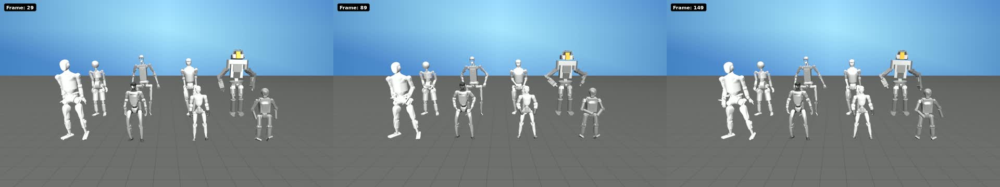
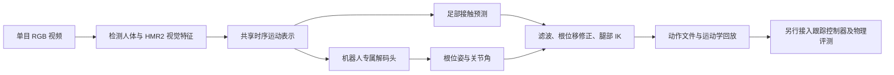

<!-- Generated by the offline translation workflow.
Source: 07-机器人操作、运动控制/Locomotion/03-BeyondRetarget单目视频动作复现/README.md
Source SHA-256: 334865978456c27ec1a604eca92609b71767236e4a275eda5ecc79e81b22e419
Model: tencent/Hy-MT2-1.8B-GGUF:Q4_K_M
Review machine-translated technical claims before relying on them.
-->
# BeyondRetarget: Generating Eight Humanoid Robot Moves from Monocular Video

> Verification date: 2026-10-18. Corresponding to the [ video demonstration of ](https://weixin.qq.com/sph/A9gBA1DBZ6), the project "BeyondRetarget" by teams from Nanjing University, etc. This article provides official online reasoning, local basic version reasoning, and result checking processes. For specific testing results, see [ verification record and ](results/validation.md).

[](./results/eight_robots.mp4)

Click on the image to view the six-second replay generated this time; [ downloads eight action files ](../../../../07-机器人操作、运动控制/Locomotion/03-BeyondRetarget单目视频动作复现/results/motions.zip). These are new inference results obtained by calling official services in this tutorial. The input is a cropped version of a single person's footage from the provided video account; it is not the robot footage from the original demonstration used as the result. The input resolution is low and is only used for process verification. Therefore, it cannot be used to report accuracy or execution success rates.

## 1. First, understand what needs to be reproduced

The input is a full-body visible RGB video, and the output is the robot root node position, root node rotation, and the angle of each joint over time. It is suitable for generating motion reference trajectories, which can then be fed to the motion tracking controller.

1. The traditional approach is usually "video → human motion reconstruction → action redirection". BeyondRetarget directly predicts robot motion from visual features during the inference stage; using human annotation training does not mean that the SMPL must be output before inference. The scope of its paper and the currently public basic version should be understood separately:[Paper](https://arxiv.org/html/2609.29850v1)、[Official project page](https://bear-ty.github.io/Beyondretarget_page/)、[Official code](https://github.com/bear-ty/BeyondRetarget)。



The key difference lies in the last two steps: correcting foot sole contact, floating, and support foot sliding can improve the trajectory; directly writing the joint angles into the simulation model for playback still cannot prove that the robot can follow this trajectory under gravity, contact, and actuator constraints. The execution success rate of the paper also used the SONIC tracker. This paper does not consider the export of NPZ or rendered video as physical execution success.

As of the verification date, GitHub has made the basic version inference code, resource downloader, and streaming entry publicly available. The original code and weights are under **CC BY-NC 4.0**; the robot and third-party components retain their respective licenses. The public repository on Hugging Face Space is merely a shell for calling private runtime packages—the two should not be confused. The tutorial points to the upstream source, and the upstream code, weights, or original videos are not re released under this repository's CC BY 4.0 license. See [ for upstream licenses ](https://github.com/bear-ty/BeyondRetarget/blob/main/LICENSE), [ for third-party statements ](https://github.com/bear-ty/BeyondRetarget/blob/main/THIRD_PARTY_NOTICES.md), [ for Space details ](https://huggingface.co/spaces/bear-ty/BeyondRetarget/blob/main/README.md).

## 2. Prepare the appropriate video

Take a video of the fixed camera position for 5–10 seconds: the person, full body, and feet should always be visible. Perform actions such as raising hands, stretching sideways, or squatting shallowly, avoiding blocking and large-scale movement. The current basic version does not support free camera movement and large-scale global trajectory, so these inputs cannot be used to determine the effects of the upcoming enhanced version.

The content in the video link explains how to splice images using the Ganda method. Do not treat the entire 78.75-second video as a single input. Recording the video yourself makes it easier to observe the corresponding actions. During the online demonstration, the uploaded video will be sent to the author's Hugging Face service; please use materials that can be publicly processed.

Install [FFmpeg](https://ffmpeg.org/download.html), and convert your original video into a six-second, 30 FPS, silent input. Execute it in PowerShell or Linux terminal:

```bash
ffmpeg -i input.mp4 -t 6 -vf fps=30 -an -c:v libx264 -crf 18 person_6s.mp4
ffprobe -v error -show_entries stream=width,height,r_frame_rate,nb_frames -show_entries format=duration -of json person_6s.mp4
```

This is a resampled video. The subsequent `--fps 30` should be consistent with it. Directly modifying the FPS metadata of a video at any frame rate will change the action time scale.

## 3. No local GPU: Official online inference

Open the [ official Space](https://huggingface.co/spaces/bear-ty/BeyondRetarget), upload a video that takes no more than 10 seconds, and click **Generate Robot Motion**. After completion, a video and an action ZIP file for eight robots should appear simultaneously. ZeroGPU uses a shared queue; if the limit is reached or the service fails, try manually again later, but do not submit continuously.

You can also use the client script in this chapter. Run it from the **chapter directory**. For a Windows activated environment, use `.venv-client\Scripts\Activate.ps1`, and for Linux, use `source .venv-client/bin/activate`:

```bash
python -m venv .venv-client
# 激活环境后：
python -m pip install -r requirements-client.txt
python scripts/run_online.py /absolute/path/person_6s.mp4 --output /absolute/path/runs/beyondretarget-online-001
python scripts/inspect_motion.py /absolute/path/runs/beyondretarget-online-001/motions.zip --output /absolute/path/runs/beyondretarget-online-001/motion_report.json
```

The output directory must not exist to avoid overwriting existing results. `run_online.py` first checks the duration, and then uses the **same Gradio session** to call `/zero_gpu_inference` and `/finish_cpu_stage` in sequence. In the first step, only the server status is saved; in the second step, the video and ZIP files are rendered and returned. If only the first step is called or the client is recreated, the state required for the subsequent steps will be lost. The script saves the input hash, runtime, success/failure status, and output hash; when it fails, `run.json` still retains the failure type.

The interface names may be updated by the upstream. When an error occurs, manually verify on the Space page first, and then check the interface using `Client("bear-ty/BeyondRetarget").view_api()`. The running package version of the online service does not have a public correspondence with the GitHub commit, so the online results cannot claim to come from the fixed local source code version below. [ Gradio client documentation ](https://www.gradio.app/main/docs/python-client/introduction) explains the session state and interface calling methods.

## 4. Linux + NVIDIA: Local Basic Version Inference

### 4.1 Fixed Source Code and Independent Environment

The upstream submission verified in this chapter is `e0331d0faf9091095bae9100e03655c944e2b64a`. The following steps are organized based on the version entry and installation script; whether it has been run in practice in this tutorial, please refer to the verification records.

The upstream environment is Linux x86_64, Python 3.10, PyTorch 2.3.0 / CUDA 12.1. Do not install these dependencies into an existing training environment; Windows native and AMD ROCm are not supported in this installation process. The Blackwell GPU also requires verification of the compatibility of the older PyTorch version; it is not sufficient to assume the environment is usable just because `nvidia-smi` is working properly.

```bash
mkdir -p "$HOME/src"
git clone https://github.com/bear-ty/BeyondRetarget.git "$HOME/src/BeyondRetarget"
cd "$HOME/src/BeyondRetarget"
git checkout e0331d0faf9091095bae9100e03655c944e2b64a
bash scripts/setup_rgb2robo.sh --env-name beyondretarget-tutorial
conda activate beyondretarget-tutorial
bash scripts/setup_rgb2robo.sh --env-name beyondretarget-tutorial --check-only
```

The installer will create the environment, download resources, and check the installation; it is not a training command. Running it again after interruption can restore the downloaded files. `--check-only` should not download or fix the environment; `--quick-check` will skip some weight loading checks and cannot replace a full check. Source: [ Fixed version installer ](https://github.com/bear-ty/BeyondRetarget/blob/e0331d0faf9091095bae9100e03655c944e2b64a/scripts/setup_rgb2robo.sh).

The total size of the compressed files for the four essential resources is approximately 3.35 GB. After decompression, additional space will be used. For large files stored outside the tutorial repository, the resource directories and grid references are retained:

| Resource | Relative Path Required by Upstream | Download File Size |
| --- | --- | ---: |
| Action Prediction Weights | `assets/checkpoints/rgb2robo_multirobot_clean.pth` | 415,291,282 B |
| HMR2 Weights | `assets/hmr2/epoch=10-step=25000.ckpt` | 2,709,494,041 B |
| YOLOv8x Weights | `assets/yolo/yolov8x.pt` | 136,890,692 B |
| Robot Resource Package | `assets/robot.zip`, decompressed to `assets/robot/` | 92,183,004 B |

The installer records the file size and SHA256; do not treat the HTML page returned by Google Drive as weights. Refer to [ resource description ](https://github.com/bear-ty/BeyondRetarget/blob/main/assets/README.md) and [ fixed version downloader ](https://github.com/bear-ty/BeyondRetarget/blob/e0331d0faf9091095bae9100e03655c944e2b64a/scripts/download_rgb2robo_assets.py).

### 4.2 Run G1 first, then expand the robot

Execute in the root directory of the upstream project:

```bash
python app/infer/infer_video.py \
  --video /absolute/path/person_6s.mp4 \
  --robots g1 \
  --fps 30 \
  --output_dir /absolute/path/runs/beyondretarget-g1-001
```

This entry generates the frame, HMR2 feature, original action, contact prediction, and post-processing action in sequence. The normal result structure is:

```text
beyondretarget-g1-001/
  inputs/person_6s/
    bbox.npy
    vit_features.pt
  predictions/
    raw/
    contact/
    postprocess/
```

The actual file is located in the robot and sequence subdirectory. Reuse the extracted visual features to avoid redundant HMR2 execution:

```bash
python scripts/validate_inputs.py /absolute/path/runs/beyondretarget-g1-001/inputs
python scripts/run_multirobot_pipeline.py \
  --input_root /absolute/path/runs/beyondretarget-g1-001/inputs \
  --checkpoint assets/checkpoints/rgb2robo_multirobot_clean.pth \
  --robots g1,r1,gr1t1,h1_with_hand,gr2v3_8_7_dummy_hand,t1_serial,atlas_v4,tienkung \
  --fps 30 --batch_windows 1 --phase all \
  --output_root /absolute/path/runs/beyondretarget-eight-001
```

Set the window batch to 1 here to facilitate a preliminary check of the process. This is not a guarantee of memory requirements, and it does not control the batch size during the HMR2 extraction phase. `--phase infer` only generates raw actions and contact predictions, while `--phase postprocess` is used for post-processing existing predictions. For the official CLI and output definitions, see [. The fixed version of the multi-robot entrance is ](https://github.com/bear-ty/BeyondRetarget/blob/e0331d0faf9091095bae9100e03655c944e2b64a/scripts/run_multirobot_pipeline.py).

| Robot | CLI Name |
| --- | --- |
| Unitree G1 / R1 | `g1` / `r1` |
| Fourier GR1-T1 / GR2-V3 | `gr1t1` / `gr2v3_8_7_dummy_hand` |
| Unitree H1 | `h1_with_hand` |
| Booster T1 | `t1_serial` |
| Tienkung / Atlas | `tienkung` / `atlas_v4` |

### 4.3 Check Data and Replay

Back to the chapter directory, perform an inspection on the **action directory** under `raw` or `postprocess`. Do not leave the `contact` directory, which contains only the contact probability, to the action checker:

```bash
python scripts/inspect_motion.py /absolute/path/runs/beyondretarget-g1-001/predictions/postprocess --output /absolute/path/runs/beyondretarget-g1-001/motion_report.json
```

The checker supports a single NPZ, a directory, or a ZIP file returned online, without the need to decompress the ZIP. It rejects empty results, unknown structures, invalid values, inconsistent frame counts, invalid FPS, and unnormalized quaternions. After the structure check is passed, a visual inspection is performed on the arm lifting direction, body orientation, foot height, sliding steps, and action transitions.

No GPU is required. You can first use the chapter result validator: `python scripts/inspect_motion.py results/motions.zip`. There are only eight `*_raw_pred.npz`s in this online package, with no contact tags or independent post-processing files; it is impossible to determine from the package content which post-processing was performed by the official service.

In the upstream original action structure, `root_trans` corresponds to `[T,3]`, `root_rot_quat` corresponds to `[T,4]` with a sequence of **wxyz**, and `dof` corresponds to `[T,D]`. `fps` contains a single value. Another body export uses `joint_pos`, `body_pos_w`, and `body_quat_w`. The model joint arrangement in G1 has a mapping with the XML arrangement, and `dof` cannot be directly written into the XML joint order without conversion. Source: [ exports implement ](https://github.com/bear-ty/BeyondRetarget/blob/main/lib/util/robot_export_utils.py), [ G1 configuration ](https://github.com/bear-ty/BeyondRetarget/blob/main/config/robot/g1.yaml).

For `g1_action_stream.npz` generated from the upstream streaming entry, it can be played back in the upstream root directory:

```bash
python stream_infer/live_mujoco_viewer.py /absolute/path/g1_action_stream.npz
```

This is the G1 kinematics viewer that requires desktop display. It updates `qpos` and calls `mj_forward`, but does not complete controller-driven dynamics tracking. Different robots should use their respective models, joint sequences, and corresponding viewing methods. [ streaming documentation ](https://github.com/bear-ty/BeyondRetarget/blob/main/stream_infer/README.md) also provides video, camera, MuJoCo viewing, and GR00T ZMQ publishing interfaces; the streaming detector needs to be prepared separately and is not included in the basic resource download.

## 5. How to Evaluate the Reproduction Experiment

It is recommended to store evidence in three layers, with each layer being reported independently:

| Level | Minimal evidence | Conclusions that can be drawn |
| --- | --- | --- |
| Video to action | Input hash, source code/service version, valid NPZ, output hash | The action was generated for this input |
| Kinematic visualization | Synchronized playback, action direction, sole and joint inspection | The trajectory can be replayed on the model |
| Physical execution | Controller version, initial state, error/termination criterion, complete contact simulation round | Can be tracked under the given protocol |

Reproduction of training requires the original training data, training configuration, and training process. The public basic version inference entry does not mean that the complete paper-based training reproduction process has been made available; `setup` or the inference operation should not be interpreted as re-training. The paper uses MotionPRO data to supervise motion and contact; the data acquisition should follow the registration and usage terms of ['s official data entry point ](https://shenqiu.njucite.cn/motionpro/); the tutorials do not include packaged data.

## 6. Troubleshooting

- **Try to compile PyTorch3D during installation**: First, ensure that Python 3.10 / PyTorch 2.3.0 / CUDA 12.1 matches the upstream Linux wheel; do not attempt to compile blindly in an incompatible environment.
- **CUDA unavailable or insufficient memory**: Check how other tasks are using resources; reduce input size or run a single robot. `--batch_windows 1` only affects the multi-robot prediction phase, and more memory may be needed during the HMR2 phase. Do not terminate others' tasks.
- **Missing detection, unstable left/right limbs or depth**: Use a fixed camera position for clear full-body input of a single person, keep the feet visible, and avoid multiple people merging or covering them; low-resolution cropping is only suitable for process testing.
- **Foot still sliding or touching the ground**: Confirm that you are viewing `postprocess` results, then check FPS, robot model, and joint order. Post-processing is not a complete dynamics solver.
- **Online generation failure**: Check the shared queue/limit; manually verify Space first. Do not continue the CPU phase of the previous session by changing clients.

## 7. Continue reading

- [ Paper and citation information ](https://arxiv.org/abs/2609.29850)
- [ Upstream source code and installation instructions ](https://github.com/bear-ty/BeyondRetarget)
- [ Post-processing instructions for contact](https://github.com/bear-ty/BeyondRetarget/blob/main/postprocess/README.md)
- [ Same chapter: Recreation of the Spring Festival Gala dance robot](../01-spring-festival-gala-dance-robot-recreated.md)
- [ Same chapter: Booster K1 web page MuJoCo and AMP](../02-BoosterK1-mjlab-AMP/README.md)
