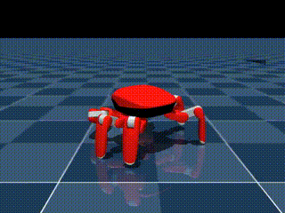
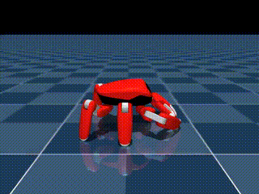
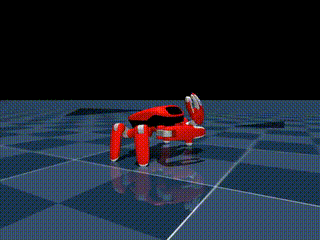

<!-- Generated by the offline translation workflow.
Source: 16-专题组队学习/07-Jumper螃蟹机器人专题/README.md
Source SHA-256: a696f893ac3737cd44603be6d9d9fd0f1811106cd137ffa29accf0841dab6e95
Model: tencent/Hy-MT2-1.8B-GGUF:Q4_K_M
Review machine-translated technical claims before relying on them.
-->
# Jumper Crab Robot: Movement Policy and Creation Special Topic

Starting from Jin Gang Technology's 22-degree-of-freedom crab robot Jumper (Jump Jump), let's learn about robot models, six-legged locomotion, reinforcement learning, simulation evaluation, and visual scene creation. For specialized topics, refer to [ MicroDuck topic ](../05-microduck-movement-policy-and-task-development-topic/README.md). Adopt a team-based learning approach and notebook format: first understand and run the public tools, then design your own movements and scenarios.

## First, look at Jump Jump's actions

The following three videos are all from the MuJoCo simulation on the Ubuntu workstation, using the policy trained based on upstream open-source tasks in this special topic. The animated GIFs are video segments; click on the animated GIFs or the links below to watch the full videos.

| Tripod Walking | Energy-Storage Jump | Crab Dance |
| --- | --- | --- |
|  [▶ Open walking video](../../../16-专题组队学习/07-Jumper螃蟹机器人专题/assets/tripod-fresh999.mp4) Policy trained from scratch with a GPU; at a command speed of 0.3 m/s, the average forward speed after 10 seconds is approximately 0.278 m/s. [Training and Evaluation](../../../16-专题组队学习/07-Jumper螃蟹机器人专题/03-Notebook/03_动作训练与评估.ipynb) |  [▶ Open jumping video](../../../16-专题组队学习/07-Jumper螃蟹机器人专题/assets/jump-trained.mp4) Simulation replay of the reference motion residual policy; the base height after single-env evaluation is approximately 0.158–0.160 m. [Training and Evaluation](../../../16-专题组队学习/07-Jumper螃蟹机器人专题/03-Notebook/06_跳跃_参考动作训练与评估.ipynb) |  [▶ Open dancing video](../../../16-专题组队学习/07-Jumper螃蟹机器人专题/assets/dance-final.mp4) Silent replay after 500 training iterations using a GPU, showing approximately 20 seconds of reference choreography. [Training and Evaluation](../../../16-专题组队学习/07-Jumper螃蟹机器人专题/03-Notebook/07_舞蹈_参考动作训练与评估.ipynb) |

The actions and measurements in the video are from simulation; the jumping evaluation and recording are different replays. For walking, jumping, and dancing in the upstream pre-trained action package, see [ action package Notebook ](../../../16-专题组队学习/07-Jumper螃蟹机器人专题/03-Notebook/05_官方动作包_跳跃与舞蹈.ipynb).

## Learning Path

| Stage | Content | Notebook | Output |
| --- | --- | --- | --- |
| 1 | Environment and Resources | [ Environment Check and Project Map ](../../../16-专题组队学习/07-Jumper螃蟹机器人专题/03-Notebook/01_环境检查与项目地图.ipynb) | Record Python, Git, GPU, and repository versions |
| 2 | Robot and Six-Legged Gait | [ Model and Gait ](../../../16-专题组队学习/07-Jumper螃蟹机器人专题/03-Notebook/02_模型与六足步态.ipynb) | Find the model and task entry point, and explain the three-legged gait |
| 3 | Training, Replay, and Evaluation | [ Action Training and Evaluation ](../../../16-专题组队学习/07-Jumper螃蟹机器人专题/03-Notebook/03_动作训练与评估.ipynb) | Save configurations, checkpoints, replay, and evaluation records |
| 4 | Appearance, Scene, and Work | [ Appearance, Scene, and Work ](../../../16-专题组队学习/07-Jumper螃蟹机器人专题/03-Notebook/04_外观场景与作品.ipynb) | Design `.skin`, `.map`, and record inspection results |
| 5 | Demonstration of Upstream Action P包 | [ Jumping and Crab Dance ](../../../16-专题组队学习/07-Jumper螃蟹机器人专题/03-Notebook/05_官方动作包_跳跃与舞蹈.ipynb) | Play and reproduction of pre-trained actions |
| 6 | Self-Training Jumping | [ Jumping Training and Evaluation ](../../../16-专题组队学习/07-Jumper螃蟹机器人专题/03-Notebook/06_跳跃_参考动作训练与评估.ipynb) | Train reference action residuals and record replays |
| 7 | Self-Training Dance | [ Dance Training and Evaluation ](../../../16-专题组队学习/07-Jumper螃蟹机器人专题/03-Notebook/07_舞蹈_参考动作训练与评估.ipynb) | Track open-source choreography and record segments |

The Notebook only performs local information checks and teaching examples by default; the installation, download, training, and deployment commands are presented as steps to be executed. The environment of the Ubuntu workstation, CPU simulation, and experimental process can be found in the [ workstation reproduction record ](01-learning-materials/record-of-ubuntu-workstation-reproduction.md). It is recommended to open the first Notebook first to confirm the environment, and then configure according to the corresponding upstream documentation.

## Ubuntu Real Run Results

The environment check, CPU short training, GPU continuous training, and GPU zero-based training have been completed. **The self-training three-legged policy has started in simulation**: After 1,000 iterations of zero-based training on the checkpoint, during a 10-second playback at 200 Hz physics, the average forward speed is 0.278 m/s for 0.3 m/s commands and 0.459 m/s for 0.5 m/s commands, and these values remain unchanged; [ to view the final policy video ](../../../16-专题组队学习/07-Jumper螃蟹机器人专题/assets/tripod-fresh999.mp4). The previously continuous training from the CPU checkpoint was nearly unchanged at 0.3 m/s commands. Logs, checkpoints, data, and reproduction steps are available in [, as well as ](01-learning-materials/record-of-ubuntu-workstation-reproduction.md) and [ training notebooks ](../../../16-专题组队学习/07-Jumper螃蟹机器人专题/03-Notebook/03_动作训练与评估.ipynb).

There are also [ walking ](../../../16-专题组队学习/07-Jumper螃蟹机器人专题/assets/official-walk-follow.mp4), [ jumping ](../../../16-专题组队学习/07-Jumper螃蟹机器人专题/assets/official-jump.mp4) and [ crab dance ](../../../16-专题组队学习/07-Jumper螃蟹机器人专题/assets/official-dance.mp4) demonstrations in the upstream pre-training action pack. For detailed records, see [ action pack Notebook ](../../../16-专题组队学习/07-Jumper螃蟹机器人专题/03-Notebook/05_官方动作包_跳跃与舞蹈.ipynb). The source of the upstream action pack and the self-trained three-legged checkpoint is different.

Using the upstream open-source trajectory and task configuration, [ jumping ](../../../16-专题组队学习/07-Jumper螃蟹机器人专题/03-Notebook/06_跳跃_参考动作训练与评估.ipynb) and [ dancing ](../../../16-专题组队学习/07-Jumper螃蟹机器人专题/03-Notebook/07_舞蹈_参考动作训练与评估.ipynb) was practiced on the workstation. The evaluation report for the single environment above the 300th checkpoint showed a height increase of 0.158–0.160 m; the dancing completed 500 training cycles, and the 20-second replay at the final checkpoint did not terminate prematurely. The videos of both are available for playback in the Notebook, and details of the training and evaluation are recorded in [ and ](01-learning-materials/jumping-and-dancing-sprint-records.md).

## Public Information

- [Jumper main repository and Chinese introduction ](https://github.com/KingKongRobotics/jumper/blob/main/README.zh.md): Models, training, playback, and action packs.
- [Project guide ](https://github.com/KingKongRobotics/jumper/blob/main/docs/PROJECT_GUIDE.md): Environment, tasks, and current integration boundaries.
- [Action training tutorial ](https://github.com/KingKongRobotics/jumper/blob/main/docs/TUTORIAL.md): Three-legged gait, jumping, dancing, packaging, and playback.
- [Jumper Design ](https://github.com/KingKongRobotics/jumper-design): Appearance, scenarios, and package format.
- [Jumper Alebrije ](https://github.com/madfam-org/jumper-alebrije): Community appearance and scenario examples.
- [Introduction to Jumping products ](https://kingkong.tech/jumper); [Six-legged robot hardware and firmware reference ](https://github.com/gitcfyang/hexapod_robot) (standalone project).

Data verification date: 2026-10-29. After upstream updates, the documents and code of the corresponding version in the repository shall prevail. The content owned by upstream maintainers is licensed under Apache-2.0; the licenses of third-party materials and generated files need to be checked separately. No code or resources are copied here. The availability of models and training tools does not mean that complete entity manufacturing data is provided.

## Teaming and Records

See [ recruitment copy ](recruitment-copy.md) and [ experiment record templates ](01-learning-materials/experiment-record-template.md). It is recommended to retain the version, configuration, data, videos, and failure cases for each sharing. Distinguish between public policy replays, short training link checks, formal evaluations, and real robot experiments.
